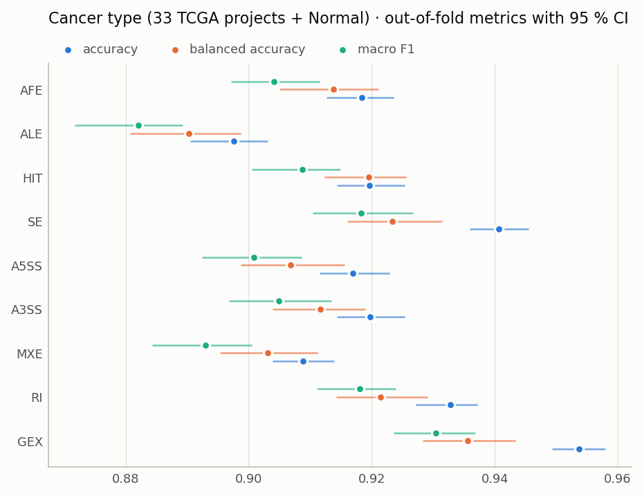

# Cancer type and tumour status from TCGA RNA processing

These are deep-learning classifiers that predict, from a single TCGA RNA-seq sample:

1. **Tumour status, per cancer.** Is the sample tumour or adjacent normal tissue? This is a
   separate binary model for each of 15 cancer types with ≥ 10 normal samples.
2. **Cancer type, pan-cancer.** Which of the 33 TCGA cancer types is the sample from, or is it
   normal tissue? This is a 34-class model.

Each task is modelled **independently in each of nine modalities**:

| View | Feature | Source |
|---|---|---|
| AFE | alternative first-exon usage | HITindex |
| ALE | alternative last-exon usage | HITindex |
| HIT | HIT index (first ↔ last exon behaviour, −1…1) | HITindex |
| SE | skipped-exon PSI | rMATS |
| A5SS | alternative 5′ splice-site PSI | rMATS |
| A3SS | alternative 3′ splice-site PSI | rMATS |
| MXE | mutually-exclusive-exon PSI | rMATS |
| RI | retained-intron PSI | rMATS |
| GEX | gene expression, log2(CPM + 1) | STAR counts |

Every model is a hyper-parameter-tuned multilayer perceptron, evaluated by nested,
patient-grouped cross-validation. It is explained with SHAP on held-out samples only.

## Results

<!-- RESULTS:START (generated by scripts/06_summarise_results.py) -->
**Cancer type (34 classes), out-of-fold:**

| View | Accuracy | Balanced accuracy | Macro F1 |
|---|---|---|---|
| AFE | 0.918 | 0.914 | 0.904 |
| ALE | 0.898 | 0.890 | 0.882 |
| HIT | 0.920 | 0.920 | 0.909 |
| SE | 0.941 | 0.923 | 0.918 |
| A5SS | 0.917 | 0.907 | 0.901 |
| A3SS | 0.920 | 0.912 | 0.905 |
| MXE | 0.909 | 0.903 | 0.893 |
| RI | 0.933 | 0.921 | 0.918 |
| GEX | 0.954 | 0.936 | 0.930 |

**Tumour vs normal, mean over the 15 cancers, out-of-fold:**

| View | AUROC | Balanced accuracy | MCC |
|---|---|---|---|
| AFE | 0.985 | 0.956 | 0.859 |
| ALE | 0.973 | 0.929 | 0.806 |
| HIT | 0.976 | 0.954 | 0.860 |
| SE | 0.973 | 0.946 | 0.866 |
| A5SS | 0.982 | 0.939 | 0.850 |
| A3SS | 0.979 | 0.938 | 0.835 |
| MXE | 0.982 | 0.938 | 0.831 |
| RI | 0.983 | 0.952 | 0.882 |
| GEX | 0.992 | 0.977 | 0.906 |

<!-- RESULTS:END -->




Full tables, CIs, figures and top SHAP features per cohort and modality are in
**[results/RESULTS.md](results/RESULTS.md)**.

**What the models learned.** The two tasks answer different questions, so they are written up
separately:

- **[results/TUMOUR_STATUS.md](results/TUMOUR_STATUS.md)** — what splicing adds to expression for
  telling a tumour from its own normal tissue; the tumour-wide shifts in RNA processing;
  splicing-factor regulons; the events different cancers share, what they do to the protein, and
  whether they carry outcome information, ending with ten events in detail (figures S1–S9).
- **[results/CANCER_TYPE.md](results/CANCER_TYPE.md)** — splicing as a lineage code: what the
  modalities each get right, class-defining exons, and how much of the advantage over expression
  is a tissue-source-site effect, ending with one event per lineage (figures T1–T8).

The methods are in [docs/BIOLOGY_METHODS.md](docs/BIOLOGY_METHODS.md) (D-13 to D-26).

## How the models are built

```
9,729 TCGA samples ─► 5 outer folds (grouped by patient, stratified by label)
                         │
                         ├─ outer-train ─► 3 inner folds ─► Optuna (30 / 20 trials)
                         │                   preprocessing fitted on inner-train only:
                         │                   missingness filter → rank (variance | ANOVA) → top K
                         │                   → median-impute → standardise → MLP
                         │                 best config refitted on outer-train
                         │
                         └─ outer-test ──► predictions (pooled → metrics + bootstrap CIs)
                                           SHAP DeepExplainer on every held-out sample
```

- **No leakage.** Every statistic, from feature filtering to epochs, is fitted on training rows
  only. A patient's tumour and normal always share a fold. Hyper-parameters never see the
  outer-test fold. See [docs/LEAKAGE_POLICY.md](docs/LEAKAGE_POLICY.md); a proof covers the one
  cohort-level pre-filter.
- **Same samples, every modality.** Splits depend only on the cohort, so modalities are
  compared on identical folds.
- **SHAP-interpretable by construction.** The MLP uses only layers that `shap.DeepExplainer`
  handles exactly (Linear, BatchNorm, ReLU, Dropout). Additivity is asserted for every
  explained sample.
- **Every choice is recorded** in [docs/DECISIONS.md](docs/DECISIONS.md) (D-01…D-12), with values in
  [config/study.yaml](config/study.yaml).

## Reading the outputs

For each job, `results/<task>/<view>/<cohort>/` contains:

| File | Content |
|---|---|
| `metrics.json` | pooled out-of-fold metrics, 95 % case-bootstrap CIs, per-fold mean ± SD, config, git commit |
| `folds.csv` | per outer fold: tuned hyper-parameters, number of features, inner loss, refit epochs, test metrics, SHAP additivity error |
| `shap_top_features.csv` | top 200 features by mean \|SHAP\|: `label` (gene + genomic region of the variable segment), `n_folds_selected` (0–5), `direction_spearman` |
| `shap_top_genes.csv` | importance summed per host gene |
| `shap_top_features_by_class.csv` | *cancer type only*: top 30 features for each of the 34 classes, with per-class direction |
| `per_class_metrics.csv`, `confusion_matrix.csv` | *cancer type only* |
| `fig_shap_beeswarm.png` | *tumour status*: each dot is one held-out sample, x = SHAP (tumour log-odds), colour = feature value |
| `fig_shap_class_heatmap.png`, `fig_confusion_matrix.png` | *cancer type* |
| `*.caption.md` | what each figure shows (figures carry no in-plot titles; [docs/FIGURE_GUIDELINES.md](docs/FIGURE_GUIDELINES.md)) |

**How to read `direction_spearman`:**
- Tumour status: > 0 means higher PSI, usage, HIT or expression pushes a sample towards
  *tumour*; < 0 means towards *normal*.
- Cancer type: per class, > 0 means a higher value raises the evidence for that class.

**Units:** SHAP values are in logit units. Task 1 uses log-odds of tumour. Task 2 uses the
centred logit zₖ − z̄ of the sample's true class (see [docs/METHODS.md](docs/METHODS.md)).

## Repository layout

```
config/       study.yaml (every rule and the search space), sources.yaml (raw data and reference paths),
              biology.yaml (interpretation thresholds)
src/ctsm/     library
  cohort.py splits.py annotation.py extract.py matrix_io.py   data
  preprocess.py model.py pipeline.py metrics.py explain.py    modelling
  biology.py                                                  interpretation helpers (GOseq, protein mapping, ...)
  figstyle.py plots.py                                        house figure style and phase-1 figures
scripts/      00_register_sources → 01_build_cohort → 02_extract_matrices → 03_validate_data
              → 04_run_job (one job) / 05_run_all (all jobs, parallel) → 06_summarise_results
              → 07_shap_importance → 08–19, 22 interpretation analyses (tables only)
              → 20_figures_status / 21_figures_type (every figure)
              run_pipeline.sh
tests/        unit tests (leakage guards, encodings, preprocessing, SHAP additivity, biology helpers)
docs/         METHODS, DECISIONS, LEAKAGE_POLICY, BIOLOGY_METHODS, FIGURE_GUIDELINES
results/      data/ (cohort, splits, extraction, validation summaries)
              tumor_status/<view>/<cancer>/, cancer_type/<view>/PANCAN/, summary/, RESULTS.md
              biology/01_complementarity … 11_event_cards/ (tables)
              figures/tumour_status/ (S1–S9), figures/cancer_type/ (T1–T8)
              TUMOUR_STATUS.md, CANCER_TYPE.md
```

## Reproducing

```bash
conda env create -f environment.yml
```

```bash
bash scripts/run_pipeline.sh
```

```bash
OMP_NUM_THREADS=1 python scripts/04_run_job.py tumor_status se BRCA
```

- The second command runs everything end to end. The third runs a single job.
- **Raw inputs:** paths are in `config/sources.yaml`. These are TCGA rMATS/HITindex tables
  and STAR counts produced from GDC BAM files, plus GENCODE annotation. They are not
  redistributed.
- **Local-only outputs:** processed matrices, model weights, SHAP arrays and per-sample
  predictions are written to the git-ignored `data.nosync/`.
- **Provenance of the published results:** the 144 jobs were run on 2026-10-10/11 with the
  code of commit `b249c3c`. Each `metrics.json` records `git_commit: null` because the runs
  finished before that first commit. Its `config` block records the exact settings.
- **Environment note:** set `OMP_NUM_THREADS` before Python starts. In this environment
  (torch 2.2.2 + conda-forge numpy, macOS), importing numpy before torch with multiple OpenMP
  threads segfaults; `scripts/_common.py` handles it.

## Related

The same TCGA processing and rules are used by
[cancer-survival-predictions](https://github.com/zachpwakefield/cancer-survival-predictions)
(survival modelling with alternative RNA processing).
