<!-- Generated by scripts/59_build_readme.py from docs/readme/README.template.md. Edit the template and rerun the script; edits made here are overwritten. -->
# Cancer type, tumour status and subtype from TCGA RNA processing

*Alternative splicing and expression as readouts of tissue, tumour state and subtype across 33 cancers,
and a splicing code of mismatch-repair deficiency written in the genome.*

## Summary

Every RNA-seq experiment measures alternative RNA processing: which first and last exons a gene uses,
which cassette exons it includes, and which splice sites and introns it keeps. Tumours are nonetheless
classified almost entirely from gene expression. We asked how much alternative processing says,
compared with expression, about three properties of a TCGA sample at increasing resolution:
- which of 33 cancers it comes from (Part 1);
- whether it is tumour or adjacent normal tissue (Part 2);
- which subtype of its cancer it belongs to (Part 3).

Each property was modelled separately from each of nine views of the same 9,729 samples: eight
splicing views and expression. Every model used nested, patient-grouped cross-validation and was
explained with SHAP on held-out samples only. After the main models, every analysis was written down
before it was computed, with its predicted direction and its correction family. One subtype result,
the splicing marks of microsatellite instability, grew into a study of its own (Part 4).

**Main findings.**
- **Splicing is a lineage code.** Its eight views together identify the cancer type almost as well as
  expression (accuracy 0.950 against 0.954), and fused with it reach 0.961. Where splicing errs, it
  confuses cell types across organs rather than anatomical neighbours.
- **Splicing is a second view of the tumour state.** Expression and splicing separate tumour from
  normal tissue almost perfectly, but they err on different samples. Fusing them removes a fifth of
  expression's errors (99 to 77).
- **Within a cancer**, splicing recovers lineage and genome-state subtypes about as well as
  expression. It loses where a small class is defined by one gene programme switched on.
- **The MSI splicing marks are written in the genome.** Mismatch-repair (MMR) deficiency shortens
  poly-T tracts just upstream of 3′ splice sites. Tract length, and for the longest tracts a distant
  predicted branch point, then sort exons into those skipped and those included more, a pattern not
  reported before. Read from RNA,
  this code finds MMR-deficient tumours in 30 cancers never used to build it (AUROC 0.83 unfitted,
  0.90 fitted). Within a cancer it ranks tumours about as well as exome MSI callers, and it adds to
  expression-based detection (0.93 combined).

## Contents

| Part | Question | Figures | Full write-up |
|---|---|---|---|
| [Study design](#study-design) | What was measured and modelled? | 1 | [docs/METHODS.md](docs/METHODS.md) |
| [1. Cancer type](#part-1-cancer-type) | Which of 33 cancers, or normal tissue? | 2–6 | [results/CANCER_TYPE.md](results/CANCER_TYPE.md) |
| [2. Tumour status](#part-2-tumour-status) | Tumour or adjacent normal tissue? | 7–12 | [results/TUMOUR_STATUS.md](results/TUMOUR_STATUS.md) |
| [3. Subtype](#part-3-subtype) | Which subtype of this cancer? | 13–21 | [results/SUBTYPE.md](results/SUBTYPE.md) |
| [4. The MSI study](#part-4-the-msi-study) | Does MMR deficiency move splicing by a rule written in the genome? | 22–34 | [manuscript/MSI_SPLICING_CODE.md](manuscript/MSI_SPLICING_CODE.md) |
| [5. Across the tasks](#part-5-connections-across-the-tasks) | How do the three tasks' models relate? | 35–38 | [results/ACROSS_TASKS.md](results/ACROSS_TASKS.md) |

The rest of this page has three more sections:
- [Methods in brief](#methods-in-brief);
- [Using the repository](#using-the-repository): outputs, layout and how to reproduce;
- [Figure index](#figure-index), which maps each figure here to its file. Each file's caption carries
  every statistic.

Supplementary figures follow each part.

---

## Study design

**Nine views of one sample.** The same RNA-seq data were quantified in nine ways
(Figure 1a). Three views describe transcript ends, measured with HITindex:
- alternative first exons (AFE);
- alternative last exons (ALE);
- the hybrid internal-terminal (HIT) index, for exons that can either start or end a transcript.

Five describe splice-site choice, measured with rMATS as percent spliced in (PSI):
- skipped (cassette) exons (SE);
- alternative 5′ and 3′ splice sites (A5SS, A3SS);
- mutually exclusive exons (MXE);
- retained introns (RI).

Gene expression (GEX, log2 CPM) is the reference.

**Three tasks.** Each task was modelled independently in every view, so the views can be compared on
identical samples and folds (Figure 1b):
- **Cancer type:** one 34-class model, the 33 TCGA projects plus pooled normal tissue.
- **Tumour status:** one tumour-versus-normal model for each of the 15 cancers with at least 10
  normal samples.
- **Subtype:** one model for each of 22 subtype cohorts drawn from 15 cancers.

**Models, explanations and pre-registration.** Every model is a hyper-parameter-tuned multilayer
perceptron, evaluated by nested cross-validation grouped by patient: a patient's tumour and normal
samples never fall on opposite sides of a split. Each model is explained with SHAP on held-out
samples only. The *AS ensemble* averages the eight splicing views' class probabilities. *Fusion*
averages that ensemble with expression, 1:1, with weights fixed before any result was seen. Every
analysis after the first models was committed with its predictions before it was run:
[config/followup.yaml](config/followup.yaml). Its decisions (D-numbers) and amendments (A-numbers)
are explained in the methods files.

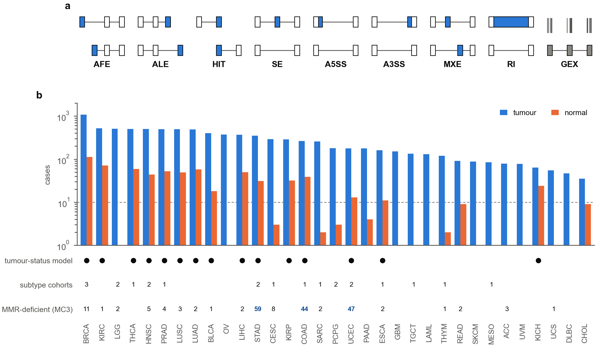

**Figure 1. Nine views of the same RNA-seq samples, and the analyses each cancer enters.** (a) The
nine views, each modelled separately. Each splicing view compares two isoforms: top, the form whose
use is measured, with the alternative segment in blue; bottom, the other form. AFE and ALE,
alternative first and last exons; HIT, the hybrid internal-terminal index of an exon that can start
or end a transcript; SE, a skipped (cassette) exon; A5SS and A3SS, alternative 5′ and 3′ splice
sites; MXE, mutually exclusive exons; RI, a retained intron; GEX, gene expression from read counts.
(b) Cases per TCGA project, tumour (blue) and normal (orange), on a log scale; dashed line = 10
cases. Below, by project: whether it has a tumour-status model (at least 10 normal cases); how many
subtype cohorts it contributes; and how many of its tumours carry at least 10 MC3 homopolymer
deletions (MMR-deficient). Bold blue marks the three cancers that trained the MSI models. Every
project enters the cancer-type model.

<sub>Figure file O1: [caption with every statistic](results/figures/overview/O1_study_design.caption.md) · [plotted values](results/figures/overview/O1_study_design.csv)</sub>

---

## Part 1. Cancer type

*Full write-up: [results/CANCER_TYPE.md](results/CANCER_TYPE.md) · methods:
[docs/BIOLOGY_METHODS.md](docs/BIOLOGY_METHODS.md) (D-13 to D-29).*

We began with the broadest question. Expression identifies TCGA cancer types with high accuracy,
because each tissue has its own transcriptional programme. If alternative processing also carries
lineage, its views should approach that accuracy. How they fail should then say what each modality
reads.

**Every view identifies the cancer type, and the splicing views together match expression.** No
single splicing view reached expression (accuracy 0.898–0.941 against 0.954; Figure 2). Their
ensemble, however, reached 0.950, with a higher macro recall than expression (0.940 against 0.936).
So the eight views make largely independent errors. Fusing the ensemble with expression gave 0.961: it
corrected 109 of expression's errors and introduced 38 (exact McNemar p = 3.9e-9). The gain is not
bought at the expense of particular classes. Fusion raised recall in 19 of the 34 classes and lowered
it in 6, and it repaired most of splicing's losses, such as the pooled normal class
(Supplementary Figures 1 and 2).

<!-- RESULTS-TYPE:START (generated by scripts/06_summarise_results.py) -->
**Out-of-fold, one 34-class model per view:**

| View | Accuracy | Balanced accuracy | Macro F1 |
|---|---|---|---|
| AFE | 0.918 | 0.914 | 0.904 |
| ALE | 0.898 | 0.890 | 0.882 |
| HIT | 0.920 | 0.920 | 0.909 |
| SE | 0.941 | 0.923 | 0.918 |
| A5SS | 0.917 | 0.907 | 0.901 |
| A3SS | 0.920 | 0.912 | 0.905 |
| MXE | 0.909 | 0.903 | 0.893 |
| RI | 0.933 | 0.921 | 0.918 |
| GEX | 0.954 | 0.936 | 0.930 |

<!-- RESULTS-TYPE:END -->

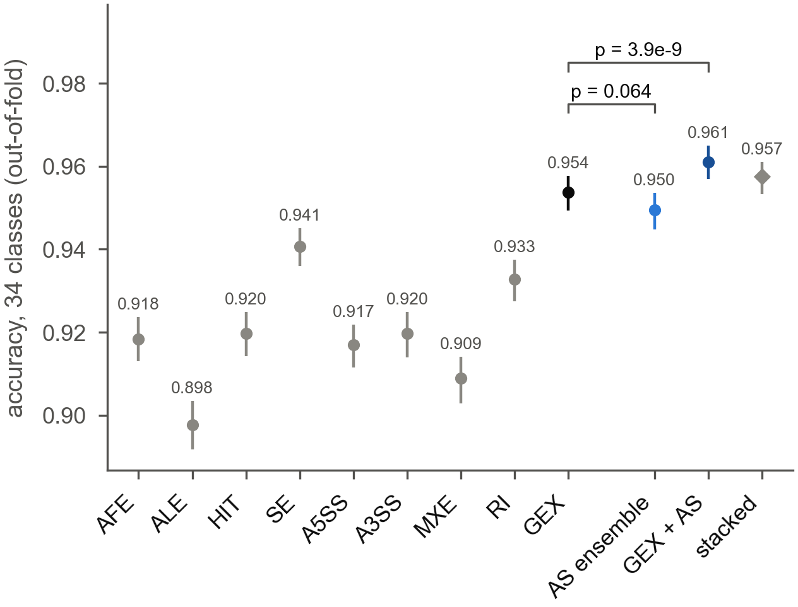

**Figure 2. No splicing view matches expression alone, but their ensemble does, and fusing the two
beats both.** Out-of-fold accuracy over all 9,729 samples and 34 classes (33 TCGA projects and a
pooled normal class). Grey: each single splicing view; black: expression (GEX); blue: the AS
ensemble (the mean of the eight splicing views' probabilities); dark blue: the equal-weight fusion
of GEX and the AS ensemble; diamond: a cross-fitted stacker on all nine views, shown as a ceiling.
Whiskers, 95% case-level bootstrap intervals (1,000 resamples); brackets, exact McNemar tests on
paired per-sample correctness, raw p.

<sub>Figure file T1: [caption with every statistic](results/figures/cancer_type/T1_modality_gain.caption.md) · [plotted values](results/figures/cancer_type/T1_modality_gain.csv)</sub>

**The two modalities fail differently, and the difference says what each reads.** We compared the
class pairs each modality confuses most (Figure 3). Expression confuses anatomical neighbours:
- colon with rectum (96 errors);
- oesophagus with stomach (40);
- lung adenocarcinoma with squamous carcinoma (37);
- glioma grades (20).

Splicing makes almost none of these errors; glioblastoma against lower-grade glioma, for instance,
gives zero. Instead it confuses cell types across organs. It mixes the squamous carcinomas of cervix,
head and neck, lung and bladder, and mixes several tumours with the normal tissue they arose in. That
is the behaviour expected of a readout of the cell of origin.

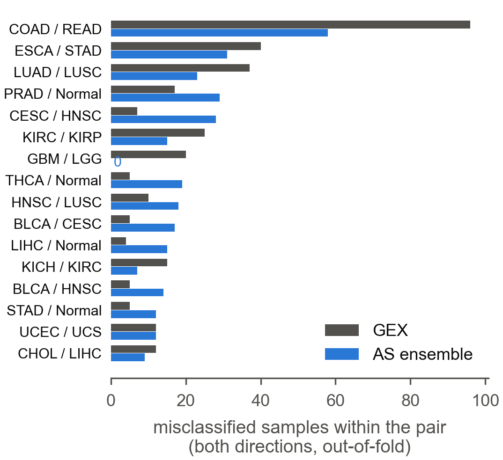

**Figure 3. Expression confuses anatomical neighbours; splicing confuses cell types across organs.**
The 16 class pairs with the most out-of-fold confusions, in either direction, for the expression
model (black) and the AS ensemble (blue). A zero is printed as a number, because it draws no bar.

<sub>Figure file T3: [caption with every statistic](results/figures/cancer_type/T3_class_confusions.caption.md) · [plotted values](results/figures/cancer_type/T3_class_confusions.csv)</sub>

Is the splicing signal simply expression in disguise? Two checks argue against it (Supplementary Figure 3):
- **Splice-site events.** The class-defining events of the five splice-site views correlate with
  their host gene's expression no more than random events do.
- **Gene overlap.** Each class's top splicing genes and top expression genes share about one gene.

An apparent wealth of pathways in the splicing explanations turned out to come from deeply covered
ribosomal-protein splice sites (Supplementary Figure 4). Once those are removed, what remains is lineage biology
and the splicing machinery's own transcripts.

**Single exons mark single lineages.** If splicing is a lineage code, individual exons should mark
individual classes. Taking the two cassette exons each class's explanation ranks highest, most are
used distinctively in that class alone (Figure 4):
- MLANA's exon is skipped in the melanocytic tumours;
- RAG2's in thymoma;
- SLC37A2's is included in the squamous carcinomas;
- TAGLN's and DENND2B's are used distinctively in acute myeloid leukaemia.

Taken one event at a time, a single splicing event can name a class (Figure 5). TOMM40L's terminal
exon serves as a last exon in every class except liver, where its use reverses. Graded cases such as
KRT19 and BSCL2 show where one event stops being enough, which is the argument for the ensembles.

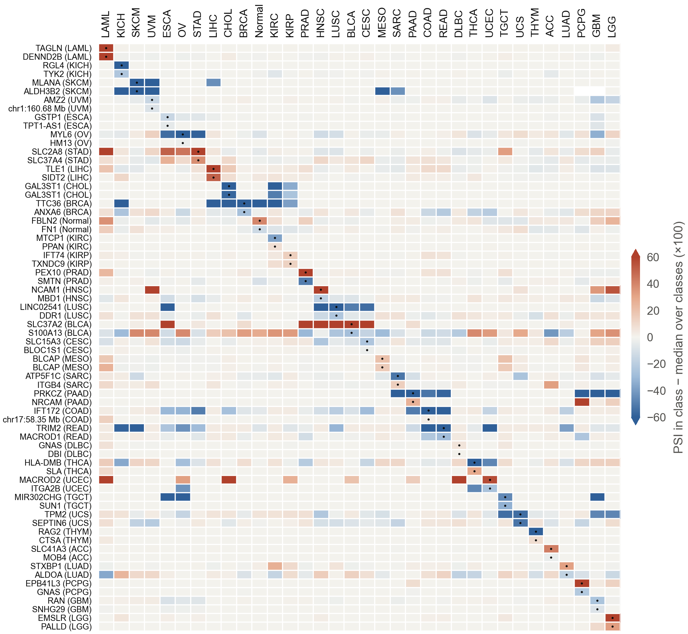

**Figure 4. Single cassette exons mark single lineages.** The two cassette exons with the largest
per-class SHAP importance for each of the 34 classes (rows; host gene, then the class that ranks the
exon), against every class (columns, clustered). Colour, the exon's median inclusion in a class
minus its median over all classes; dot, the class that ranks the exon.

<sub>Figure file T6: [caption with every statistic](results/figures/cancer_type/T6_lineage_atlas.caption.md) · [plotted values](results/figures/cancer_type/T6_lineage_atlas.csv)</sub>

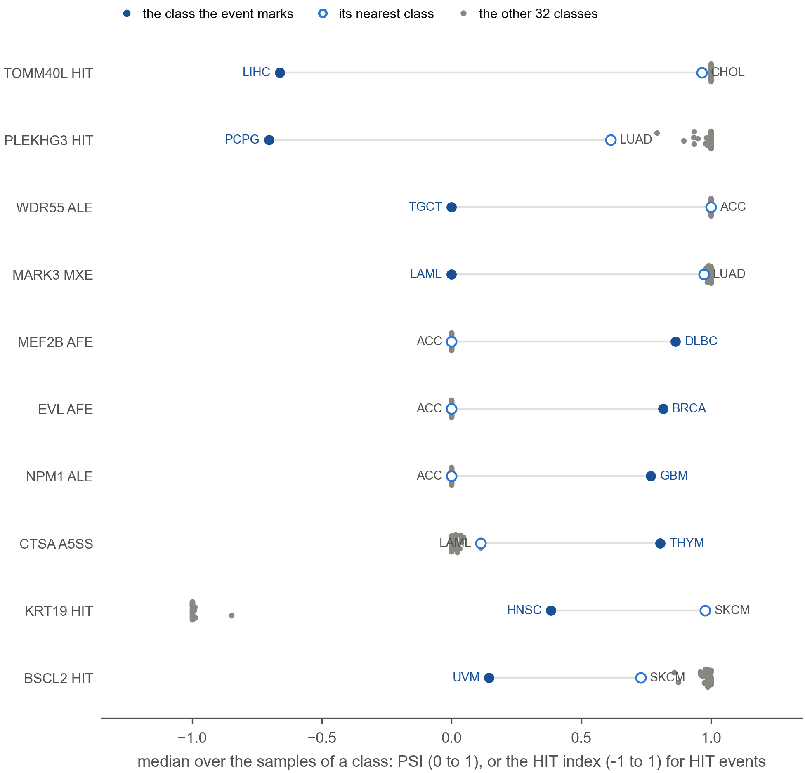

**Figure 5. A single splicing event can name a lineage on its own.** One event per class, chosen
without reference to accuracy. Of the five events with the largest mean \|SHAP\| in a class's own
explanation, across the eight splicing views, the one whose class median lies furthest from the
nearest other class. The ten clearest are drawn: filled dot, the class the event marks; open dot,
its nearest class; grey dots, the other 32 classes. No model enters these values.

<sub>Figure file T8: [caption with every statistic](results/figures/cancer_type/T8_class_events.caption.md) · [plotted values](results/figures/cancer_type/T8_class_events.csv)</sub>

**Bounding the claims.** Two features of TCGA could masquerade as lineage biology.
- **Tissue-source site.** Every tissue-source site contributes to exactly one TCGA project, so
  separating neighbouring projects can exploit how a site handled its samples. Splicing readouts
  such as intron retention plausibly depend on handling more than expression does. A fixed,
  untuned probe was cross-validated first by patient and then with whole sites held out
  (Figure 6):
  - glioma grade, kidney subtype and lung histology held (loss ≤ 0.015);
  - colon against rectum failed: no splicing view separated them at unseen sites, while expression
    kept 0.66;
  - oesophagus against stomach lost 0.08–0.14 in the splicing views, against 0.06 for expression.

  The splicing views' colon–rectum advantage is therefore a site effect, not biology.
- **Neighbouring genes.** Most TCGA libraries are unstranded and genes nest inside one another, so
  an event named after one gene can count another's reads. 61% of the models' top terminal (HIT)
  exons overlap another gene's exon, against 7% of all measured exons, and 101 of the 695 overlapping
  top events follow the neighbour's expression more than their own gene's (Supplementary Figure 5). The
  neighbours are mostly lineage genes (ceruloplasmin in liver, HNF1A in rectum, PAX6 in glioma).

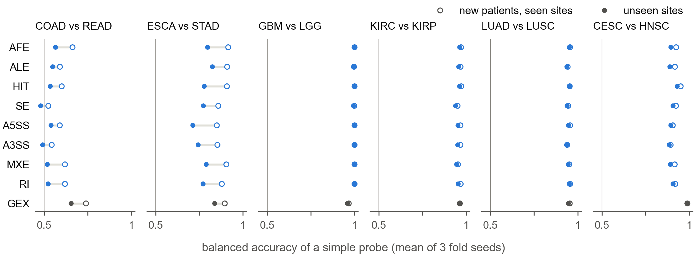

**Figure 6. Only the colon–rectum separation, and part of oesophagus–stomach, depends on the
tissue-source site.** In TCGA every tissue-source site contributes to exactly one project. One plot
per pair of related classes: a fixed, untuned classifier cross-validated grouped by patient (open)
and with whole tissue-source sites held out (filled). GEX, grey; splicing views, blue. A drop from
open to filled measures how much of a separation depends on the site.

<sub>Figure file T7: [caption with every statistic](results/figures/cancer_type/T7_site_probe.caption.md) · [plotted values](results/figures/cancer_type/T7_site_probe.csv)</sub>

Cancer type is a question between tissues, and a lineage readout answers it well. The harder test
is within a tissue. A tumour and the normal tissue it arose from share their lineage, so lineage
alone cannot separate them. That comparison also removes the site confound, because a patient's
tumour and normal samples come from the same site.

### Supplementary figures for Part 1

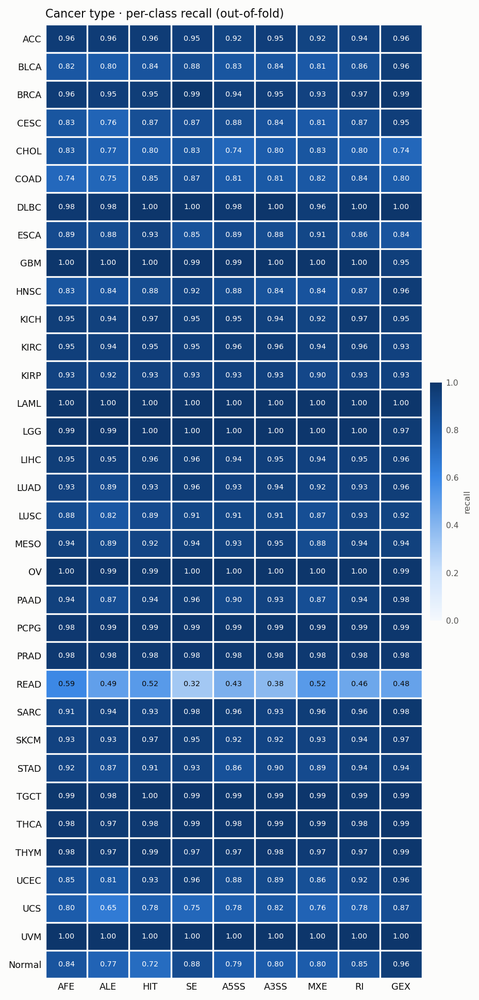

**Supplementary Figure 1. Each view's recall of each class.** Out-of-fold recall per class (rows)
and view (columns) of the 34-class model.

<sub>Figure file fig_cancer_type_recall: [caption with every statistic](results/summary/fig_cancer_type_recall.caption.md) · [plotted values](results/summary/fig_cancer_type_recall.csv)</sub>

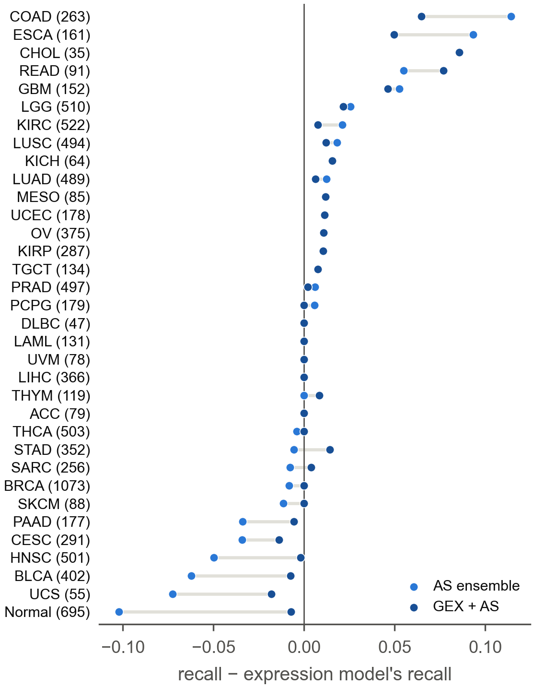

**Supplementary Figure 2. Fusion keeps splicing's gains on the classes expression confuses and
repairs most of its losses.** Out-of-fold recall of each of the 34 classes (cases in brackets), as a
difference from the expression model: the AS ensemble (light blue) and its equal-weight fusion with
expression (dark blue). Positive values mean the model recovers more of the class than expression
does.

<sub>Figure file T2: [caption with every statistic](results/figures/cancer_type/T2_recall_by_class.caption.md) · [plotted values](results/figures/cancer_type/T2_recall_by_class.csv)</sub>

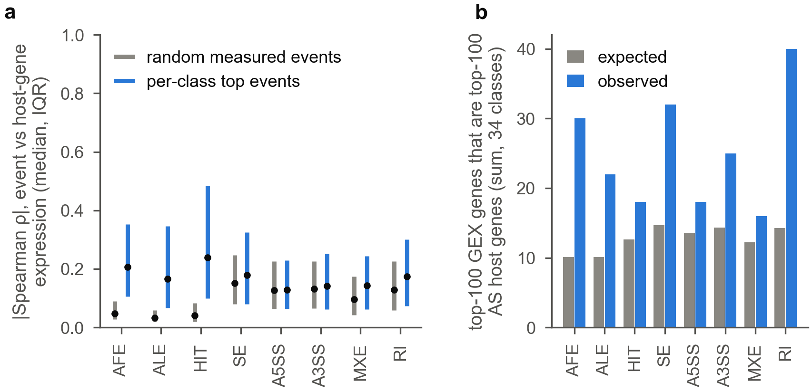

**Supplementary Figure 3. The splicing signal for cancer type is not a proxy for expression.** (a)
For each splicing view, the per-class top 20 events (union over the 34 classes) and 1,000 random
measured events: Spearman correlation of each event with its host gene's log2 CPM over 3,000 random
samples. (b) For each class, the overlap between the top 100 GEX genes and the host genes of each
splicing view's top 100 events, within genes measured by both, summed over the 34 classes, against
chance.

<sub>Figure file T5: [caption with every statistic](results/figures/cancer_type/T5_not_expression.caption.md) · [plotted values](results/figures/cancer_type/T5_not_expression.csv)</sub>

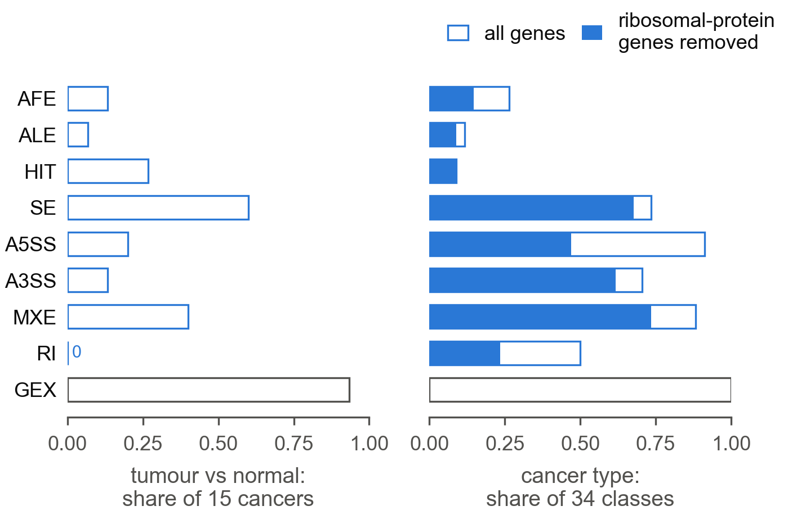

**Supplementary Figure 4. The splicing models' genes form fewer pathways than expression's, and part
of what they form is ribosomal-protein splicing.** The share of models whose top 200 SHAP genes are
enriched (q < 0.05, Benjamini–Hochberg within collection per model; GOseq/Wallenius) for at least
one Hallmark, Reactome or GO biological-process term, by view. Open bars, all genes; a share of zero
is printed as a number. (a) The 15 tumour-versus-normal models. (b) The 34 per-class explanations of
the cancer-type models; filled bars repeat the test with ribosomal-protein genes (RPL*, RPS*)
removed from both ranking and universe.

<sub>Figure file T4: [caption with every statistic](results/figures/cancer_type/T4_pathway_coherence.caption.md) · [plotted values](results/figures/cancer_type/T4_pathway_coherence.csv)</sub>

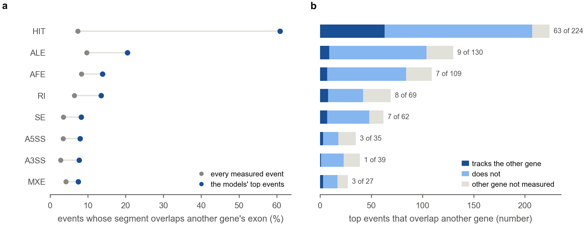

**Supplementary Figure 5. Many of the cancer-type models' terminal exons read a neighbouring lineage
gene.** The neighbouring-gene audit of the cancer-type models. (a) The share of events whose
variable segment overlaps another gene's exon, for every measured event (grey) and the
class-defining top events (dark), by view. (b) Of those overlapping top events, how many follow the
other gene's expression more than their own gene's (|ρ| ≥ 0.5 and above the host's; rule fixed in
advance).

<sub>Figure file T9: [caption with every statistic](results/figures/cancer_type/T9_overlap_audit.caption.md) · [plotted values](results/figures/cancer_type/T9_overlap_audit.csv)</sub>

---

## Part 2. Tumour status

*Full write-up: [results/TUMOUR_STATUS.md](results/TUMOUR_STATUS.md) · methods:
[docs/BIOLOGY_METHODS.md](docs/BIOLOGY_METHODS.md) (D-13 to D-29).*

Within each of the 15 cancers with at least 10 normal samples (6,815 samples), we trained one
tumour-versus-normal model per view: 135 models.

**Every view separates tumour from normal tissue, and splicing errs on different samples.** All nine
views reached a mean AUROC of 0.973–0.992 (Supplementary Figure 6). The weak cohort was
oesophageal cancer, which has 11 normal samples: every splicing view dropped there (SE to 0.711)
while expression held at 0.976. Near-perfect AUROCs hide what matters, so we counted errors instead
(Figure 7). Expression made 99 errors and the AS ensemble 91, but they were largely not the same
samples. Fusion made 77: it corrected 27 of expression's errors and introduced 5 (exact McNemar
p = 1.1e-4). A stacker allowed to learn the weights did no better (76). Splicing is therefore a
second, partly independent view of the tumour state. That raised the question of what it sees,
which we approached from two directions: transcriptome-wide shifts, with no model involved, and the
events the models chose.

<!-- RESULTS-STATUS:START (generated by scripts/06_summarise_results.py) -->
**Out-of-fold, mean over the 15 per-cancer models:**

| View | AUROC | Balanced accuracy | MCC |
|---|---|---|---|
| AFE | 0.985 | 0.956 | 0.859 |
| ALE | 0.973 | 0.929 | 0.806 |
| HIT | 0.976 | 0.954 | 0.860 |
| SE | 0.973 | 0.946 | 0.866 |
| A5SS | 0.982 | 0.939 | 0.850 |
| A3SS | 0.979 | 0.938 | 0.835 |
| MXE | 0.982 | 0.938 | 0.831 |
| RI | 0.983 | 0.952 | 0.882 |
| GEX | 0.992 | 0.977 | 0.906 |

<!-- RESULTS-STATUS:END -->

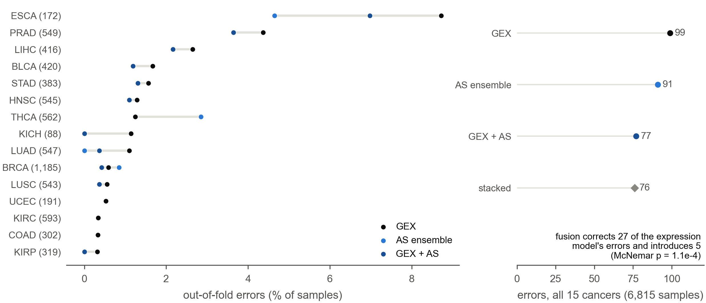

**Figure 7. Expression and splicing err on different samples, so their fusion beats expression
alone.** (a) Out-of-fold errors as a share of each cancer's samples (n in brackets) for expression
(black), the AS ensemble (light blue) and their equal-weight fusion (dark blue); stars, exact
McNemar test of fusion against expression. (b) Errors pooled over all 6,815 samples; 'stacked' is a
cross-fitted logistic regression that learns the weights, shown as a ceiling.

<sub>Figure file S1: [caption with every statistic](results/figures/tumour_status/S1_modality_gain.caption.md) · [plotted values](results/figures/tumour_status/S1_modality_gain.csv)</sub>

**Tumours retain more intronic sequence and move their last exons upstream.** To find shifts no
model selection could have shaped, we compared each patient's tumour with their own normal tissue
over every measured event (Figure 8). Three shifts appeared:
- **Retained introns.** Tumours retained more intronic sequence in 7 cancers (breast cancer went the
  other way).
- **Splice sites.** They used the longer splice-site forms more often (A5SS higher in 10 cancers,
  lower in none).
- **Last exons.** They used upstream last exons in 7 cancers and downstream ones in none.

One caveat applies to the first: RNA degradation also raises intronic reads, and TCGA records no RNA
integrity number for these samples.

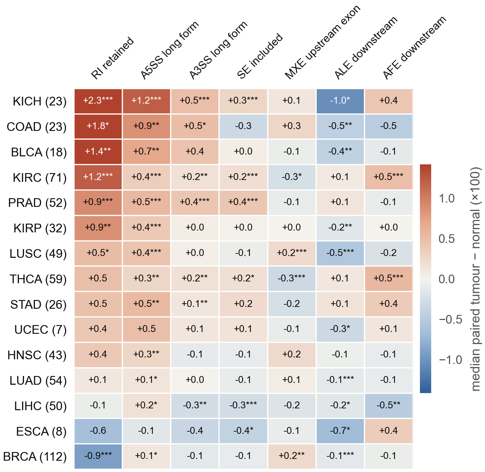

**Figure 8. Tumours retain more intronic sequence and move their last exons upstream, relative to
their own normal tissue.** Every measured event, with no SHAP ranking anywhere in the calculation.
Each cell is the median, over matched patients, of the patient's own tumour − normal change in the
event class (columns), by cancer (rows; pairs in brackets). Blue, higher in the tumour; orange,
higher in the normal tissue; stars, raw Wilcoxon p across patients.

<sub>Figure file S2: [caption with every statistic](results/figures/tumour_status/S2_global_shifts.caption.md) · [plotted values](results/figures/tumour_status/S2_global_shifts.csv)</sub>

**The models' events sit in small splicing-factor programmes, not in pathways.** The splicing models'
top genes rarely formed pathways: an enriched Hallmark set appeared in at most 9 of the 15 cancers
(SE) and in none for retained introns, against 14 of 15 for expression (Supplementary Figure 7). We therefore
asked whether the events are organised by their regulators instead (Figure 9). A factor's *core
regulon* was defined as the events whose PSI tracks its expression within tumours, in at least 5
cancers, after removing stromal and immune scores and the sample's mean PSI. The models' events were
depleted from the large shared programme of nuclear RNA-processing factors. They concentrated in the
small, distinct regulons of tissue and differentiation regulators: PTBP1, RBM47, HNRNPU, HNRNPF and
QKI. The splicing signal is organised by regulator rather than by pathway, which is the mechanical
reason it complements expression.

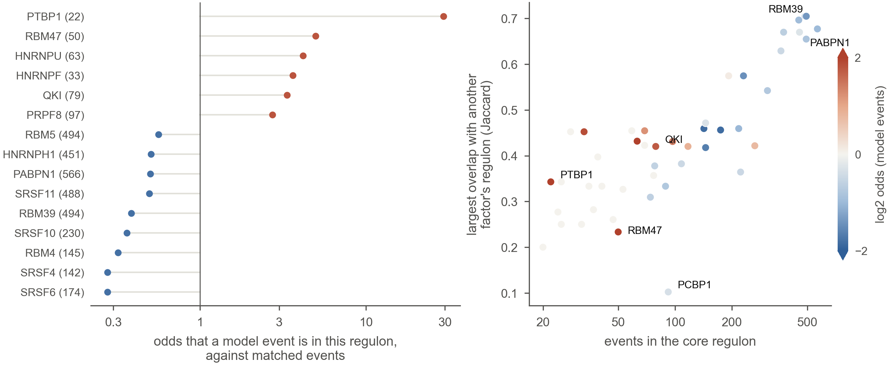

**Figure 9. The models' events sit in small, specific splicing-factor programmes, not in the large
shared one.** A factor's core regulon: the events whose PSI tracks its expression within tumours
(partial Spearman \|ρ\| ≥ 0.3, p < 0.05, after rank-residualising both on stromal and immune scores
and the sample's mean PSI in that view), with the same sign in at least 5 of the 15 cancers. (a) For
each factor with at least 15 marked events, the odds that a model's top event lies in its core
regulon, against a background matched on coverage and spread; only factors with q < 0.05
(Benjamini–Hochberg over 32 factors) are shown, regulon size in brackets. (b) Each factor with at
least 20 core events: regulon size against its largest overlap (Jaccard) with another factor's
regulon, coloured by the odds in (a).

<sub>Figure file S4: [caption with every statistic](results/figures/tumour_status/S4_regulons.caption.md) · [plotted values](results/figures/tumour_status/S4_regulons.csv)</sub>

**Different cancers rely on the same events, which move the same way.** The 15 tumour-versus-normal
models were trained independently. Even so, 404 events ranked in the top 100 of at least 4 of them,
where about 3 would be expected by chance (Figure 10). These recurrent events moved in the same
direction in a median of 73% of cancers, including cancers whose models did not rank them. The most
consistent of them shift the typical tumour, not a few outliers, and the models read them as
markers (Supplementary Figure 9). Several genes contributed switch pairs moving in opposite directions: two
EXOSC7 last exons, two NDE1 first exons and two TPM1 mutually exclusive exons.

Drawn on their proteins, none of the ten most shared events is a cassette exon (Figure 11). Six are
mutually exclusive pairs and four are terminal exons. Among them are:
- the macroH2A1.1/1.2 switch;
- the SH2-domain switch of chimaerin (CHN1);
- a length-neutral 23-amino-acid exchange in the C-terminal domain of collagen V.

The macroH2A1 exon behaves as the literature predicts. It falls as QKI rises within tumours (12 of 15
cancers) and rises with proliferation (13 of 15). Across all their cassette exons, the models
favoured exons that keep the reading frame and avoid folded domains (Supplementary Figure 8).

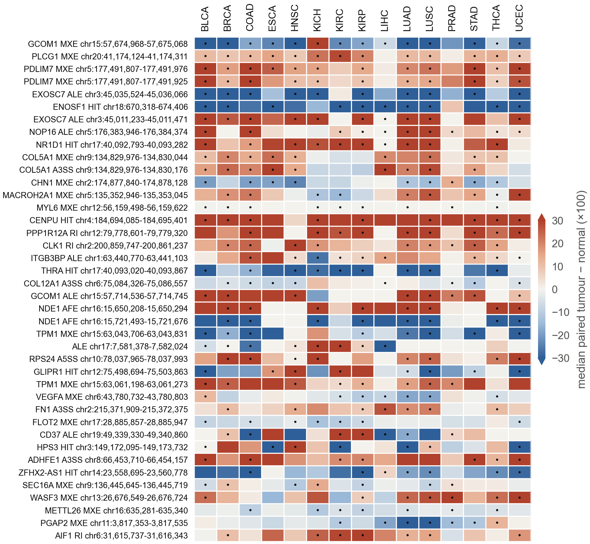

**Figure 10. Different cancers rely on the same events, and those events move the same way across
cancers.** The 40 events in the top 100 of the most per-cancer models (rows). Colour, the median
paired tumour − normal change in every cancer (columns), including cancers where the event did not
rank, so the pattern along a row is not selected on (blue, higher in the tumour; orange, higher in
the normal tissue). Dots, the cancers whose top 100 contains the event.

<sub>Figure file S5: [caption with every statistic](results/figures/tumour_status/S5_recurrent_events.caption.md) · [plotted values](results/figures/tumour_status/S5_recurrent_events.csv)</sub>

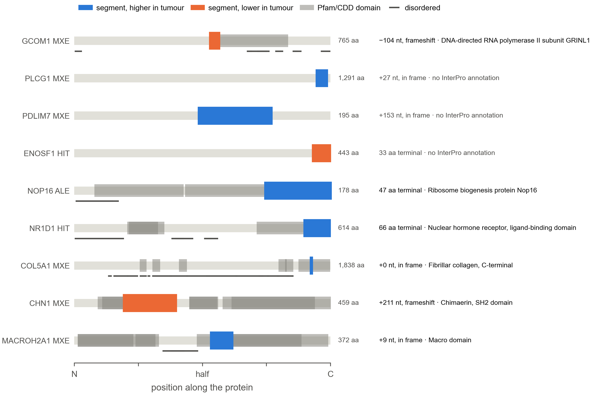

**Figure 11. The most shared events exchange protein segments through mutually exclusive and
terminal exons.** Nine of the ten most shared events, each on its own protein scaled from N to C
terminus. Grey blocks, Pfam/CDD domains; line beneath, disordered regions; coloured block, the
segment the event adds or removes (blue, higher in tumours; orange, lower). The tenth event belongs
to no coding transcript. Three transcripts carry no InterPro features at all, which is not evidence
that they have no domain.

<sub>Figure file S9: [caption with every statistic](results/figures/tumour_status/S9_event_protein.caption.md) · [plotted values](results/figures/tumour_status/S9_event_protein.csv)</sub>

**Model events are modestly enriched for survival associations.** Tumour-versus-normal separation
and outcome are different axes, but events chosen for the first might carry some of the second. Every
model event was tested against a background event matched on view, coverage and spread
(Figure 12). Model events reached nominal Cox p < 0.05 more often than background events (11.1%
against 9.0%), and the rate rose with how many models agreed on an event (odds ratio 1.27, 1.56,
1.62). Outcomes shuffled between patients gave 5.6%, so the background rate is itself above noise.
The effect is modest, however:
- it roughly halves once age, sex and stage enter;
- the events that clear FDR within a single cancer are 94% renal;
- directions differ between cancers.

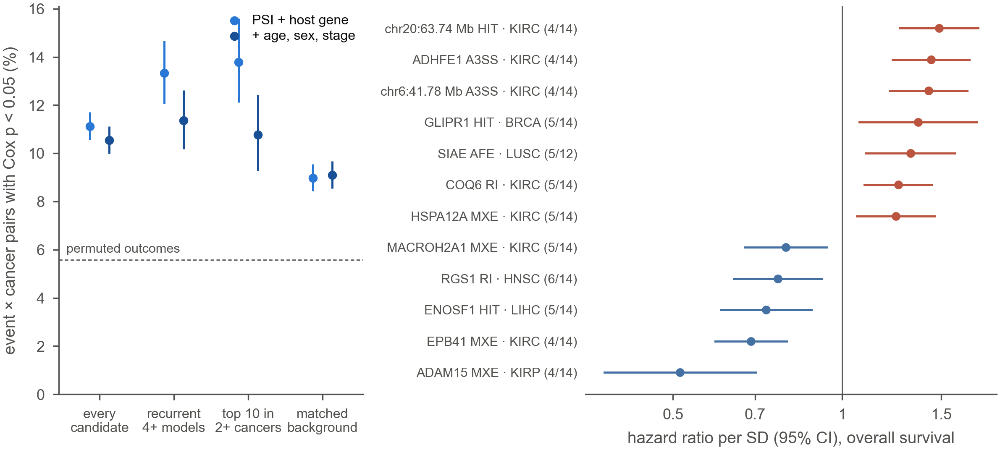

**Figure 12. The models' events are modestly enriched for survival associations, more so the more
models agree.** Every model event and a background event matched on view, coverage and spread,
tested with splice-assay 0.4.0 in each of 15 cancers (6,152 tumours, 1,620 deaths); nothing about
outcome entered either selection. (a) The share of event × cancer pairs reaching nominal Cox p <
0.05 in two pre-specified arms (PSI with the host gene's expression; with age, sex and stage added),
with 95% Clopper–Pearson intervals; candidate sets are nested by how many models agree. Dashed line,
the same pipeline on outcomes shuffled between patients within each cancer. (b) The 12 events
associated in the most cancers, each in its strongest cancer: hazard ratio per SD with 95% CI, and
cancers with p < 0.05 / cancers tested. Red, a higher value goes with worse survival.

<sub>Figure file S8: [caption with every statistic](results/figures/tumour_status/S8_survival.caption.md) · [plotted values](results/figures/tumour_status/S8_survival.csv)</sub>

**The neighbouring-gene check.** The audit of Part 1 applies here too (Supplementary Figure 10). Top HIT exons
overlap another gene's exon far more often than measured exons do (44% against 7%; odds 6.6 with exon
length held fixed). 163 of the 1,105 overlapping top events track the other gene: the falling EXOSC7
exon follows the stromal gene CLEC3B, and an NDE1 first exon follows smooth-muscle MYH11. The models
are unchanged by this, and so is the survival enrichment without these events (odds 1.25 against
1.27). What changes is how the events are named.

Splicing therefore reads both lineage and a tumour state partly independent of expression. Clinical
decisions, however, turn on finer distinctions within a cancer: histology, genomic class, receptor
status. Part 3 asks whether alternative processing resolves those.

### Supplementary figures for Part 2

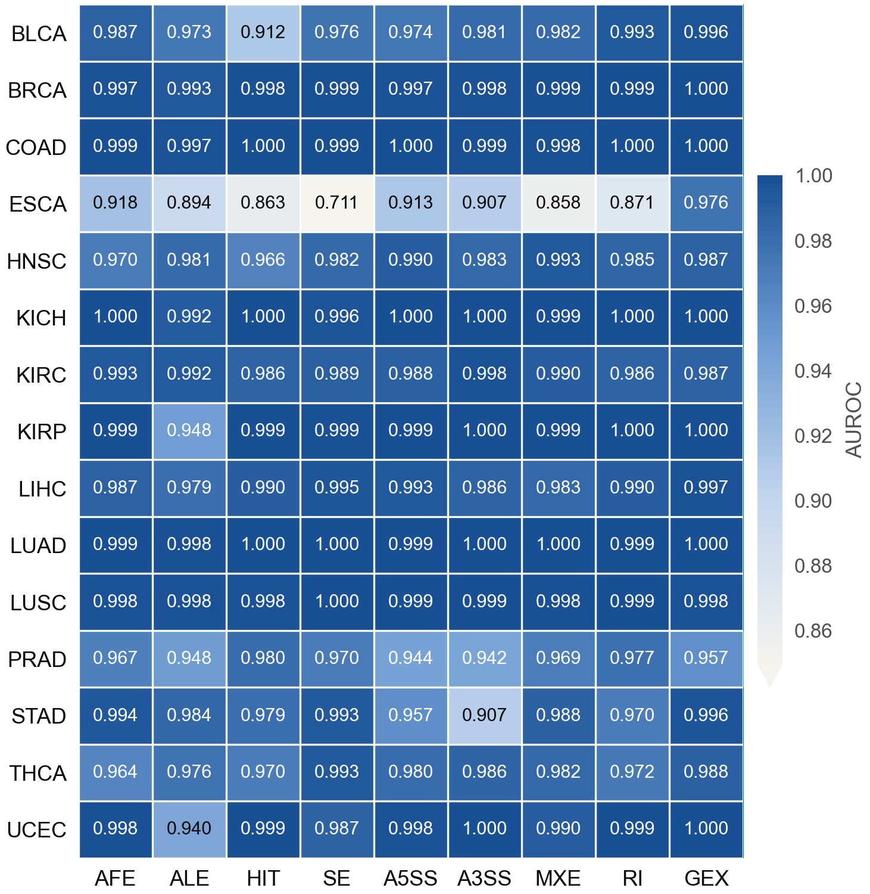

**Supplementary Figure 6. Every view separates tumour from normal tissue almost perfectly in most
cancers.** Pooled out-of-fold AUROC of each per-cancer tumour-versus-normal model: rows, the 15
cancers with at least 10 normal cases; columns, the nine views. Each sample is scored by the
outer-fold model that never saw its patient.

<sub>Figure file fig_tumor_status_auroc: [caption with every statistic](results/summary/fig_tumor_status_auroc.caption.md) · [plotted values](results/summary/fig_tumor_status_auroc.csv)</sub>


**Supplementary Figure 7. Expression models draw on stromal programmes; the splicing models' genes
rarely form pathways.** For every cancer (columns) and view, the 200 genes with the largest SHAP
importance, tested for enrichment of MSigDB Hallmark sets against all genes measurable in that view
and cohort (GOseq/Wallenius, correcting for the number of events per gene). Dot, a set significant
in at least one splicing view, sized by the number of splicing views (of 8); ring, significant in
the GEX model; significance, q < 0.05 within the Hallmark collection of each model.

<sub>Figure file S3: [caption with every statistic](results/figures/tumour_status/S3_pathways.caption.md) · [plotted values](results/figures/tumour_status/S3_pathways.csv)</sub>

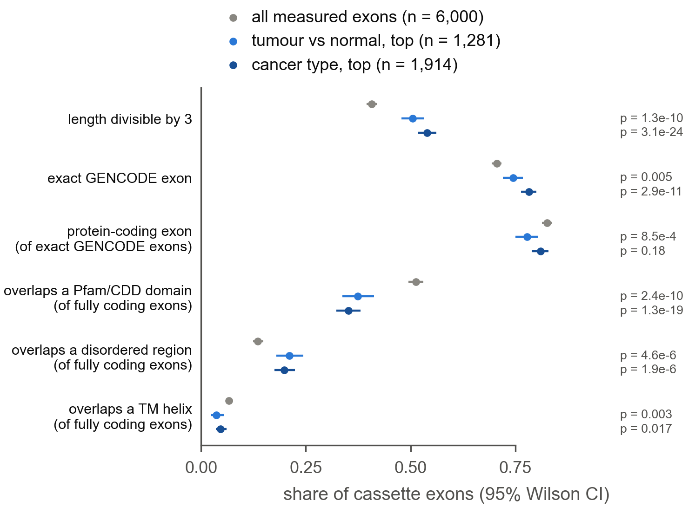

**Supplementary Figure 8. The models' cassette exons keep the reading frame and avoid folded
domains.** Cassette exons in the top 100 of any tumour-versus-normal model (blue) or any class of
the cancer-type model (dark blue), against 6,000 random measured exons (grey): the share whose
length is divisible by 3, and, for exact GENCODE exons on their best transcript, the share
overlapping a Pfam/CDD domain, a disordered region or a transmembrane helix. p, two-sided Fisher
exact test against all measured exons.

<sub>Figure file S6: [caption with every statistic](results/figures/tumour_status/S6_exon_consequences.caption.md) · [plotted values](results/figures/tumour_status/S6_exon_consequences.csv)</sub>


**Supplementary Figure 9. The most shared events shift the typical tumour, and the models read them
as markers.** The six most recurrent events whose paired change has the same sign in at least 80% of
the cancers where they are measured, one per gene. (a) Median value in matched normal (orange) and
tumour (blue) samples of each cancer; cancers whose top 100 contains the event in black, others in
grey. (b) SHAP dependence in the cancer where the event ranks highest: each held-out sample's event
value against its SHAP value on the tumour log-odds.

<sub>Figure file S7: [caption with every statistic](results/figures/tumour_status/S7_event_portraits.caption.md) · [plotted values](results/figures/tumour_status/S7_event_portraits.csv)</sub>

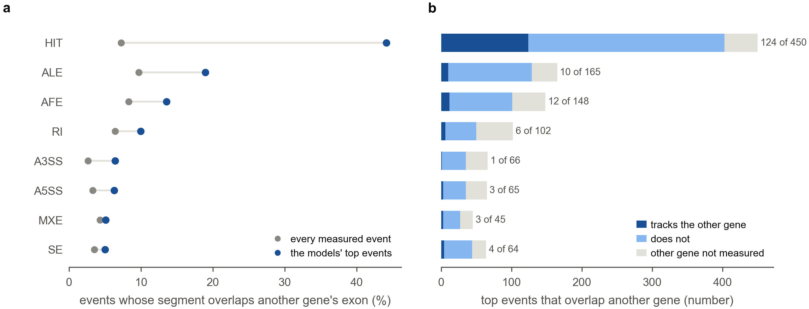

**Supplementary Figure 10. Some of the models' events, terminal exons above all, read a neighbouring
gene's expression.** Most TCGA libraries are unstranded and GENCODE nests genes inside one another,
so an event named after one gene can count another's reads. (a) The share of events whose variable
segment overlaps another gene's exon, for every measured event (grey) and the models' top events
(dark), by view. (b) Of the overlapping top events, how many follow the other gene's expression more
than their own (rule fixed in advance).

<sub>Figure file S10: [caption with every statistic](results/figures/tumour_status/S10_overlap_audit.caption.md) · [plotted values](results/figures/tumour_status/S10_overlap_audit.csv)</sub>

---

## Part 3. Subtype

*Full write-up: [results/SUBTYPE.md](results/SUBTYPE.md) · methods:
[docs/SUBTYPE_METHODS.md](docs/SUBTYPE_METHODS.md) (D-30 to D-47, D-57 to D-60).*

Subtypes are where a classifier meets clinical use. We assembled 22 subtype cohorts from 15 cancers
(7,552 patient–cohort pairs, 198 models), grouped by how each label was made:
- 12 histological;
- 7 genomic or immunohistochemical;
- 3 defined by expression clusters, on which the expression model is near-circular but which are a
  fair test for splicing.

Every label map, exclusion and minimum class size (20 patients) was fixed in
[config/subtype.yaml](config/subtype.yaml) before the first model was fitted.

**Splicing matches expression on lineage and genome-state subtypes and loses on single-programme
classes.** Outside the expression-defined labels, the AS ensemble came within 0.03 of expression in
11 of 19 cohorts and was ahead in 4 (Figure 13). It fell more than 0.10 short in 3: PCPG site
(−0.17), the prostate ETS class (−0.15) and the endometrial molecular class (−0.12). Fusion moved
balanced accuracy by −0.04 to +0.04. Splicing's largest losses were all in classes of fewer than 40
patients defined by one programme switched on (Figure 14):
- POLE-ultramutated endometrial cancer (recall 0.54 → 0.08);
- myxofibrosarcoma (0.67 → 0.29);
- ETV1-fused prostate cancer (0.93 → 0.57).

In each, at least one single splicing view did better than the ensemble: averaging eight views that
are weak on a small class pulls its probability down.

| View | Histology (12) | Genomic / IHC (7) | Expression-defined (3) |
|---|---|---|---|
| AFE | 0.765 | 0.759 | 0.721 |
| ALE | 0.740 | 0.729 | 0.659 |
| HIT | 0.760 | 0.800 | 0.751 |
| SE | 0.802 | 0.821 | 0.794 |
| A5SS | 0.778 | 0.741 | 0.693 |
| A3SS | 0.753 | 0.747 | 0.710 |
| MXE | 0.745 | 0.750 | 0.705 |
| RI | 0.784 | 0.781 | 0.739 |
| GEX | 0.836 | 0.882 | 0.897 |
| AS ensemble (mean of 8) | 0.804 | 0.822 | 0.812 |
| GEX + AS (1:1) | 0.834 | 0.883 | 0.909 |

*Out-of-fold balanced accuracy, mean over the cohorts of each label family.*

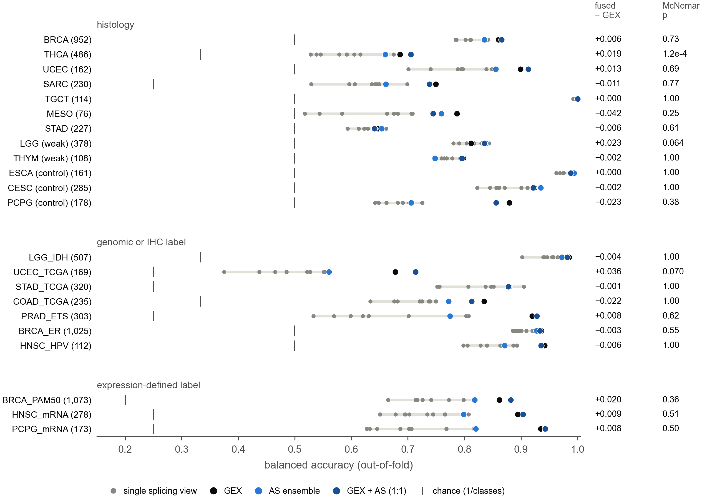

**Figure 13. Splicing matches expression on lineage and genome-state subtypes, and fusing the two
adds little.** Out-of-fold balanced accuracy (mean per-class recall) of one model per cohort and
view. Grey bar, the range of the eight splicing views; black, expression (GEX); blue, the AS
ensemble; dark blue, GEX + AS fused 1:1; tick, chance (1/classes, also the majority-class
predictor's balanced accuracy). Rows, cohorts with patients in brackets, grouped by how the label
was made: histology (weak, a poorly reproducible label; control, a lineage or site contrast),
genomic or IHC, and expression-defined. Columns at right: fused minus GEX balanced accuracy, and the
exact McNemar test of fused against GEX, raw p.

<sub>Figure file U1: [caption with every statistic](results/figures/subtype/U1_performance.caption.md) · [plotted values](results/figures/subtype/U1_performance.csv)</sub>

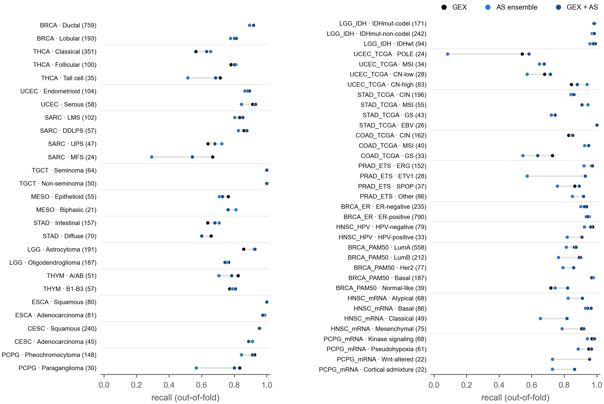

**Figure 14. Splicing loses most on small classes defined by one programme.** Out-of-fold recall of
every class (patients in brackets) for GEX (black), the AS ensemble (blue) and GEX + AS fused 1:1
(dark blue). (a) Histology cohorts. (b) Genomic and IHC cohorts, then the expression-defined
cohorts.

<sub>Figure file U2: [caption with every statistic](results/figures/subtype/U2_recall_by_class.caption.md) · [plotted values](results/figures/subtype/U2_recall_by_class.csv)</sub>

**A histology model's errors follow the molecular class.** If the models read biology, their
mistakes should be the patients whose histology and molecular state disagree. Four histology cohorts
have a published molecular class for the same patients (Figure 15). In glioma, the expression model
called 41 of 58 non-codeleted oligodendrogliomas astrocytoma, which is the reclassification WHO made in
2016. In endometrial cancer, 9 of the 12 endometrioid tumours called serous were copy-number high,
against 28 of 100 overall. In phaeochromocytoma and paraganglioma, every adrenal tumour called
extra-adrenal was pseudohypoxic, with low expression of the adrenal enzyme PNMT (median 1.6 against
7.9 log2 CPM in adrenal tumours called correctly).

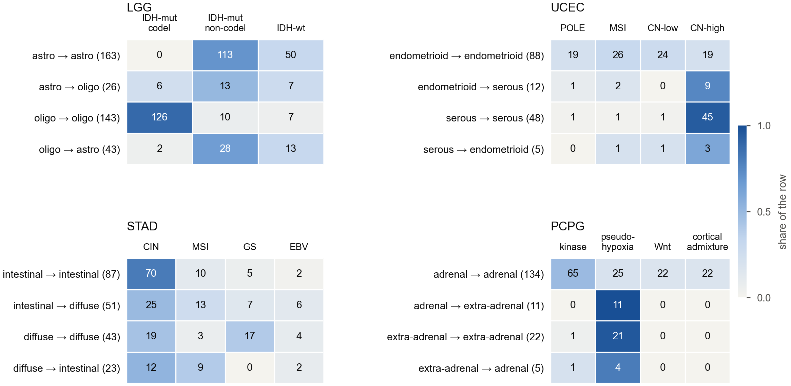

**Figure 15. Histology models err in the molecular direction.** Four histology cohorts with a
published molecular class for the same patients: true histology against the GEX model's out-of-fold
call, broken down by molecular class. Counts only; no molecular label entered any histology model.

<sub>Figure file U3: [caption with every statistic](results/figures/subtype/U3_histology_errors.caption.md) · [plotted values](results/figures/subtype/U3_histology_errors.csv)</sub>

**The literature's markers are in the expression models, rarely in the splicing models.** Forty
gene markers were fixed in advance with their sources (Figure 16). In the data, 39 differed between
classes in the expected direction. In the models, 27 ranked in the top 100 of their expression
model, but only 8 had an event in a splicing model's top 100: among them CDH1's first exon in breast
cancer, ERG's cassette exon in prostate cancer and the p16INK4a first exon of CDKN2A in HPV-positive
head-and-neck cancer. The two modalities read different genes: a cohort's splicing and expression
top-50 lists share a median of one gene (Supplementary Figure 11). Yet they still repeat most of each other's
errors, which is why fusion adds little here. The strongest single splicing event of each cohort was
also audited for neighbouring genes: four of 19 read another gene (Supplementary Figure 12).

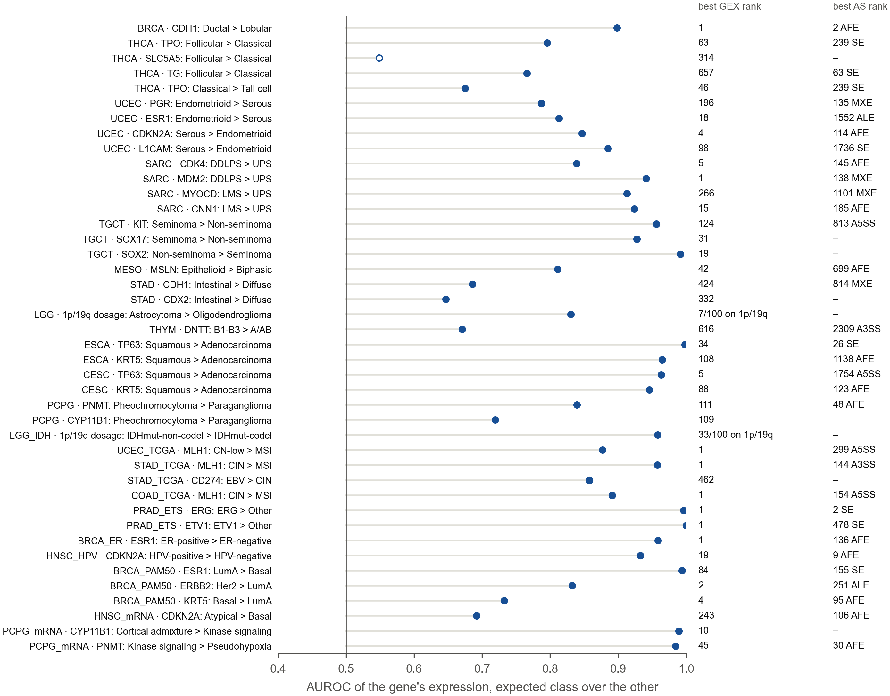

**Figure 16. The literature's markers are in the data and in the expression models, far less in the
splicing models.** The 40 gene markers fixed in advance with their sources, one row per marker: the
AUROC of the marker between its classes in the data, and its rank in the GEX model and in the
splicing models of its cohort.

<sub>Figure file U4: [caption with every statistic](results/figures/subtype/U4_literature_markers.caption.md) · [plotted values](results/figures/subtype/U4_literature_markers.csv)</sub>

**Named splicing regulators differ between subtypes as predicted.** Six predictions about splicing
factors were fixed before any factor was examined by subtype (Figure 17). Four were supported:
- ESRP2 is lower in biphasic than in epithelioid mesothelioma (AUROC 0.82);
- ESRP1 is lower in the mesenchymal head-and-neck class (0.76);
- PTBP1 is lower in leiomyosarcoma (0.66);
- higher PTBP1 moves the ACTN1 smooth-muscle exon away from the leiomyosarcoma pattern, as PTB's
  known repression of that exon predicts.

A fifth matched its pre-specified sign, but on re-reading the source the sign had been misread. In
TPM1, PTB and MBNL1 repress the non-smooth-muscle exon, so the data run against the published
mechanism (amendment A-5).

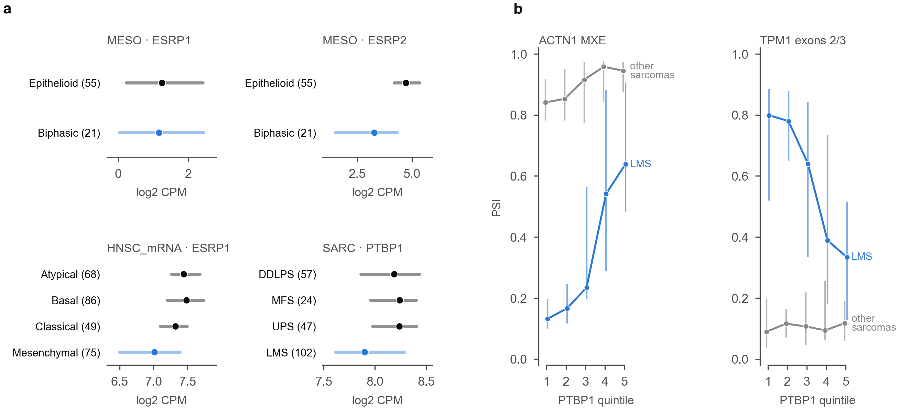

**Figure 17. Named splicing regulators differ between subtypes as predicted in four of six tests.**
Six predictions fixed before splicing factors were examined by subtype. (a) Each factor's log2 CPM
by class: dot, median; bar, interquartile range; blue, the class predicted lower. (b) The ACTN1 and
TPM1 events by PTBP1 quintile, the quintiles cut within leiomyosarcoma (blue) and within the other
sarcomas (grey).

<sub>Figure file U8: [caption with every statistic](results/figures/subtype/U8_regulators.caption.md) · [plotted values](results/figures/subtype/U8_regulators.csv)</sub>

**Part of the splicing accuracy is tied to the site.** Part 1 showed that site handling can pass for
biology between projects. We repeated the site probe within 21 subtype cohorts (Figure 18).
Expression lost ≤ 0.035 balanced accuracy in 20 of 21 cohorts when whole sites were held out.
Splicing lost more in particular cohorts: HPV status (0.098), cervical histology (0.077), thyroid
histology (0.077) and the head-and-neck expression classes (0.073). The pre-specified prediction
that splicing would lose more than expression in most cohorts held in 16 of 21 but was not resolved
(q = 0.080).

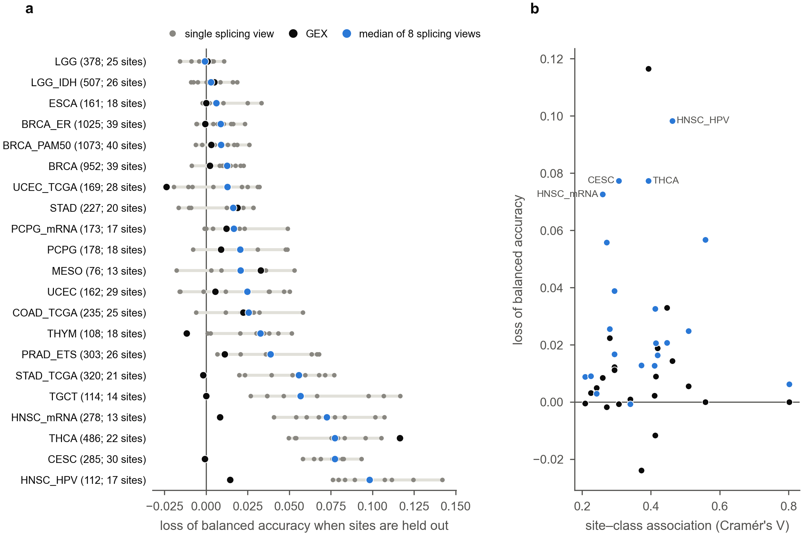

**Figure 18. Part of the splicing models' subtype signal is tied to the site that sent the sample.**
The site probe of Figure 6 on 21 subtype cohorts: a fixed classifier cross-validated grouped by
patient and then with whole tissue-source sites held out. (a) Loss of balanced accuracy per cohort:
single splicing views (grey), their median (blue), GEX (black). (b) The loss against the site–class
association (Cramér's V).

<sub>Figure file U9: [caption with every statistic](results/figures/subtype/U9_site_probe.caption.md) · [plotted values](results/figures/subtype/U9_site_probe.csv)</sub>

**Breast cancer, with DNA.** In breast cancer we could ask what the subtype models read beyond their
labels, using copy number and mutations. The PAM50 models' probability of the HER2-enriched class
first appeared to separate ERBB2-amplified luminal tumours better from splicing than from expression
(AUROC 0.81 against 0.72; Figure 19). Removing the 17q12 amplicon's own inputs cost splicing nothing,
so splicing reads a HER2-enriched programme rather than the amplified genes. The apparent advantage
then did not survive a better copy-number call (Figure 20). ABSOLUTE never reports more than 7
copies at ERBB2, so genome-doubled tumours could not be called amplified. Taking the copy ratio
without that ceiling added 15 amplified luminal tumours (median ploidy 3.85), and splicing and
expression became indistinguishable (0.81 against 0.75, not resolved; 0.82 against 0.83 on the new
tumours). Two further checks behaved as expected. Splice-site mutations skipped their exon (110 of 157),
and SF3B1-hotspot tumours used cryptic acceptors (AUROC 0.90; Supplementary Figure 13). A label-blind scan for
inherited, genotype-like splicing events mostly found subtype programmes instead: only 82 of 1,110
events passed a tumour–normal pair check for inheritance (Supplementary Figure 14).

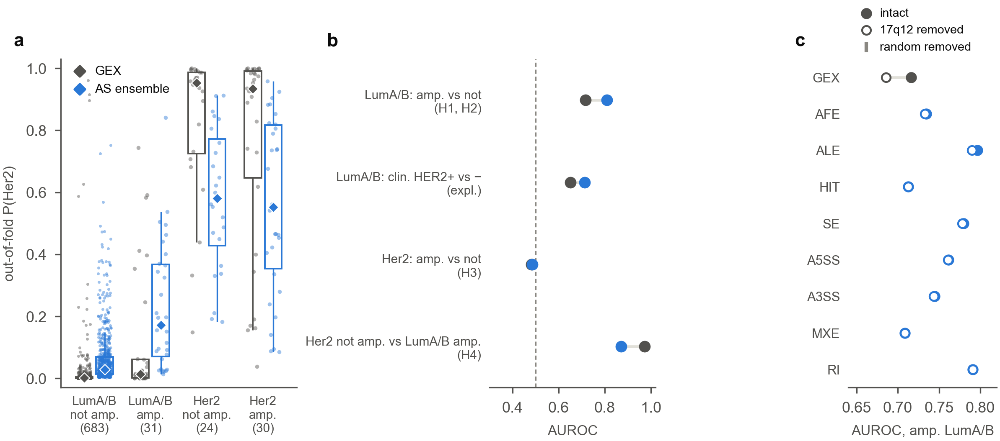

**Figure 19. Splicing reads HER2 through the HER2-enriched programme, not through the 17q12
amplicon.** (a) The PAM50 models' probability of the HER2-enriched class by PAM50 group and ERBB2
amplification (ABSOLUTE), for GEX and the AS ensemble. (b) AUROC for each comparison. (c) The
amplicon knockout: luminal AUROC with the 17q12 inputs set to their mean (hollow), against random
input sets of the same size (tick).

<sub>Figure file U13: [caption with every statistic](results/figures/subtype/U13_brca_two_her2.caption.md) · [plotted values](results/figures/subtype/U13_brca_two_her2.csv)</sub>

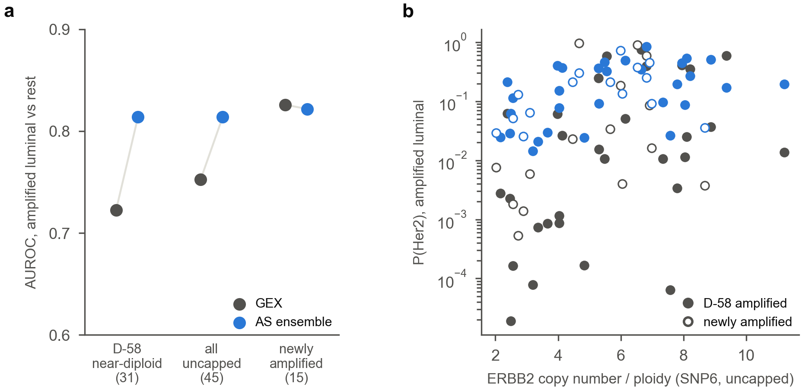

**Figure 20. Without the ABSOLUTE ceiling, splicing matches expression on ERBB2 amplification but
does not beat it.** ERBB2 amplification called from the SNP6 copy ratio without ABSOLUTE's 7-copy
ceiling. (a) AUROC of the HER2-enriched probability, GEX against the AS ensemble, for the earlier
amplified tumours, all tumours amplified by the uncapped call, and the newly amplified ones. (b)
That probability against copy number divided by ploidy in amplified luminal tumours (hollow, newly
amplified).

<sub>Figure file U15: [caption with every statistic](results/figures/subtype/U15_brca_her2_uncapped.caption.md) · [plotted values](results/figures/subtype/U15_brca_her2_uncapped.csv)</sub>

**MSI leaves the same splicing marks in three cancers.** One observation in the subtype models
started the study of Part 4. The MSI classes of endometrial, gastric and colorectal cancer were
modelled separately, yet their models chose overlapping events. Ten events separated MSI from the
other tumours in all three cancers, with no model involved (Figure 21). Seven of the ten were chosen
by at least two of the three models. A 57-bp CCNDBP1 exon was chosen by all three (AUROC 0.83, 0.93
and 0.97). None of the ten followed immune infiltration, and none overlapped another gene. This
analysis was added after the recurrence was noticed (amendment A-4) and is exploratory. It raised a
mechanistic question: why should the same exons respond to MMR deficiency in three organs?

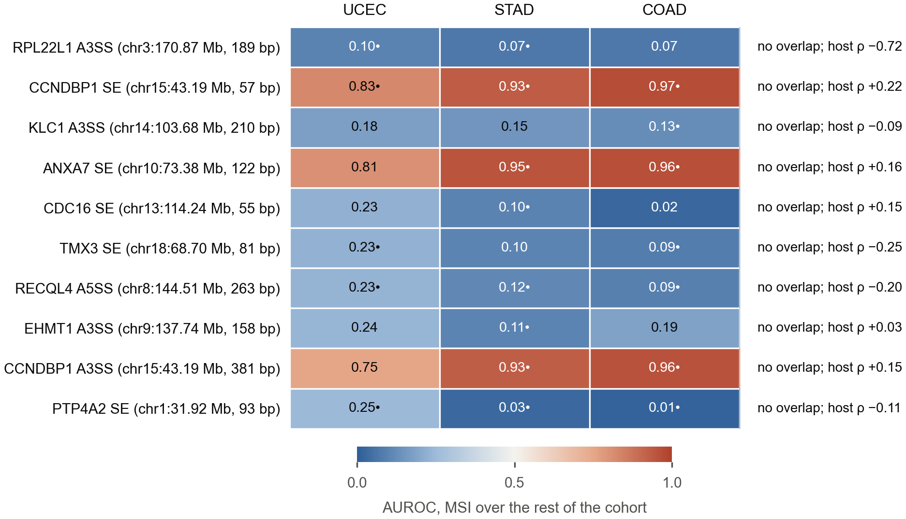

**Figure 21. Ten MSI splicing events replicate across endometrial, gastric and colorectal cancer.**
Splicing events from the MSI top 5 of the UCEC, STAD or COAD subtype models, measured as MSI against
the other tumours in all three cancers with no model involved. The ten drawn separate MSI in all
three (AUROC ≥ 0.75 or ≤ 0.25 in each); markers show each cancer's AUROC.

<sub>Figure file U7: [caption with every statistic](results/figures/subtype/U7_msi_events.caption.md) · [plotted values](results/figures/subtype/U7_msi_events.csv)</sub>

### Supplementary figures for Part 3

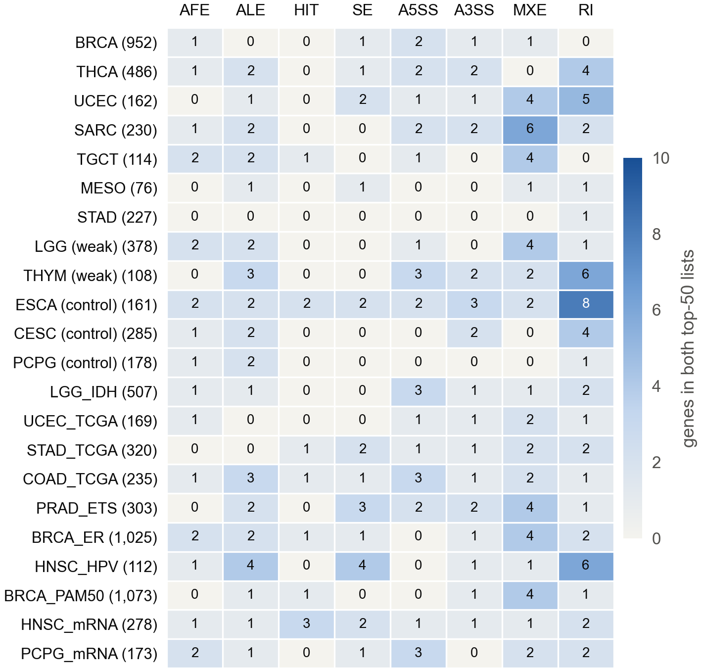

**Supplementary Figure 11. The splicing and expression models of a cohort read different genes.**
For each cohort and splicing view, the number of genes shared between the splicing model's top 50
host genes and the GEX model's top 50 genes.

<sub>Figure file U5: [caption with every statistic](results/figures/subtype/U5_as_vs_gex_genes.caption.md) · [plotted values](results/figures/subtype/U5_as_vs_gex_genes.csv)</sub>

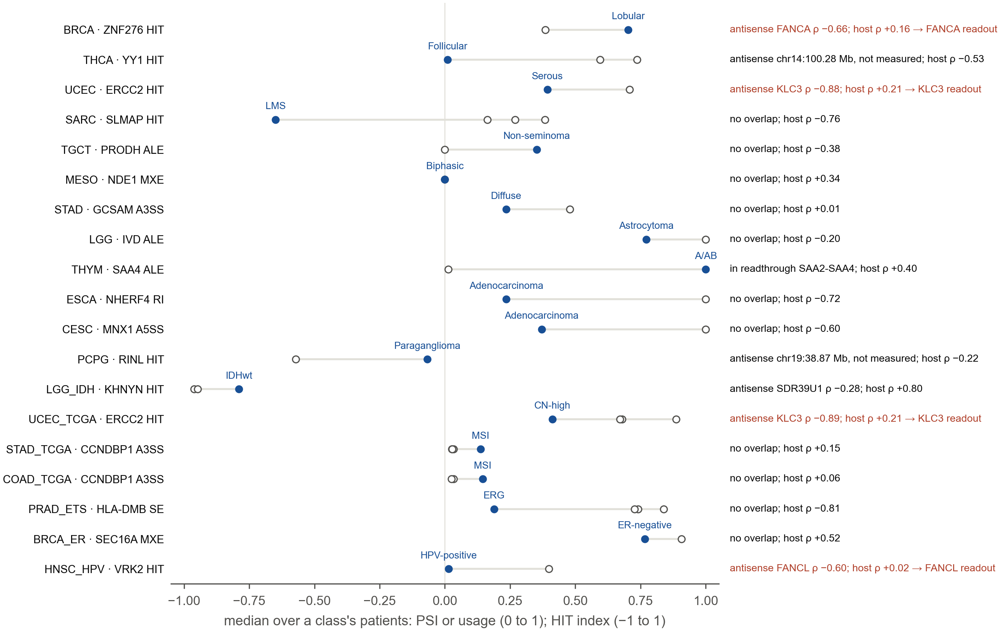

**Supplementary Figure 12. Four of the nineteen strongest splicing events read a neighbouring
gene.** For each histology and genomic/IHC cohort, the splicing event with the largest
class-specific importance, with its median in each class. At right, the neighbouring-gene audit:
overlap with another gene's exon, and Spearman correlation with that gene's and the host gene's
expression.

<sub>Figure file U6: [caption with every statistic](results/figures/subtype/U6_event_audit.caption.md) · [plotted values](results/figures/subtype/U6_event_audit.csv)</sub>

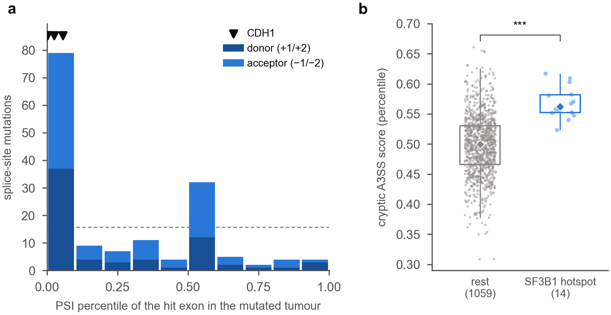

**Supplementary Figure 13. Splice-site mutations skip their exons, and SF3B1 hotspot tumours use
cryptic acceptors.** (a) PSI percentile, within the cohort, of the exon next to each splice-site
mutation in the mutated tumour; dashed line, no effect. (b) A cryptic-acceptor score in
SF3B1-hotspot tumours against the other tumours.

<sub>Figure file U14: [caption with every statistic](results/figures/subtype/U14_brca_mutations.caption.md) · [plotted values](results/figures/subtype/U14_brca_mutations.csv)</sub>

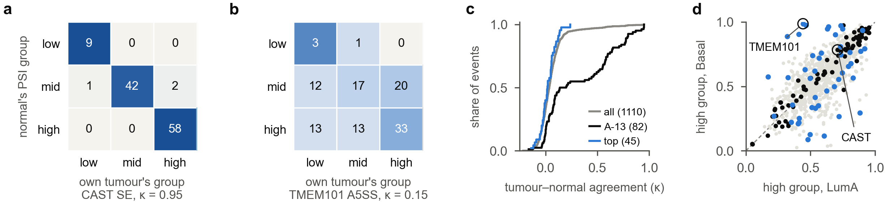

**Supplementary Figure 14. Most of the BRCA models' genotype-like events are subtype programmes, not
inherited alleles.** (a, b) Each normal sample's genotype-like group against its own tumour's group,
for CAST (a germline event) and TMEM101 (the models' top genotype-like event). (c) Tumour–normal
agreement (Cohen's κ) for all events, for those passing the pair check and for the models' top
events. (d) High-group frequency in LumA against basal-like tumours, per event.

<sub>Figure file U12: [caption with every statistic](results/figures/subtype/U12_brca_germline_check.caption.md) · [plotted values](results/figures/subtype/U12_brca_germline_check.csv)</sub>

---

## Part 4. The MSI study

*Journal-style write-up: [manuscript/MSI_SPLICING_CODE.md](manuscript/MSI_SPLICING_CODE.md) ·
methods: [docs/SUBTYPE_METHODS.md](docs/SUBTYPE_METHODS.md) (D-52 to D-56 and D-61 to D-77) ·
step-wise test of the rising arm: [results/MSI_RISING_ARM_PROOF.md](results/MSI_RISING_ARM_PROOF.md) ·
literature: [docs/MSI_REPEATS_LITERATURE.md](docs/MSI_REPEATS_LITERATURE.md).*

Tumours that lose DNA mismatch repair cannot correct slippage at short repeats. They accumulate
thousands of repeat-length changes, called microsatellite instability (MSI). MSI matters clinically:
MMR-deficient tumours respond to PD-1 blockade whatever their organ, so every MSI-high patient is
worth finding, including in cancers where MSI is rare. Poly-T runs are among the repeats MMR loss
destabilises most, and many sit in the polypyrimidine tract just upstream of a 3′ splice site.
Single genes show that shortening such a tract makes the next exon skipped: MRE11 exon 5 and HSP110
exon 9. A colorectal study found hundreds of such sites (Jonchère et al. 2024). Two questions were
open:
- Is there a rule, readable from the reference genome, that says which exons move and in which
  direction?
- Does such a rule hold in organs beyond those where it was found?

The tests below, each fixed in writing before it was run, arrive at the model of Figure 22.

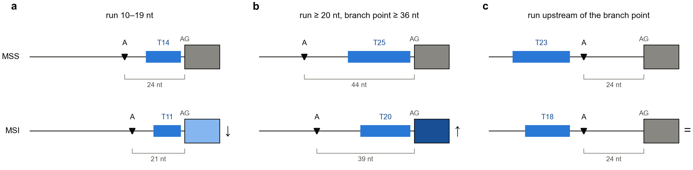

**Figure 22. A two-arm model of how mismatch-repair deficiency moves 3′ splice-site use.** Schematic
with illustrative lengths. Each panel shows one acceptor before (MSS) and after (MSI) a contraction
of its T-run (blue bar). Triangle, the branch-point adenosine; box, the cassette exon; bracket, the
branch-point-to-AG distance; arrow, the predicted change in inclusion. (a) Runs of 10–19 nt:
contraction weakens the tract and the exon is skipped more. (b) Runs of 20 nt or more between a
distant branch point and the AG: the tract stays long and the branch point moves toward the optimal
distance, so the exon is included more. (c) A long run upstream of the branch point: contraction
leaves the branch-point-to-AG distance unchanged.

<sub>Figure file M1: [caption with every statistic](results/figures/manuscript/M1_msi_code_model.caption.md) · [plotted values](results/figures/manuscript/M1_msi_code_model.csv)</sub>

**The MSI models had found the repeats.** We annotated every cassette exon from the reference genome
alone, recording the longest T-run in the 50 intron bases before it (Figure 23). Most of the MSI
models' top exons followed a run of at least 10 nt: 40 of the stomach model's top 50 and 34 of the
colon model's, against 5% of all exons. A per-patient score built from these exons, with no model and
no training, ranked MSI tumours at AUROC 0.71 in stomach and 0.78 in colon cancer. Runs deep in the
intron did far worse, and the same exons shifted together across organs (ρ 0.43–0.65). Endometrium,
however, did not separate (0.51), and that failure led to the next observation.

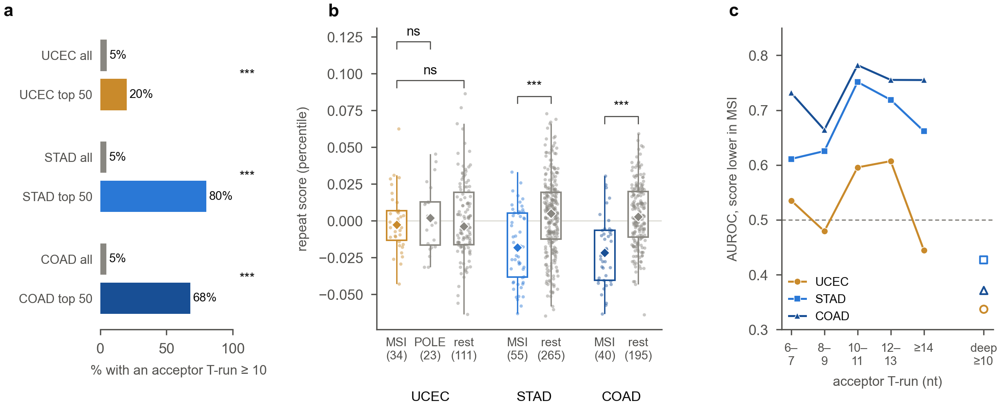

**Figure 23. Genome sequence alone says which exons MSI tumours skip.** Exons annotated from the
reference genome: the longest T-run within 50 nt upstream of the 3′ splice site. (a) Share of exons
with an acceptor T-run ≥ 10 nt among all exons and among the top 50 SE events of each cohort's MSI
model. (b) A genome-only repeat score per patient, MSI against the other tumours. (c) Its AUROC by
run length, and for runs deep in the intron (hollow).

<sub>Figure file U10: [caption with every statistic](results/figures/subtype/U10_msi_repeats.caption.md) · [plotted values](results/figures/subtype/U10_msi_repeats.csv)</sub>

**The longest tracts go the other way.** Exons after runs of 20 nt or more were included *more* in MSI
tumours in all three cancers: 56–67% moved up, against 38–49% for runs of 10–19 nt (Figure 24). This
was seen after the fact. Replication on unread alternative-3′-splice-site events supported 2 of 6
tests, with all 6 in the predicted direction. A one-directional score therefore cancels itself
wherever long tracts are common. Deletion load explained little: only in stomach cancer did more MC3
homopolymer deletions go with a stronger score (Supplementary Figure 15). Endometrial MSI tumours carried the
most deletions yet had the weakest score.

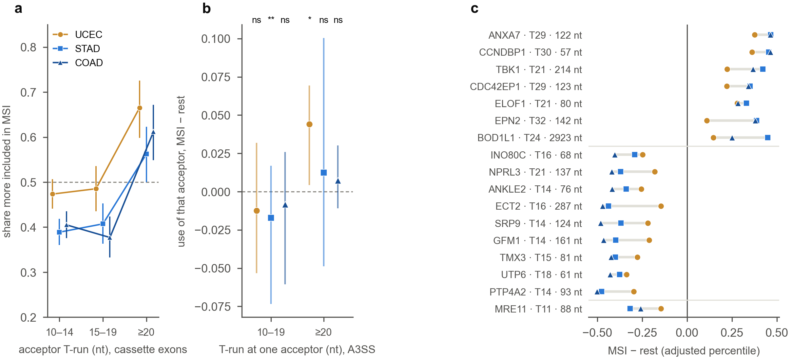

**Figure 24. The longest acceptor repeats move toward inclusion in MSI.** (a) Share of repeat exons
more included in MSI than in the other tumours, by acceptor run length, in each cancer. (b) The A3SS
replication: use of the acceptor that carries the run, MSI minus the other tumours. (c) The exons
with the largest shifts shared across cancers, labelled with run and exon length.

<sub>Figure file U11: [caption with every statistic](results/figures/subtype/U11_msi_long_tracts.caption.md) · [plotted values](results/figures/subtype/U11_msi_long_tracts.csv)</sub>

**The predicted branch point's distance goes with the direction.** What separates rising from
falling tracts? A
poly-T tract lies between the branch point and the AG, and the 3′ splice site works best with the
branch point about 19–23 nt away. An exon whose sequence-predicted branch point lay further from the
AG gained inclusion in MSI, beyond its run length (adjusted ρ 0.11–0.16, supported in all three
cancers; Figure 25). Among runs of 20 nt or more, 48% moved up when the branch point was near and
73% when it was far. A contraction that brings a distant branch point toward the optimum would fit.
When the 36-nt cut was tested later in junction reads, it was not resolved (D-77, below).

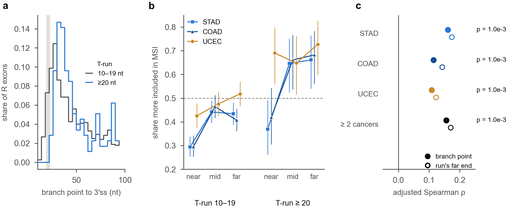

**Figure 25. The predicted branch point's distance from the 3′ splice site goes with the direction
of the MSI shift.** (a) Distance from the sequence-predicted branch point to the AG, by run length;
grey band, the 19–23 nt optimum. (b) Share of repeat exons more included in MSI, by branch-point
tertile within each run class. (c) Correlation of the MSI shift with branch-point distance (filled)
and with the run's far end (hollow), adjusted for run length.

<sub>Figure file U17: [caption with every statistic](results/figures/subtype/U17_msi_branchpoint.caption.md) · [plotted values](results/figures/subtype/U17_msi_branchpoint.csv)</sub>

**A two-arm code finds MMR-deficient tumours in 30 cancers never used to build it.** These
observations define score G, which has two arms:
- runs of 10–19 nt count as falling;
- runs of 20 nt or more with the predicted branch point at least 36 nt from the AG count as rising.

The 36-nt cut is the first tertile of that distance among runs of 20 nt or more. It was computed
without labels, but chosen after the reversal had been seen. It defines the rising class; a later
test in junction reads did not support it as a threshold (D-77, below).

We fixed the code in advance and applied it, without refitting, to the 30 TCGA cancers outside
colon, stomach and endometrium. MMR deficiency there was defined from DNA: at least 10 MC3
homopolymer deletions, found in 50 of 7,685 tumours (Figure 26). Score G found these tumours at
AUROC 0.83, where the one-armed score reached 0.55. Its performance held up in several ways:
- **Without close relatives** of the training cancers (rectum, oesophagus, carcinosarcoma): 0.81.
- **Against hypermutated MMR-proficient tumours**: 0.85.
- **Exon by exon**, the held-out shifts replicated the training shifts (ρ 0.51).

Three pre-specified checks bounded it:
- **Specificity.** The relation needs the tract and is absent in POLE-mutant and chromosomal
  contrasts (Supplementary Figure 16).
- **Not infiltration.** Adjusting for immune and stromal expression kept the whole effect, and the
  less-infiltrated half of tumours separated as well (0.84; Supplementary Figure 17).
- **Independent callers.** It separated MSI-high from stable tumours as called by MANTIS (0.97) and
  MSIsensor (0.89; Supplementary Figure 18).

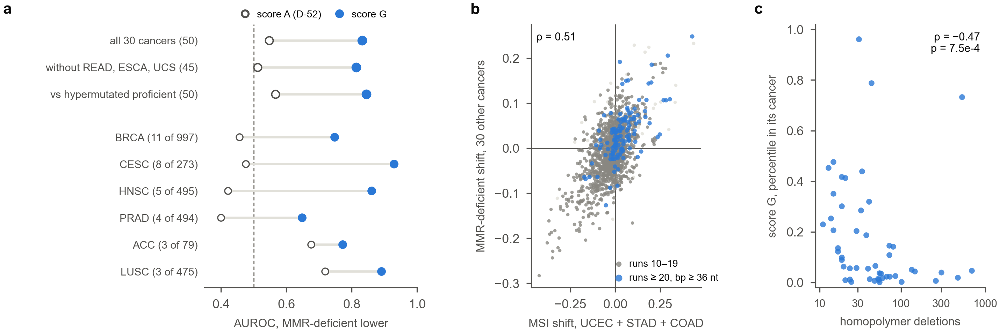

**Figure 26. A two-arm sequence code finds mismatch-repair-deficient tumours in 30 cancers never
used to define it.** Score G: runs of 10–19 nt fall; runs ≥ 20 nt with the branch point ≥ 36 nt from
the AG rise. Score A counts every repeat exon as falling. MMR-deficient: ≥ 10 MC3 homopolymer
deletions. (a) AUROC of score A (hollow) and score G (filled) in the 30 held-out cancers: pooled,
without the training cancers' tissue relatives, against hypermutated proficient tumours, and per
cancer. (b) Per-exon shift in the 30 held-out cancers against the training cancers (blue, the rising
arm). (c) Score G against the deletion count within the 50 MMR-deficient tumours.

<sub>Figure file U18: [caption with every statistic](results/figures/subtype/U18_msi_code_pancancer.caption.md) · [plotted values](results/figures/subtype/U18_msi_code_pancancer.csv)</sub>

**The rising arm is real, but its mechanism is open.** Long tracts should weaken a splice site, so
the rise needed testing on its own. Eight pre-specified tests gave 3 supported, 1 against and 4 not
resolved (Figure 27). Supported:
- **The rise is real.** In the held-out cancers, 98 of 135 rising-arm exons rose.
- **It is not a tumour-wide shift.** Adjusting for each tumour's mean inclusion left the effect
  unchanged.
- **It needs the tract.** Background exons whose predicted branch point is also ≥ 36 nt but which
  have no T-run did not move.
- **It is not mutation burden.** Hypermutated MMR-proficient tumours did not show it.

Branch-point geometry, however, did not explain all of it:
- runs upstream of the branch point rose too;
- a link to a branch-point-free measure of geometry was not shown;
- a rise with deletion count was not shown;
- relief of PTB repression ran the wrong way.

The leading alternative is loss of a repressor that binds the run itself, such as hnRNP C. Minigenes
would decide between the two.

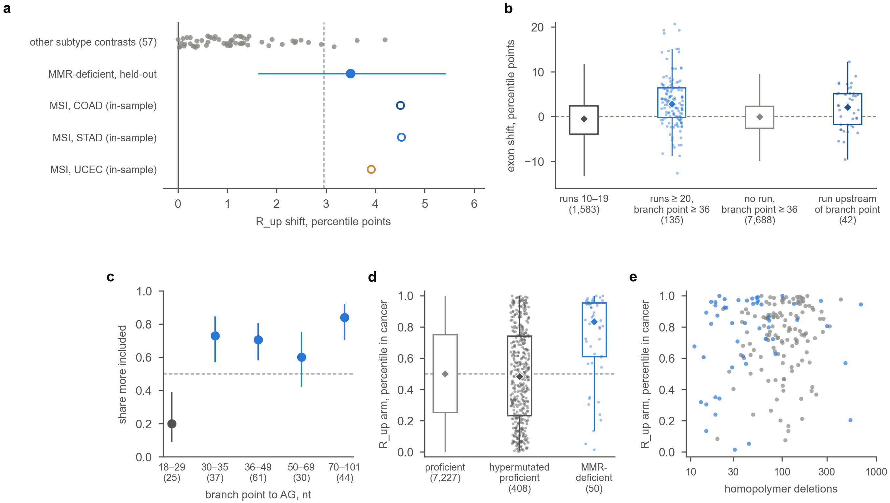

**Figure 27. The rising arm is specific to mismatch repair and needs the tract, but its mechanism is
not settled.** (a) Mean shift of rising-arm exons in 20 against 20 tumours: 57 other subtype
contrasts (grey, absolute value; dashed, their 95th percentile), held-out MMR-deficient tumours
(blue; bar, 95% of draws) and, in-sample, MSI in the three training cohorts (hollow). (b) Held-out
exon shifts by exon class. (c) Exploratory: long runs (≥ 20 nt), share more included by branch-point
distance. (d) The rising arm of held-out tumours by DNA class. (e) The rising arm against
homopolymer deletions in MMR-deficient and MSI tumours.

<sub>Figure file U22: [caption with every statistic](results/figures/subtype/U22_msi_code_rising_arm.caption.md) · [plotted values](results/figures/subtype/U22_msi_code_rising_arm.csv)</sub>

**The rise holds in junction reads, but only part of the claim is supported.** The tests above read
percentiles of a PSI that counts exon-body reads, used a heuristic branch point, and used cuts set
after the reversal was seen. We therefore tested the rising arm again in eight pre-specified steps,
on junction reads only, in the 30 held-out cancers (D-77; Figure 28). The verdict is partial: 9 of
the 12 required tests were supported.
- **The rise holds.** Rising-arm exons rose by 0.0070 PSI (95% CI 0.0033–0.0107) in held-out
  MMR-deficient tumours, and the falling arm fell.
- **It is carried by a minority of exons.** The ten largest of 92 held 81% of the summed rise; the
  median exon moved by 0.0019.
- **It needs the tract,** and it exceeds long pyrimidine tracts, deep T-runs and Alu acceptors. It
  survives exon and tumour covariates and separates MMR deficiency from mutation load.
- **The 36-nt cut is not supported as a threshold** (Figure 29). Neither 36-nt test was resolved.
  Within the rising arm the heuristic and mapped distances are not rank-correlated (Spearman
  ρ = −0.12, 65 exons; the heuristic distances are all ≥ 36 nt, which limits ρ). Of the 63 exons
  whose mapped branch point lies upstream of the run, 45 have it ≥ 36 nt from the AG and 18 under
  36 nt. With experimentally mapped branch points, the rise was rank-associated with the gap between
  run and branch point in the held-out cancers (partial ρ = 0.44); in the training cancers it did
  not replicate (not resolved; ρ = 0.07, p = 0.61).
- **Not shown:** that it beats poly-A and donor-side runs (underpowered), that it is unique to MSI
  (four of 57 subtype contrasts move it more), a dose relation, or the mechanism.

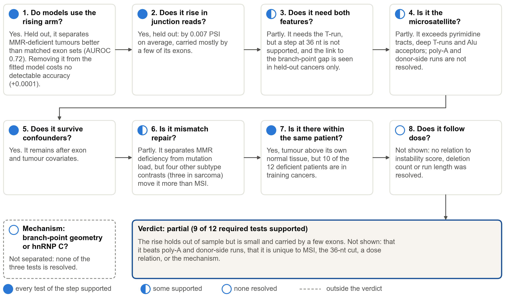

**Figure 28. In junction reads the rising arm rises in held-out cancers, but the claim is only
partly supported.** The eight pre-specified steps of D-77, in order. Each box gives the step's
question and a plain answer; filled marker, every test of the step supported; half, some; hollow,
none resolved. Dashed box, the mechanism tests, outside the verdict. Held-out cancers, junction
reads only.

<sub>Figure file RP0: [caption with every statistic](results/figures/rising_proof/RP0_overview.caption.md) · [plotted values](results/figures/rising_proof/RP0_overview.csv)</sub>

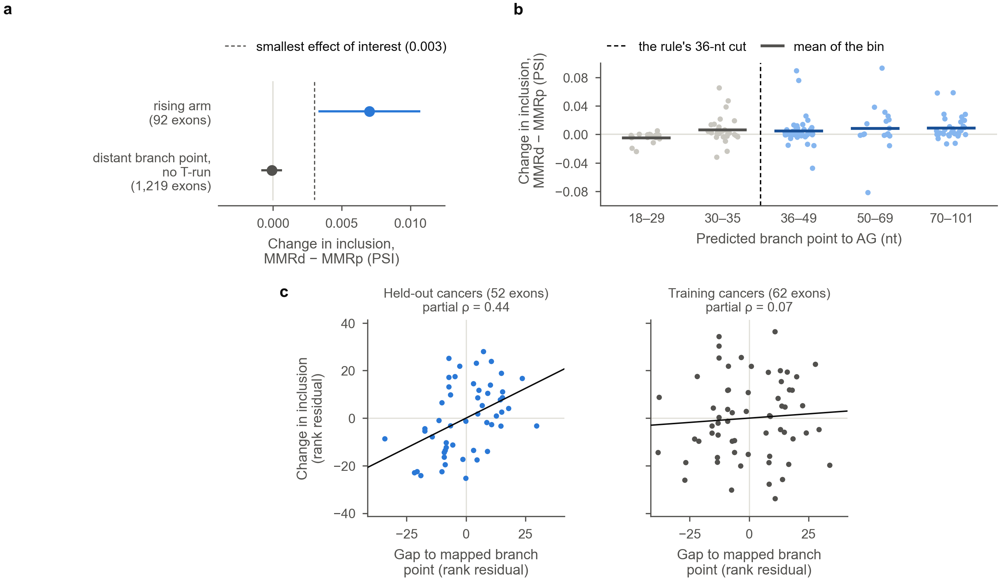

**Figure 29. The rise needs the T-run, a step at 36 nt is not supported, and the link to the
branch-point gap is seen in held-out cancers only.** Held-out cancers unless stated, junction reads
only; change in inclusion, MMR-deficient mean minus the proficient mean of the same cancer. (a) The
rising arm against background exons whose predicted branch point is also ≥ 36 nt from the AG,
without a T-run; bars, 95% intervals; dashed line, smallest effect of interest. (b) Exons with a
T-run of 20 nt or more, by predicted branch-point distance; bars, bin means; dashed line, the rule's
36-nt cut. Descriptive. (c) Rank of the change against rank of the gap to an experimentally mapped
branch point, at fixed run length and offset, held out (left) and in training cancers (right).
Descriptive.

<sub>Figure file RP3: [caption with every statistic](results/figures/rising_proof/RP3_branch_point.caption.md) · [plotted values](results/figures/rising_proof/RP3_branch_point.csv)</sub>

**A fitted model on the repeat exons transfers and matches exome callers within a cancer.** Score G
has no fitted weights. We next fitted one weight per repeat exon: an L2 logistic regression on the
1,562 exons with an acceptor run of at least 10 nt, trained on colon, stomach and endometrium only,
with its penalty chosen by leaving one training cancer out (Figure 30). Results:
- **Held out**, it reached AUROC 0.900 in the 30 other cancers (score G 0.832) and an AUPRC of 0.44
  (0.08).
- **Its largest weights** reproduce the code: long runs with a far branch point are positive, runs of
  10–19 nt negative.
- **Against exome callers**, it was benchmarked against MANTIS, MSIsensor and the MC3 count, each
  judged by the consensus of the other two (Figure 31). Within each cancer it reached 0.998, at
  most 0.002 below the exome measures, from RNA alone.
- **Across cancers** it is not calibrated, because its inputs are ranks within a cancer: at a
  caller's call volume it found 82–84% of positives, against 94–100% for the callers.

Where the model and the exome disagreed, its own extra calls sat just above threshold and mostly
looked false. Its misses were mostly endometrial (Supplementary Figure 19), where MSI shifts repeats less than in
colon (Wang et al. 2017; Wu et al. 2019; Chung et al. 2023).

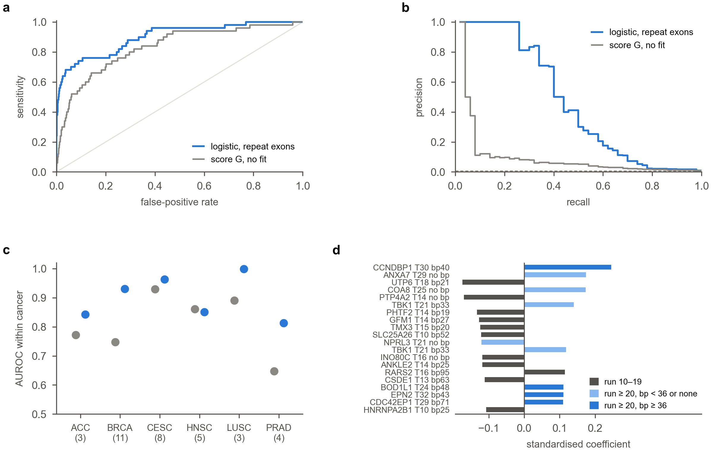

**Figure 30. Logistic regression on repeat exons, fitted in three cancers, finds MMR deficiency in
30 others.** L2 logistic regression with balanced class weights on 1,562 repeat exons (each input,
the exon's inclusion percentile within its cancer minus the tumour's mean percentile of matched
non-repeat exons), trained on COAD, STAD and UCEC with C chosen by leaving one training cancer out,
and tested on the 30 other cancers. (a) ROC held out, against score G; grey line, chance. (b)
Precision against recall held out; dashed line, prevalence. (c) AUROC per held-out cancer with three
or more MMR-deficient tumours (in brackets). (d) The 20 largest standardised coefficients, labelled
by gene, acceptor T-run length and branch-point distance.

<sub>Figure file U23: [caption with every statistic](results/figures/subtype/U23_msi_code_models.caption.md) · [plotted values](results/figures/subtype/U23_msi_code_models.csv)</sub>

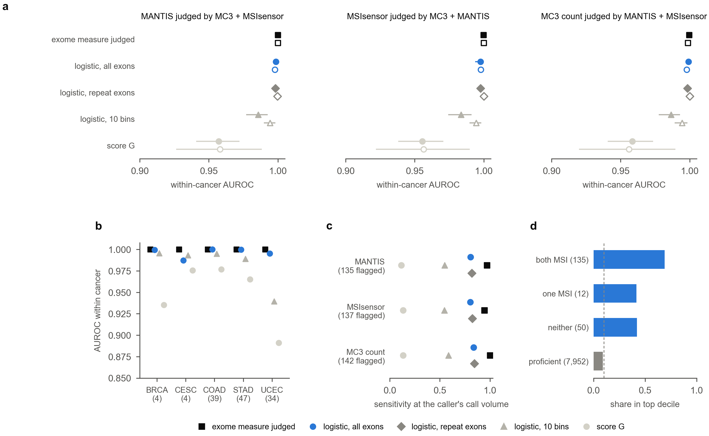

**Figure 31. Within each cancer, the repeat-exon model ranks tumours almost as well as the exome MSI
callers.** Each exome measure is judged against the tumours on which the other two agree, and the
repeat-exon model against the same tumours; within-cancer AUROC ranks each positive only against
negatives of its own cancer. (a) Within-cancer AUROC: filled, each cancer left out of training;
hollow, the 30 cancers held out from a model trained on COAD, STAD and UCEC; bars, 95% bootstrap
intervals. (b) Per cancer with three or more positives (MANTIS judged by MC3 and MSIsensor). (c)
Sensitivity (filled) and PPV (hollow) when the model flags as many tumours as the caller calls MSI,
pooled over cancers. (d) Tumours with ≥ 10 MC3 deletions grouped by the two callers' calls, and
proficient tumours: share in the top decile of the model's score within their cancer; dashed line,
chance.

<sub>Figure file U24: [caption with every statistic](results/figures/subtype/U24_msi_callers_benchmark.caption.md) · [plotted values](results/figures/subtype/U24_msi_callers_benchmark.csv)</sub>

**Splicing against expression.** Expression-based MSI classifiers already exist, built and tested
mainly in colon, stomach and endometrium. Was transfer to other organs special to splicing? We
trained expression models exactly as the splicing model, with the same tumours, label, split and
tuning (Figure 32). We had predicted that splicing would transfer better, and the comparisons did
not resolve it:
- **Retrained expression came close.** On all genes it reached 0.893, against 0.900 for splicing.
- **A small published panel did not transfer.** PreMSIm's 15 genes reached 0.70–0.79.
- **MLH1 silencing did not separate them.** Where MLH1 was not silenced, the two read-outs tied.
- **They are complementary.** They ranked the deficient tumours differently (ρ = 0.36). Together
  they reached 0.926 and doubled the precision at half recall (0.68 against 0.30 and 0.39).
- **Splicing stayed closer to the exome callers within a cancer** (0.998 against 0.975–0.979).

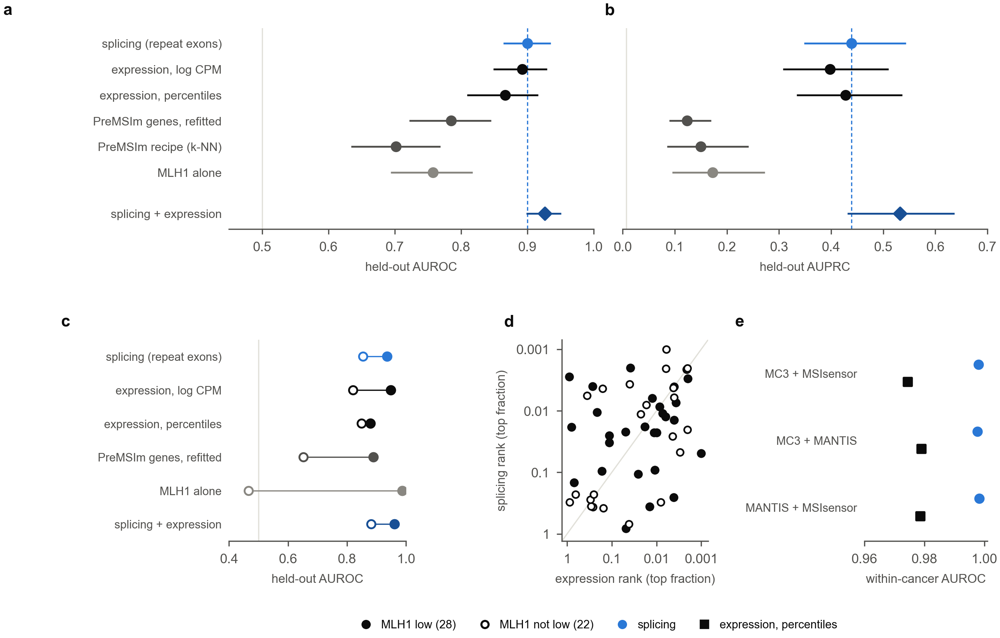

**Figure 32. Expression models trained the same way transfer almost as well; splicing adds to
them.** All models trained on COAD, STAD and UCEC and tested on the 30 other cancers (50
MMR-deficient among 7,685), tuned by leaving one training cancer out. (a) Held-out AUROC and (b)
AUPRC; bars, 95% bootstrap intervals; dashed line, the splicing model. (c) AUROC for held-out
MMR-deficient tumours with MLH1 in the bottom tenth of their cancer (filled) or not (hollow), each
against all proficient tumours. (d) Each held-out MMR-deficient tumour's rank within its cancer
under splicing and under expression (fraction of the cancer at or above it; log axes); grey line,
equality. (e) Each cancer left out of training: within-cancer AUROC against the tumours on which two
exome measures agree.

<sub>Figure file U26: [caption with every statistic](results/figures/subtype/U26_msi_splicing_vs_expression.caption.md) · [plotted values](results/figures/subtype/U26_msi_splicing_vs_expression.csv)</sub>

**How large are the shifts?** Every result so far ranked tumours within a cancer; none said how far
an exon moves. Measured in PSI units (Figure 33), the typical repeat exon moves a little and a
minority move a lot:
- **Small per exon.** Among exons that are alternatively spliced in proficient tumours (proficient
  median PSI 0.1–0.9), the median R_down exon falls by 0.02–0.03 PSI in colon and stomach cancer and
  by 0.0055 in the held-out cancers. Over all measured exons the median shift is 0 in every class,
  because most exons sit at PSI 0 or 1. MMR status explains about 0.5% of a typical repeat exon's
  variance.
- **Large in a minority.** 16–18% of those exons fall by at least 0.10, against 4% of exons without
  a repeat; the share rises with tract length. The largest move by 0.2–0.4 (METTL8, BOD1L1,
  CCNDBP1).
- **A few dozen per tumour.** An MMR-deficient colon or stomach tumour has about 33 more repeat exons
  down by 0.10 than a typical proficient tumour of its cancer.
- **Not explained by purity, and not confined to a subset of tumours.** We had predicted that the
  shift would grow with purity and crowd into a subset of tumours. Neither held: the arm shift is
  flat across purity, and outside the PSI bounds the tails are only slightly heavier than a uniform
  move predicts. The pre-specified tail test was itself distorted at PSI 0 and 1 (amendment A-20).

The rule's power therefore comes from the number of exons it reads, not from the size of any one
change, which is why a model over many repeat exons transfers where single events do not.

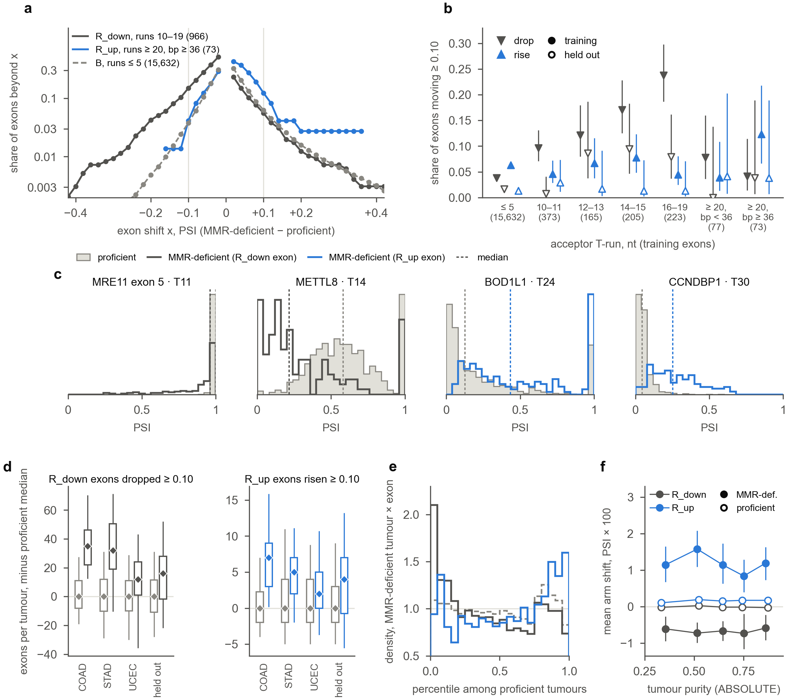

**Figure 33. A minority of exons move by a tenth of PSI or more; the typical exon moves by a few
hundredths.** Within each cancer, MMR-deficient tumours against proficient tumours; panels a, b and
e use exons whose proficient median PSI lies between 0.1 and 0.9. (a) Share of exons whose shift
lies below x (left) or above x (right), three training cancers pooled; log scale. (b) Share of exons
dropping (▼) or rising (▲) by at least 0.10, by acceptor T-run length; filled, training cancers;
hollow, held-out cancers; bars, 95% Wilson intervals. (c) PSI of four exons in proficient (grey) and
MMR-deficient tumours (line); dashed lines, medians. (d) Per tumour, the R_down exons down and the
R_up exons up by at least 0.10, minus the cancer's median proficient tumour; boxes, quartiles;
whiskers, 5th–95th percentiles. (e) Density of MMR-deficient tumours' percentiles among proficient
tumours; 1, no difference. (f) Mean arm shift by purity fifth; filled, MMR-deficient; hollow,
proficient; bars, 95% bootstrap intervals.

<sub>Figure file U27: [caption with every statistic](results/figures/subtype/U27_msi_shift_magnitude.caption.md) · [plotted values](results/figures/subtype/U27_msi_shift_magnitude.csv)</sub>

**What the rising exons are.** Rising-arm exons are mostly near-silent in proficient tumours (median
PSI 0.06). We placed every cassette exon in its gene's canonical protein-coding transcript and
translated through it, to ask what including it does (D-76; Figure 34). The largest rises are mostly
in *poison* exons: including one puts a premature stop codon where nonsense-mediated decay (NMD)
should see it (exploratory).
- **The movers.** Of the 15 largest exon × cancer rises among exons with a coding consequence, 12
  belong to five poison exons (BOD1L1, CCNDBP1, LRR1, C19orf12 and BRCA1), each rising in two or three
  training cancers. As a class, poison exons are not shown to move more often: at a rise of 0.05 or
  more, 14 of 129 poison rows moved, about as often as other rows. Only in-frame rows stand apart (0 of
  23), and that contrast is not resolved (Fisher p = 0.13). The three exons switched on in a training
  cancer's MMR-deficient tumours, from at most 0.05 in its proficient tumours and normal tissue to
  0.10 or more, are all poison exons.
- **An ordinary set of exons** (exploratory). As a whole the rising arm is 35% poison exons, as many as
  background exons of the same baseline inclusion (33%).
- **No sign of a global NMD defect** (exploratory). Background poison exons barely moved in
  MMR-deficient tumours, about as little as in-frame ones (band means −0.0086 to +0.0014 PSI over
  training and held-out cancers).
- **Not shown: an effect on gene output.** The pre-specified tests asked whether MSI's rise in poison
  exons lowers their genes' mRNA. Their positive control was not resolved: background poison exons
  tracked their gene's mRNA no more negatively than in-frame ones. That coupling follows baseline
  inclusion far more than consequence, which suggests why (exploratory). The three tests on the rising
  arm therefore could not be read. Why the largest movers are poison exons, like the rising arm's
  mechanism, is open.

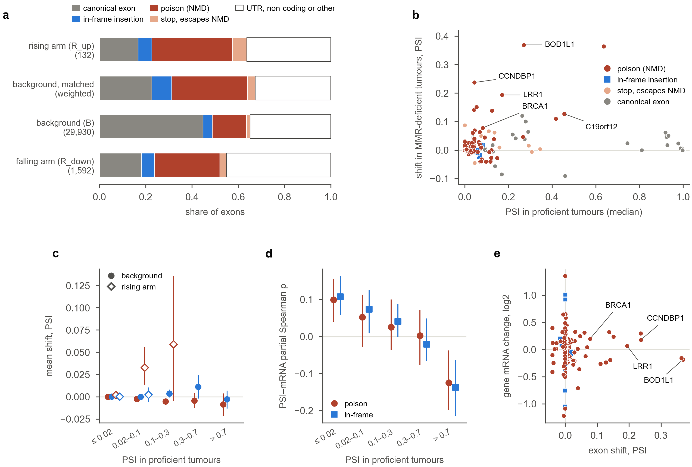

**Figure 34. Most of the rising-arm exons that move furthest are poison exons.** Each cassette exon
placed in its gene's canonical protein-coding transcript (GENCODE v45) and translated through:
canonical exon, in-frame insertion, poison (premature stop, predicted NMD), stop escaping NMD, or
other (UTR, non-coding). (a) Consequence of inclusion by exon class, training cancers; background as
it is and reweighted to the rising arm's proficient PSI. (b) Rising-arm exons, one dot per exon and
training cancer: shift in MMR-deficient tumours against the proficient median PSI, by consequence.
(c) Training cancers: mean shift by proficient PSI band for poison (red) and in-frame (blue) exons;
filled, background; hollow, rising arm; bars, 95% bootstrap intervals. (d) Background exons: partial
Spearman ρ of PSI with the host gene's mRNA across tumours, by proficient PSI band; median and
quartiles. (e) Rising-arm exons inserted into the coding sequence, training cancers: shift against
the host gene's mRNA change.

<sub>Figure file U28: [caption with every statistic](results/figures/subtype/U28_msi_rising_consequence.caption.md) · [plotted values](results/figures/subtype/U28_msi_rising_consequence.csv)</sub>

**Where this stands.** A literature search found no splicing-based MSI classifier. It also found no
report of exons gaining inclusion at long poly-T tracts, and no RNA classifier tested across many
held-out organs against DNA calls. Three parts of this work are therefore new:
- the rising arm;
- a rule, read from the genome, that says which exons move;
- its transfer to 30 cancers.

The skipping of exons at MSI tracts, RNA-based detection of MSI and the weak endometrial signal were
known. The practical claim is narrower than "it travels". An expression model retrained the same way
travels almost as well. Splicing adds a mechanism, closer agreement with exome callers within a
cancer, and errors that differ from expression's. Four things are needed next:
- **Minigenes**, to separate branch-point geometry from a run-binding repressor.
- **The tumours' own alleles** at the rising-arm loci, read from exome reads (specified in D-56).
- **An RNA cohort** processed outside TCGA.
- **A comparison with a repeat-length caller** run on the RNA alignments.

### Supplementary figures for Part 4

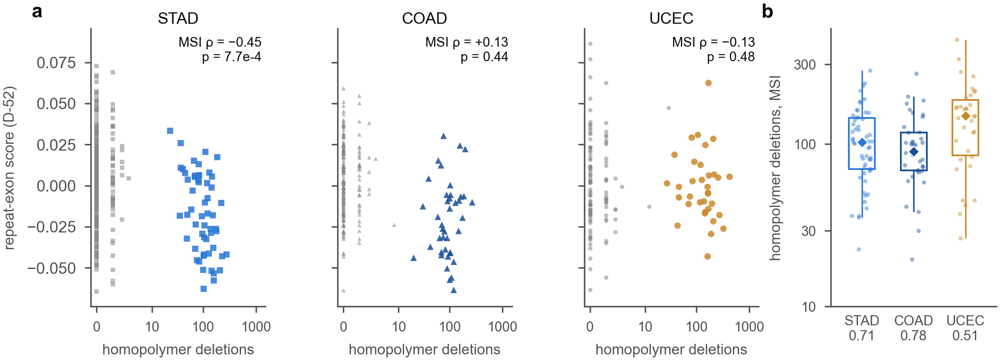

**Supplementary Figure 15. Mismatch-repair damage tracks the repeat score in stomach cancer only.**
(a) Repeat score against MC3 homopolymer deletions per tumour in STAD, COAD and UCEC; the grey
column is the rest of each cohort. (b) Deletion counts of the MSI tumours by cancer, with each
cancer's repeat-score AUROC.

<sub>Figure file U16: [caption with every statistic](results/figures/subtype/U16_msi_deletion_load.caption.md) · [plotted values](results/figures/subtype/U16_msi_deletion_load.csv)</sub>

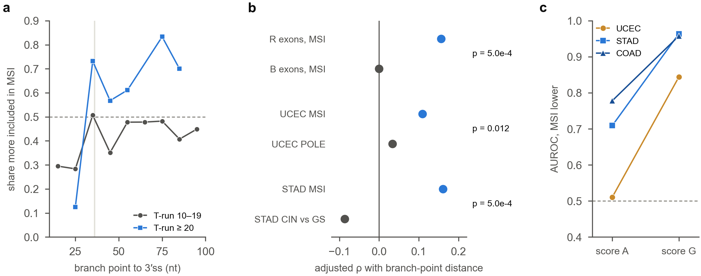

**Supplementary Figure 16. The code is specific to the branch point and to mismatch repair.** (a)
Share of repeat exons more included in MSI, by branch-point distance, for runs of 10–19 nt and ≥ 20
nt. (b) Adjusted branch-point correlation for MSI (blue) and for control contrasts (grey): exons
without a tract, POLE-mutant against other endometrial tumours, CIN against genomically stable
gastric tumours. (c) AUROC of score A and score G in the three training cancers.

<sub>Figure file U19: [caption with every statistic](results/figures/subtype/U19_msi_code_specificity.caption.md) · [plotted values](results/figures/subtype/U19_msi_code_specificity.csv)</sub>

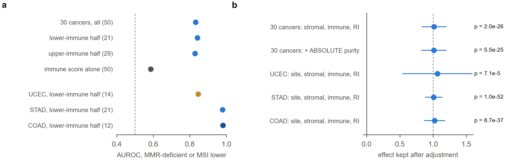

**Supplementary Figure 17. The code is not an infiltration readout.** (a) AUROC of score G in all
held-out tumours and in each immune half, of the immune score alone (grey), and in the
less-infiltrated half of each training cancer. (b) The effect of MMR deficiency (or MSI) on score G
kept after adjusting for stromal, immune and retained-intron levels, with purity or site; 95% CI.

<sub>Figure file U20: [caption with every statistic](results/figures/subtype/U20_msi_code_infiltration.caption.md) · [plotted values](results/figures/subtype/U20_msi_code_infiltration.csv)</sub>

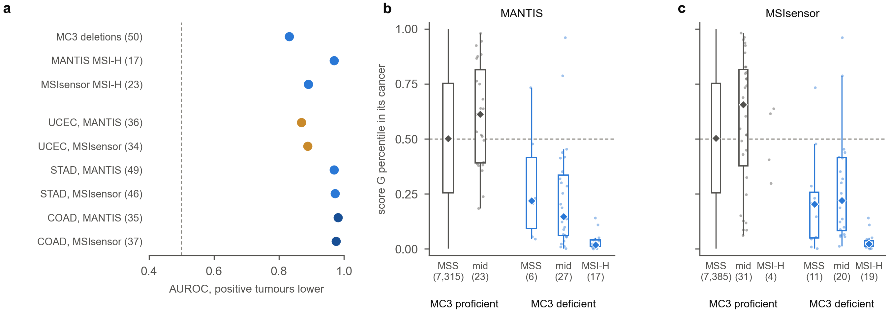

**Supplementary Figure 18. The code finds the tumours that two exome MSI callers call MSI-high.**
(a) AUROC of score G against the MC3 call and against MANTIS and MSIsensor MSI-high calls, held out,
then in-sample in the three training cancers. (b, c) Score G percentile of the held-out tumours by
MC3 call (grey, proficient; blue, deficient) and by each caller's call (mid, between its two
cut-offs).

<sub>Figure file U21: [caption with every statistic](results/figures/subtype/U21_msi_code_msi_calls.caption.md) · [plotted values](results/figures/subtype/U21_msi_code_msi_calls.csv)</sub>


**Supplementary Figure 19. The model agrees with the exome measures on its confident calls; its own
extra calls are borderline.** Calls: the model, decision function above 0 with each cancer left out
of training; MC3, ≥ 10 homopolymer deletions; MANTIS > 0.6; MSIsensor > 10; tumours with both caller
scores. (a) Tumours called MSI by each combination of the four (dots below; bars coloured by
agreement). (b) Calls per cancer by agreement, for cancers with three or more. (c–e) The model's
score against each exome measure; dashed lines, calling thresholds; red, model only; black, exome
only; rings, three model-only tumours examined individually.

<sub>Figure file U25: [caption with every statistic](results/figures/subtype/U25_msi_model_vs_callers.caption.md) · [plotted values](results/figures/subtype/U25_msi_model_vs_callers.csv)</sub>

---

## Part 5. Connections across the tasks

*Full write-up: [results/ACROSS_TASKS.md](results/ACROSS_TASKS.md) · methods:
[docs/ACROSS_TASKS_METHODS.md](docs/ACROSS_TASKS_METHODS.md) (D-48 to D-51).*

The three tasks were modelled separately on overlapping patients. Their models can therefore be
compared without refitting anything, using only out-of-fold predictions and held-out SHAP values. The
predictions, their sources and a list of what had already been seen were committed before anything
was computed.

**The tasks' models read overlapping genes.** For every subtype cohort, its subtype model, its
cancer's status model and the type model's explanation of that cancer share top genes 5–8 times more
often than chance (Figure 35). Almost all of the genes common to all three come from splicing views.
Most are smooth-muscle and stromal switches (TPM1, CHN1, ACTN1) that track tissue composition, which
varies in every task's samples.


**Figure 35. The three tasks' models read overlapping genes, several-fold more than chance.** For
each subtype cohort, the top 100 genes per view of three models: the subtype model, its cancer's
tumour-status model and the cancer-type model's importance over that cancer's samples. (a) Overlap
of each pair of tasks against chance, one dot per cohort and view; bar, median. (b) The five
histology cohorts with a status model: Jaccard overlap of the subtype list with the status list and
with the type list.

<sub>Figure file X1: [caption with every statistic](results/figures/across_tasks/X1_gene_overlap.caption.md) · [plotted values](results/figures/across_tasks/X1_gene_overlap.csv)</sub>

**Subtypes resemble the cancers the literature predicts.** The pan-cancer type model never saw a
subtype label, yet where it spread probability beyond a tumour's own project, it did so as 12 of 13
pre-specified predictions said (Figure 36):
- squamous oesophageal and cervical tumours leaned towards head-and-neck and lung squamous carcinoma;
- oesophageal adenocarcinoma leaned towards stomach;
- IDH-wildtype lower-grade glioma leaned towards glioblastoma;
- HPV-positive head-and-neck cancer leaned towards cervix (AUROC 0.92).

The tumour-status models, likewise, saw the six predicted subtypes as less tumour-like, among them
normal-like breast cancer, follicular-variant thyroid cancer, diffuse gastric cancer and lobular breast
cancer (Figure 37). That held for all six in the splicing models but for only two in expression,
whose probabilities sit at the ceiling. Stromal and immune content did not explain it.


**Figure 36. In the cancer-type model, subtypes resemble the cancers the literature predicts.**
Thirteen pre-specified predictions, one per row: a subtype, the projects it should resemble (→) and
its comparison group. (a) Mean summed out-of-fold probability of the target projects in each group,
GEX + AS fused (log scale). (b) AUROC per model, higher-probability group against lower; filled,
Benjamini–Hochberg q < 0.05 within the model.

<sub>Figure file X2: [caption with every statistic](results/figures/across_tasks/X2_type_probability_by_subtype.caption.md) · [plotted values](results/figures/across_tasks/X2_type_probability_by_subtype.csv)</sub>


**Figure 37. The splicing status models see the six predicted subtypes as less tumour-like.** Six
pre-specified predictions, one per row: the subtype expected to look less tumour-like against its
comparison. (a) Mean 1 − P(tumour) in the predicted group (filled) and the comparison (open), for
GEX and the AS ensemble (log scale). (b) AUROC per model; filled, q < 0.05 within the model. (c)
Spearman ρ of P(tumour) with the stromal and the immune score over each cancer's tumours.

<sub>Figure file X3: [caption with every statistic](results/figures/across_tasks/X3_status_probability_by_subtype.caption.md) · [plotted values](results/figures/across_tasks/X3_status_probability_by_subtype.csv)</sub>

**The same kind of exon in every task.** Whatever separates tumour from normal, tissue from tissue or
subtype from subtype, the splicing models reached for the same kind of cassette exon (Figure 38).
These exons more often keep the reading frame (49% of subtype exons against 41% of all measured), less
often fall in a folded domain (39% against 51%) and more often in a disordered region (18% against
14%). Such exons rewire interaction segments rather than break folded domains.


**Figure 38. The subtype models' cassette exons share the protein character of the other two tasks'
exons.** Cassette exons in the top 100 of any tumour-status model (blue), any cancer-type class
(dark blue) or any subtype cohort's SE model (amber), against 6,000 random measured exons (grey):
the share whose length is divisible by 3, and the shares in a Pfam/CDD domain, a disordered region
and a transmembrane helix. Fisher exact tests against all measured exons.

<sub>Figure file X4: [caption with every statistic](results/figures/across_tasks/X4_exon_protein_character.caption.md) · [plotted values](results/figures/across_tasks/X4_exon_protein_character.csv)</sub>

---

## Methods in brief

```
9,729 TCGA samples ─► 5 outer folds (grouped by patient, stratified by label)
                         │
                         ├─ outer-train ─► 3 inner folds ─► Optuna (30 / 20 trials)
                         │                   preprocessing fitted on inner-train only:
                         │                   missingness filter → rank (variance | ANOVA) → top K
                         │                   → median-impute → standardise → MLP
                         │                 best config refitted on outer-train
                         │
                         └─ outer-test ──► predictions (pooled → metrics + bootstrap CIs)
                                           SHAP DeepExplainer on every held-out sample
```

- **No leakage.** Every statistic, from feature filtering to the number of epochs, is fitted on
  training rows only. A patient's tumour and normal samples always share a fold, and
  hyper-parameters never see the outer-test fold
  ([docs/LEAKAGE_POLICY.md](docs/LEAKAGE_POLICY.md)).
- **Same samples, every view.** Splits depend only on the cohort, so views are compared on
  identical folds.
- **SHAP by construction.** The MLP uses only layers that `shap.DeepExplainer` handles exactly, and
  additivity is asserted for every explained sample.
- **Pre-registration.** Main-model choices are recorded in [docs/DECISIONS.md](docs/DECISIONS.md)
  (D-01 to D-12). Every later analysis was committed to [config/followup.yaml](config/followup.yaml)
  with its predictions before it was run. Decisions and amendments are explained in three files:
  - [docs/BIOLOGY_METHODS.md](docs/BIOLOGY_METHODS.md), D-13 to D-29;
  - [docs/SUBTYPE_METHODS.md](docs/SUBTYPE_METHODS.md), D-30 to D-47 and D-52 to D-77;
  - [docs/ACROSS_TASKS_METHODS.md](docs/ACROSS_TASKS_METHODS.md), D-48 to D-51.
- **Individual-level data stay local.** Per-sample predictions, SHAP arrays and per-tumour figure
  points are written to the git-ignored `data.nosync/`; only aggregates are committed (D-12).
- **Figures** follow [docs/FIGURE_GUIDELINES.md](docs/FIGURE_GUIDELINES.md). Each comes as SVG, PDF
  and PNG, with a CSV of its plotted values and a caption file holding every statistic.

## Using the repository

### Outputs of a model

For each job, `results/<task>/<view>/<cohort>/` contains:

| File | Content |
|---|---|
| `metrics.json` | pooled out-of-fold metrics, 95% case-bootstrap CIs, per-fold mean ± SD, config, git commit |
| `folds.csv` | per outer fold: tuned hyper-parameters, number of features, inner loss, refit epochs, test metrics, SHAP additivity error |
| `shap_top_features.csv` | top 200 features by mean \|SHAP\|: `label` (gene and variable segment), `n_folds_selected` (0–5), `direction_spearman` |
| `shap_top_genes.csv` | importance summed per host gene |
| `shap_top_features_by_class.csv` | *cancer type only*: top 30 features for each of the 34 classes, with per-class direction |
| `per_class_metrics.csv`, `confusion_matrix.csv` | *cancer type only* |

`direction_spearman` > 0 means that a higher PSI, usage, HIT index or expression pushes a sample
towards tumour (tumour status) or raises the evidence for the class (cancer type). SHAP values are in
logit units: the log-odds of tumour for task 1, and the centred logit of the sample's true class for
task 2 ([docs/METHODS.md](docs/METHODS.md)). Full tables, intervals and the top SHAP features of every
cohort and view are in [results/RESULTS.md](results/RESULTS.md).

### Repository layout

```
config/       study.yaml (rules and search space), sources.yaml (raw data paths), biology.yaml,
              subtype.yaml (label maps, fixed before any fit), followup.yaml (every later prediction),
              local.env.example (template for this machine's paths; the copy is git-ignored)
src/ctsm/     library: cohort, splits, extraction, preprocessing, model, pipeline, metrics, SHAP,
              biology helpers, subtype labels, figure style
scripts/      00–06    data, models and summaries (05 runs all jobs)
              07–25    interpretation of tumour status and cancer type; 20/21 draw S1–S10, T1–T9
              30–38    subtype task; 36 draws U1–U28
              40–41    across tasks (X1–X4)
              42–57    MSI study (repeats, code, rising arm, models, benchmarks); 53 draws M1
              60       MSI study: size of the shifts in PSI units (D-75)
              61       MSI study: what including a rising-arm exon does to its transcript (D-76)
              62–63    MSI study: step-wise test of the rising arm in junction reads (D-77); 63 draws RP0–RP8, RPM
              46–49    breast cancer with DNA
              58–59    overview figure (O1) and this README
              run_pipeline.sh
tests/        unit tests (leakage guards, encodings, preprocessing, SHAP additivity, analysis helpers)
docs/         METHODS, DECISIONS, LEAKAGE_POLICY, BIOLOGY_METHODS, SUBTYPE_METHODS, ACROSS_TASKS_METHODS,
              MSI_REPEATS_LITERATURE, FIGURE_GUIDELINES, readme/README.template.md
manuscript/   MSI_SPLICING_CODE.md (journal-style account of Part 4)
results/      per-task model outputs, summary/, biology/, subtype/, across_tasks/ (tables)
              figures/{overview,cancer_type,tumour_status,subtype,rising_proof,manuscript,across_tasks}/
              CANCER_TYPE.md, TUMOUR_STATUS.md, SUBTYPE.md, MSI_RISING_ARM_PROOF.md, ACROSS_TASKS.md,
              RESULTS.md
```

### Reproducing

```bash
conda env create -f environment.yml
```

```bash
cp config/local.env.example config/local.env
```

```bash
bash scripts/run_pipeline.sh
```

```bash
OMP_NUM_THREADS=1 python scripts/04_run_job.py tumor_status se BRCA
```

```bash
python scripts/59_build_readme.py
```

- **Commands.** The second creates this machine's settings file, whose paths you then edit. The
  third runs everything end to end, the fourth a single job, and the fifth rebuilds this page
  from [docs/readme/README.template.md](docs/readme/README.template.md).
- **Raw inputs.** `config/sources.yaml` names them through `${CTSM_*}` variables. Their locations
  are set in `config/local.env`, which git ignores, or exported in the shell: TCGA rMATS and
  HITindex tables and STAR counts produced from GDC BAM files, plus GENCODE annotation, the GRCh38
  genome and the TCGA-CDR table. They are not redistributed.
- **Downloaded labels.** Subtype labels, copy number and mutation calls are open-access GDC
  PanCanAtlas files, and the MANTIS and MSIsensor scores come from the public cBioPortal API. All
  are fetched and MD5-checked by `scripts/00b_fetch_gdc_labels.py` and
  `scripts/00c_fetch_msi_scores.py`.
- **Provenance.** The 144 status and type jobs ran on 2026-10-10/11 with the code of commit
  `b249c3c`; their `metrics.json` records `git_commit: null` because they finished before that
  first commit. The 198 subtype jobs ran on 2026-10-12 from a working tree whose subtype code was
  committed afterwards with the results, so their `git_commit` carries `+dirty`.
- **Environment.** Set `OMP_NUM_THREADS` before Python starts. In this environment (torch 2.2.2 with
  conda-forge numpy, macOS), importing numpy before torch with several OpenMP threads segfaults;
  `scripts/_common.py` handles it.

## Figure index

Each README figure and the file it shows. The file's caption (`.caption.md`) carries every statistic,
and the write-ups refer to figures by their file IDs.

| README | File | Title |
|---|---|---|
| Figure 1 | [O1](results/figures/overview/O1_study_design.png) | Nine views of the same RNA-seq samples, and the analyses each cancer enters. |
| Figure 2 | [T1](results/figures/cancer_type/T1_modality_gain.png) | No splicing view matches expression alone, but their ensemble does, and fusing the two beats both. |
| Figure 3 | [T3](results/figures/cancer_type/T3_class_confusions.png) | Expression confuses anatomical neighbours; splicing confuses cell types across organs. |
| Figure 4 | [T6](results/figures/cancer_type/T6_lineage_atlas.png) | Single cassette exons mark single lineages. |
| Figure 5 | [T8](results/figures/cancer_type/T8_class_events.png) | A single splicing event can name a lineage on its own. |
| Figure 6 | [T7](results/figures/cancer_type/T7_site_probe.png) | Only the colon–rectum separation, and part of oesophagus–stomach, depends on the tissue-source site. |
| Supplementary Figure 1 | [fig_cancer_type_recall](results/summary/fig_cancer_type_recall.png) | Each view's recall of each class. |
| Supplementary Figure 2 | [T2](results/figures/cancer_type/T2_recall_by_class.png) | Fusion keeps splicing's gains on the classes expression confuses and repairs most of its losses. |
| Supplementary Figure 3 | [T5](results/figures/cancer_type/T5_not_expression.png) | The splicing signal for cancer type is not a proxy for expression. |
| Supplementary Figure 4 | [T4](results/figures/cancer_type/T4_pathway_coherence.png) | The splicing models' genes form fewer pathways than expression's, and part of what they form is ribosomal-protein splicing. |
| Supplementary Figure 5 | [T9](results/figures/cancer_type/T9_overlap_audit.png) | Many of the cancer-type models' terminal exons read a neighbouring lineage gene. |
| Figure 7 | [S1](results/figures/tumour_status/S1_modality_gain.png) | Expression and splicing err on different samples, so their fusion beats expression alone. |
| Figure 8 | [S2](results/figures/tumour_status/S2_global_shifts.png) | Tumours retain more intronic sequence and move their last exons upstream, relative to their own normal tissue. |
| Figure 9 | [S4](results/figures/tumour_status/S4_regulons.png) | The models' events sit in small, specific splicing-factor programmes, not in the large shared one. |
| Figure 10 | [S5](results/figures/tumour_status/S5_recurrent_events.png) | Different cancers rely on the same events, and those events move the same way across cancers. |
| Figure 11 | [S9](results/figures/tumour_status/S9_event_protein.png) | The most shared events exchange protein segments through mutually exclusive and terminal exons. |
| Figure 12 | [S8](results/figures/tumour_status/S8_survival.png) | The models' events are modestly enriched for survival associations, more so the more models agree. |
| Supplementary Figure 6 | [fig_tumor_status_auroc](results/summary/fig_tumor_status_auroc.png) | Every view separates tumour from normal tissue almost perfectly in most cancers. |
| Supplementary Figure 7 | [S3](results/figures/tumour_status/S3_pathways.png) | Expression models draw on stromal programmes; the splicing models' genes rarely form pathways. |
| Supplementary Figure 8 | [S6](results/figures/tumour_status/S6_exon_consequences.png) | The models' cassette exons keep the reading frame and avoid folded domains. |
| Supplementary Figure 9 | [S7](results/figures/tumour_status/S7_event_portraits.png) | The most shared events shift the typical tumour, and the models read them as markers. |
| Supplementary Figure 10 | [S10](results/figures/tumour_status/S10_overlap_audit.png) | Some of the models' events, terminal exons above all, read a neighbouring gene's expression. |
| Figure 13 | [U1](results/figures/subtype/U1_performance.png) | Splicing matches expression on lineage and genome-state subtypes, and fusing the two adds little. |
| Figure 14 | [U2](results/figures/subtype/U2_recall_by_class.png) | Splicing loses most on small classes defined by one programme. |
| Figure 15 | [U3](results/figures/subtype/U3_histology_errors.png) | Histology models err in the molecular direction. |
| Figure 16 | [U4](results/figures/subtype/U4_literature_markers.png) | The literature's markers are in the data and in the expression models, far less in the splicing models. |
| Figure 17 | [U8](results/figures/subtype/U8_regulators.png) | Named splicing regulators differ between subtypes as predicted in four of six tests. |
| Figure 18 | [U9](results/figures/subtype/U9_site_probe.png) | Part of the splicing models' subtype signal is tied to the site that sent the sample. |
| Figure 19 | [U13](results/figures/subtype/U13_brca_two_her2.png) | Splicing reads HER2 through the HER2-enriched programme, not through the 17q12 amplicon. |
| Figure 20 | [U15](results/figures/subtype/U15_brca_her2_uncapped.png) | Without the ABSOLUTE ceiling, splicing matches expression on ERBB2 amplification but does not beat it. |
| Figure 21 | [U7](results/figures/subtype/U7_msi_events.png) | Ten MSI splicing events replicate across endometrial, gastric and colorectal cancer. |
| Supplementary Figure 11 | [U5](results/figures/subtype/U5_as_vs_gex_genes.png) | The splicing and expression models of a cohort read different genes. |
| Supplementary Figure 12 | [U6](results/figures/subtype/U6_event_audit.png) | Four of the nineteen strongest splicing events read a neighbouring gene. |
| Supplementary Figure 13 | [U14](results/figures/subtype/U14_brca_mutations.png) | Splice-site mutations skip their exons, and SF3B1 hotspot tumours use cryptic acceptors. |
| Supplementary Figure 14 | [U12](results/figures/subtype/U12_brca_germline_check.png) | Most of the BRCA models' genotype-like events are subtype programmes, not inherited alleles. |
| Figure 22 | [M1](results/figures/manuscript/M1_msi_code_model.png) | A two-arm model of how mismatch-repair deficiency moves 3′ splice-site use. |
| Figure 23 | [U10](results/figures/subtype/U10_msi_repeats.png) | Genome sequence alone says which exons MSI tumours skip. |
| Figure 24 | [U11](results/figures/subtype/U11_msi_long_tracts.png) | The longest acceptor repeats move toward inclusion in MSI. |
| Figure 25 | [U17](results/figures/subtype/U17_msi_branchpoint.png) | The predicted branch point's distance from the 3′ splice site goes with the direction of the MSI shift. |
| Figure 26 | [U18](results/figures/subtype/U18_msi_code_pancancer.png) | A two-arm sequence code finds mismatch-repair-deficient tumours in 30 cancers never used to define it. |
| Figure 27 | [U22](results/figures/subtype/U22_msi_code_rising_arm.png) | The rising arm is specific to mismatch repair and needs the tract, but its mechanism is not settled. |
| Figure 28 | [RP0](results/figures/rising_proof/RP0_overview.png) | In junction reads the rising arm rises in held-out cancers, but the claim is only partly supported. |
| Figure 29 | [RP3](results/figures/rising_proof/RP3_branch_point.png) | The rise needs the T-run, a step at 36 nt is not supported, and the link to the branch-point gap is seen in held-out cancers only. |
| Figure 30 | [U23](results/figures/subtype/U23_msi_code_models.png) | Logistic regression on repeat exons, fitted in three cancers, finds MMR deficiency in 30 others. |
| Figure 31 | [U24](results/figures/subtype/U24_msi_callers_benchmark.png) | Within each cancer, the repeat-exon model ranks tumours almost as well as the exome MSI callers. |
| Figure 32 | [U26](results/figures/subtype/U26_msi_splicing_vs_expression.png) | Expression models trained the same way transfer almost as well; splicing adds to them. |
| Figure 33 | [U27](results/figures/subtype/U27_msi_shift_magnitude.png) | A minority of exons move by a tenth of PSI or more; the typical exon moves by a few hundredths. |
| Figure 34 | [U28](results/figures/subtype/U28_msi_rising_consequence.png) | Most of the rising-arm exons that move furthest are poison exons. |
| Supplementary Figure 15 | [U16](results/figures/subtype/U16_msi_deletion_load.png) | Mismatch-repair damage tracks the repeat score in stomach cancer only. |
| Supplementary Figure 16 | [U19](results/figures/subtype/U19_msi_code_specificity.png) | The code is specific to the branch point and to mismatch repair. |
| Supplementary Figure 17 | [U20](results/figures/subtype/U20_msi_code_infiltration.png) | The code is not an infiltration readout. |
| Supplementary Figure 18 | [U21](results/figures/subtype/U21_msi_code_msi_calls.png) | The code finds the tumours that two exome MSI callers call MSI-high. |
| Supplementary Figure 19 | [U25](results/figures/subtype/U25_msi_model_vs_callers.png) | The model agrees with the exome measures on its confident calls; its own extra calls are borderline. |
| Figure 35 | [X1](results/figures/across_tasks/X1_gene_overlap.png) | The three tasks' models read overlapping genes, several-fold more than chance. |
| Figure 36 | [X2](results/figures/across_tasks/X2_type_probability_by_subtype.png) | In the cancer-type model, subtypes resemble the cancers the literature predicts. |
| Figure 37 | [X3](results/figures/across_tasks/X3_status_probability_by_subtype.png) | The splicing status models see the six predicted subtypes as less tumour-like. |
| Figure 38 | [X4](results/figures/across_tasks/X4_exon_protein_character.png) | The subtype models' cassette exons share the protein character of the other two tasks' exons. |

## Related

The same TCGA processing and rules are used by
[cancer-survival-predictions](https://github.com/zachpwakefield/cancer-survival-predictions)
(survival modelling with alternative RNA processing).
