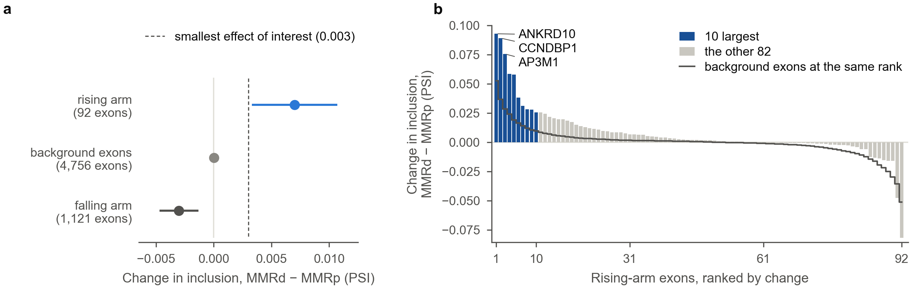

# Mismatch-repair deficiency moves splicing by a two-arm code written in acceptor poly-T tracts

*Working draft, 23 October 2026. Every analysis is in this repository (`scripts/42`–`57`, `60`,
`62`–`63`). Each was pre-specified in [`config/followup.yaml`](../config/followup.yaml) before it
was computed, with decisions D-52 to D-75 and D-77 and amendments A-9 to A-20 and A-22 to A-25 in
[`docs/SUBTYPE_METHODS.md`](../docs/SUBTYPE_METHODS.md). The step-wise test of the rising arm (D-77)
is written up in full in [`results/MSI_RISING_ARM_PROOF.md`](../results/MSI_RISING_ARM_PROOF.md).
Figure files carry fuller legends with every test; this text gives the journal version.*

---

## Abstract

**Background.** Tumours that lose DNA mismatch repair (MMR) accumulate deletions in mononucleotide
repeats, and the intronic poly-T runs that form part of many 3′ splice sites are among those
repeats. Single genes show that shortening such a tract makes the next exon skipped. Whether a
general rule governs which exons move, and in which direction, has not been shown.

**Methods.** We trained splicing-based classifiers of molecular subtypes across The Cancer Genome
Atlas (TCGA) and read which exons the microsatellite-instability (MSI) models relied on. We then
annotated the acceptor of every cassette exon from the reference genome, without labels, and ran
a chain of pre-registered tests: three training cancers (stomach, colon, endometrium), then 30
cancers never used to build the rule.

**Results.**
- **The models found the repeats.** The stomach and colon MSI models relied on exons that follow a
  poly-T run of 10 nt or more at the acceptor: 40 and 34 of their top 50 exons, against about 5%
  of all exons.
- **Two directions.** Runs of 10–19 nt were skipped in MSI tumours. Runs of 20 nt or more were
  *included more*, most clearly where the sequence-predicted branch point lay far from the 3′ splice
  site. We defined the rising class with a branch-point cut at 36 nt; a later test did not support
  that cut as a threshold.
- **The code travels.** A score built from this two-arm rule, with no refitting, found
  MMR-deficient tumours in 30 cancers it had never seen (AUROC 0.83; 0.85 against hypermutated
  tumours whose repair is intact). It was not explained by immune infiltration. It separated
  MSI-high tumours called by two independent exome callers (AUROC 0.97 and 0.89).
- **Many small shifts.** Among exons with a proficient median PSI of 0.1–0.9, the typical
  falling-arm exon moved by 0.02–0.03 in PSI in colon and stomach cancer. Over all exons the median
  shift was 0, because most exons sit at PSI 0 or 1. About one in six
  alternatively spliced R_down exons fell by 0.10 or more in colon and stomach cancer, against 4%
  of exons without a repeat, so each MMR-deficient tumour carried a few dozen such changes. The
  shift did not scale with tumour purity.
- **A model can learn it.** Logistic regression on the inclusion of the 1,562 repeat exons, trained
  in three cancers, reached AUROC 0.90 in the 30 others. Within each cancer it ranked tumours
  almost exactly as the exome MSI callers did (AUROC 0.998–1.000 against their consensus), from
  RNA alone. An expression model trained the same way came close (0.89) but agreed less well with
  the callers, and the two together reached 0.93.
- **The rising arm holds in junction reads; its cause is open.** The rise of long-tract exons held
  out of sample. It was independent of each tumour's overall inclusion level, required the tract,
  and was not seen in hypermutated MMR-proficient tumours. A step-wise test in junction reads gave
  the pre-registered verdict "partial", with 9 of 12 required tests supported. In the held-out
  cancers, rising-arm exons rose by 0.0070 PSI (95% CI 0.0033–0.0107). The ten largest of 92 exons
  carried 81% of the summed rise, and the median exon moved by 0.0019. The rise was rank-associated
  with the gap to an experimentally mapped branch point (partial ρ = 0.44); in the training cancers
  it did not replicate (not resolved), and the 36-nt cut was not supported as a threshold. Links to
  a branch-point-free measure of geometry, to the run lying between branch point and AG, and to
  deletion load were not shown. Relief of PTB repression was not supported (the data ran the other
  way).

**Conclusions.** MMR deficiency moves 3′ splice-site use in both directions by rules written in the
reference genome. That gives an interpretable RNA read-out of MMR deficiency that works across
organs, adds to expression-based detection and, once fitted, ranks tumours within a cancer about
as well as exome-based callers. Why the longest tracts gain inclusion, and what part the branch
point plays, remains to be established experimentally.

---

## Introduction

DNA mismatch repair corrects the insertion–deletion loops that DNA polymerase leaves when it slips
on short tandem repeats. Tumours that lose it, through MLH1 promoter silencing or mutation of an MMR
gene, acquire thousands of repeat-length changes: microsatellite instability (MSI). MSI is
common in colorectal, gastric and endometrial cancer and present at low frequency in many others
(Kim et al. 2013; Hause et al. 2016; Cortes-Ciriano et al. 2017; Bonneville et al. 2017). It
matters clinically because MMR-deficient tumours respond to PD-1 blockade whatever their organ
(Le et al. 2017). Every MSI-high patient is therefore worth finding, including in cancers where
MSI is rare. MSI is usually called from DNA, for instance by MANTIS or MSIsensor from exome reads
(Bonneville et al. 2017; Niu et al. 2014). It can also be called from RNA, from gene expression
(Danaher et al. 2019; Li et al. 2020; Jia et al. 2024) or from repeat lengths in RNA reads (Choi
et al. 2024; Tubacher et al. 2025). Those classifiers were built, and mostly tested, in colorectal,
gastric and endometrial cancer.

Mononucleotide runs are the repeats MMR loss destabilises most, and many sit inside introns. Just
upstream of most 3′ splice sites lies a polypyrimidine tract, bound by U2AF2, between the branch
point and the AG. When MSI shortens a poly-T run there, the splice site can weaken. Two genes made
this concrete:
- **MRE11.** Deletions in a poly(T)11 skip exon 5 and inactivate the protein (Giannini et al. 2002,
  2004), which sensitises cells to PARP inhibition (Vilar et al. 2011).
- **HSP110.** Deletions in a T17 skip exon 9 and make a dominant-negative protein (Dorard et al.
  2011); larger deletions predict a better response to chemotherapy (Collura et al. 2014).

Genome-wide, Jonchère et al. (2024) found hundreds of MSI deletions at U2AF-binding tracts in
colorectal cancer, arising early and explaining part of its exon skipping.

Two questions were left open. First, is there a rule, readable from the reference genome alone,
that says which exons move and in which direction? Second, does such a rule hold beyond the organs
where it was found? We came to these questions indirectly. We had trained per-modality classifiers
of TCGA molecular subtypes, and asked what the splicing models of MSI had learned. The answer led
to a series of tests, each fixed in writing before it was computed. This paper reports that
series, including the tests that failed. Figure 1 summarises the model the tests arrive at.

**Figure 1. A two-arm model of how mismatch-repair deficiency moves 3′ splice-site use.** The
schematic uses illustrative lengths. Each panel shows one acceptor before (MSS) and after (MSI) a
contraction of its T-run (blue bar). The triangle marks the branch-point adenosine, the box the
cassette exon and the bracket the branch-point-to-AG distance. The arrow is the predicted change in
inclusion. (a) Runs of 10–19 nt: contraction weakens the tract and the exon is skipped more. (b)
Runs of 20 nt or more between a distant branch point and the AG: the tract stays long, and the
branch point moves toward the optimal distance, so the exon is included more. Panel (b) is the
hypothesis the code was built on. The rise held in junction reads (verdict partial), but no
branch-point threshold was supported, and the mechanism is unresolved (Figs 11 and 13). (c) A long
run upstream of the branch point: contraction leaves the branch-point-to-AG distance unchanged.
Panels (a) and (b) are the code tested in Figs 4–6 and 11–13; panel (c) is a control in Fig. 6.

---

## Results

### Splicing models of MSI rely on exons that follow acceptor poly-T tracts

Within each of 22 TCGA subtype cohorts we trained multilayer perceptrons, separately for each of
nine RNA views, with nested, patient-grouped cross-validation. We explained them with SHAP (Methods).
Three cohorts carry an MSI class:
- stomach (STAD, 55 MSI of 320);
- colon (COAD, 40 of 235);
- endometrium (UCEC, 34 of 169).

The models separated MSI from the other classes well: the splicing ensemble reached out-of-fold
AUROC 0.99 in STAD and COAD and 0.84 in UCEC.

To ask what these models read, we annotated every cassette exon from GRCh38 alone. For each exon
we took the longest sense-strand T-run overlapping intron positions −1 to −50 before it (Methods).
5% of exons carry a run of 10 nt or more. Among the top 50 exons of each MSI model, 40 carried
such a run in STAD, 34 in COAD and 10 in UCEC (odds ratios 84, 43 and 5; Fig. 2a).

**Figure 2. Genome sequence alone says which exons MSI tumours skip.** (a) Share of exons with an
acceptor T-run of 10 nt or more, among all exons measured and among the top 50 exons of each
cohort's MSI model; Fisher's exact test. (b) Per-patient repeat score: each exon's inclusion as a
percentile within the cohort, averaged over exons with a run of 10 nt or more, minus the average
over matched exons with 5 nt or less. Boxes show the interquartile range, diamonds the median.
Mann–Whitney test. (c) AUROC of the same score built from each run-length bin, and from runs
lying deep in the intron (hollow).

A score built from the genome annotation alone, with no model and no label, ranked MSI tumours
below the rest:
- **By organ.** AUROC 0.71 in STAD and 0.78 in COAD (p ≤ 1.1 × 10⁻⁶), but 0.51 in UCEC
  (Fig. 2b).
- **Only at the acceptor.** Runs deep in the intron (−201 to −400) gave no such separation
  (Fig. 2c).
- **The same exons across organs.** The exon-level shifts of repeat exons correlated between
  cancers (Spearman ρ 0.43–0.65, against 0.19–0.35 for background exons).
- **Positive control.** MRE11 exon 5 was less included in MSI in all three cancers (AUROC 0.63,
  0.81, 0.76).

The signal held within single hospitals (AUROC 0.68 STAD, 0.81 COAD). It also held after
adjustment for stromal and immune expression and the tumour's retained-intron level (D-55).

### Shorter tracts are skipped; the longest are included more

Stratifying by run length showed an unexpected reversal (Fig. 3a):
- **Runs of 10–19 nt** leaned toward skipping in MSI: 38–49% of exons were more included.
- **Runs of 20 nt or more** leaned toward inclusion: 56–67% more included, in all three cancers.

The exons with the largest shared increase carried runs of 21–32 nt (ANXA7, CCNDBP1, TBK1, CDC42EP1
and others). The largest decreases carried 14–21 nt (Fig. 3c).

**Figure 3. The longest acceptor repeats move toward inclusion in MSI.** (a) Share of repeat exons
more included in MSI tumours, by run length; bars show Wilson 95% intervals. (b) Replication on
alternative 3′ splice-site events, where the run lies at one of two competing acceptors. The
plot shows the change in use of the acceptor that carries the run; marker = median, bar =
interquartile range. Wilcoxon signed-rank test. (c) Exons with the largest shared increases (top)
and decreases (bottom) across the three cancers, with MRE11 exon 5. Labels give gene, run length
and exon length.

This reversal was found after the first tests had been read, so we treated it as a hypothesis.
- **hnRNP C did not explain it.** hnRNP C competes with U2AF2 on long U-tracts (Zarnack et al.
  2013). That predicts a reversal that depends on baseline inclusion. It did not (D-53; 0 of 9
  tests supported).
- **Partial replication.** On alternative 3′ splice-site events not read before, the direction
  replicated in 2 of 6 pre-registered tests, and all 6 medians lay in the predicted direction
  (D-54; Fig. 3b).

### The predicted branch point's distance goes with the direction

A long T-run sits between the branch point and the AG, so it also pushes the branch point away
from the 3′ splice site. Step II of splicing works best when the branch point lies 19–23 nt from
the AG (Chua and Reed 2001). We predicted the branch point from sequence: the nearest yUnAy
adenosine upstream of the run, found for 83% of 1,580 repeat exons. We then asked whether its
distance predicts the MSI shift beyond run length (D-63).

It did, in all three cancers. After both variables were adjusted for run-length bins and mean
inclusion, exons with a more distant branch point were more included in MSI (adjusted ρ = 0.16
STAD, 0.11 COAD, 0.11 UCEC; all q = 0.001; Fig. 4).

**Figure 4. The predicted branch point's distance from the 3′ splice site goes with the direction of
the MSI shift.** (a) Distance from the predicted branch point to the AG, by run class; the grey band
is the 19–23 nt optimum (Chua and Reed 2001). (b) Share of repeat exons more included in MSI, by
tertile of that distance within each run class and cancer; Wilson 95% intervals. (c) Spearman
correlation of the MSI shift with branch-point distance after adjustment for run length and mean
inclusion. Hollow markers use the run's far end instead of the branch point.

The relation was specific (D-65; Supplementary Fig. S2):
- **Beyond the run's end.** It held for the gap between the run and the branch point, adjusted for
  where the run ends (ρ = 0.12).
- **Absent without a tract.** It was absent in exons without a tract (ρ ≈ 0).
- **Absent in proficient contrasts.** It was weaker or absent in two MMR-proficient contrasts: POLE
  against the rest in UCEC, and chromosomally unstable against genomically stable tumours in STAD.

Among long runs, inclusion switched on sharply near 30 nt (exploratory, read after the tests). With
the branch point 20–29 nt from the AG, 12% of long-run exons were more included; at 30–39 nt, 73%.
D-77 later tested the 36-nt cut in junction reads, and it was not resolved (Fig. 13); two longer
sensitivity cuts carried no q. Its descriptive junction-read bins change sign between 18–29 nt
(−0.0047) and 30–35 nt (+0.0063); a cut near 30 nt has not been tested.

### A two-arm code finds MMR-deficient tumours in 30 cancers never used to build it

These results define a code (Fig. 1). Runs of 10–19 nt fall in MSI (the falling arm, R_down). Runs
of 20 nt or more whose predicted branch point lies at least 36 nt from the AG rise (the rising arm,
R_up). The 36-nt cut is the first tertile of that distance among runs of 20 nt or more. It was
computed without labels, but chosen after the reversal had been seen in the training cancers. The
cut defines the class; it is not a demonstrated property of the biology, and D-77 did not support it
as a threshold (Fig. 13). Score G subtracts the rising arm from the falling arm, each against
matched exons without a tract. The original score (score A) treated all repeat exons as falling.

We tested the code, without refitting, in the 30 other TCGA cancers (D-66). The DNA truth came from
public exome calls (MC3; Ellrott et al. 2018):
- **MMR-deficient** = 10 or more homopolymer deletions. That cut, fixed in the three training
  cohorts, puts 129 of 129 MSI tumours and 2 of 571 others above it. In the held-out cancers, 50 of
  7,685 tumours qualified.
- **Hypermutated proficient** = fewer deletions but 500 or more single-nucleotide variants (408
  tumours).

**Figure 5. A two-arm sequence code finds mismatch-repair-deficient tumours in 30 cancers never
used to define it.** (a) AUROC for MMR-deficient tumours scoring lower: pooled over the 30
cancers, without the three tissue relatives of the training cancers (READ, ESCA, UCS), against
hypermutated proficient tumours only, and per cancer (cancers with 3 or more MMR-deficient
tumours; counts in brackets). Hollow = score A, filled = score G. (b) Exon shifts in the held-out
cancers against the mean shift in the training cancers; blue = rising-arm exons. (c) Within
MMR-deficient tumours, score G against the number of homopolymer deletions.

Score G found MMR-deficient tumours across the held-out cancers (Fig. 5a):
- **Pooled.** AUROC 0.83, against 0.55 for score A.
- **Organ independence.** 0.81 without the training cancers' tissue relatives.
- **Not mutation burden.** 0.85 against hypermutated proficient tumours.
- **Per cancer.** From 0.65 (prostate) to 0.93 (cervix).
- **Exon by exon.** Shifts replicated the training cancers (ρ = 0.51 over 1,753 repeat exons;
  Fig. 5b), and rising-arm exons rose more than falling-arm exons (AUROC 0.70).
- **Dose.** Within MMR-deficient tumours, score G fell further as deletions rose (partial ρ = −0.47
  given purity; Fig. 5c).
- **Endometrium.** The code also separated endometrial MSI (AUROC 0.84, against 0.51 for score A),
  though this is in-sample for the rule (D-67).

Three checks addressed confounding:
- **Infiltration (D-68; Supplementary Fig. S3).** MSI tumours are heavily infiltrated, but
  adjusting for stromal and immune expression, the retained-intron level and purity kept the whole
  MMR effect. Held out, the coefficient was −0.339 adjusted against −0.335 unadjusted. In the less
  infiltrated half of each cancer, the AUROC was 0.84. The immune score itself marked MMR
  deficiency only weakly (AUROC 0.59).
- **Independent MSI calls (D-69; Supplementary Fig. S4).** Against two exome MSI callers that do
  not use MC3, score G separated MSI-high from stable tumours in the held-out cancers: AUROC 0.97
  for MANTIS (17 MSI-high) and 0.89 for MSIsensor (23).
- **The continuous score.** Score G did not follow the continuous MANTIS score among stable tumours
  (ρ = +0.01). It marks the MSI-high state, not graded instability.

### The rising arm is real, but its mechanism is not settled

The rising arm is the counter-intuitive half of the code, and it carries more of the held-out
signal (AUROC 0.73 for the rising arm alone, 0.61 for the falling arm). We therefore pre-registered
eight further tests of it (D-70; Fig. 6). These tests read percentiles of a PSI that counts
exon-body reads. A later step-wise test re-examined the arm in junction reads (D-77; Fig. 11).

**Figure 6. The rising arm is specific to mismatch repair and needs the tract, but its mechanism is
not settled.** (a) Mean shift of rising-arm exons in 20 against 20 tumours, averaged over 50 draws.
Grey: every pair of subtypes in the 22 cohorts, with MSI, POLE and MMR-deficient tumours removed
(absolute values; dashed line = their 95th percentile). Blue: held-out MMR-deficient tumours, each
paired with a proficient tumour of the same cancer (bar = 95% of draws). Hollow: MSI in the three
training cancers (in-sample). (b) Held-out exon shifts by class:
- falling arm (runs 10–19 nt);
- rising arm;
- background exons whose predicted branch point is also ≥ 36 nt but which have no T-run;
- exons whose long run lies upstream of a branch point.

(c) Exploratory: exons with runs of 20 nt or more, share more included by branch-point distance;
Wilson 95% intervals. (d) Rising-arm score of held-out tumours by DNA class. (e) Rising-arm score
against homopolymer deletions in MMR-deficient (blue) and training-cohort MSI tumours (grey).

**What held.**
- **Held out.** 98 of 135 rising-arm exons were more included in held-out MMR-deficient tumours
  (median +2.8 percentile points; Fig. 6b).
- **Not a tumour-wide shift (RV2).** Adjusting for each tumour's average inclusion, stromal and
  immune expression and the retained-intron level left the MMR effect unchanged (+0.236 against
  +0.237). Adding PTBP1, HNRNPC, U2AF2 and MKI67 expression did not reduce it either (+0.248;
  exploratory).
- **It needs the tract (RV3).** Background exons whose predicted branch point is also ≥ 36 nt but
  which have no T-run did not move (median −0.04 points; AUROC 0.69 for the difference).
- **Mismatch repair, not burden (RV7).** Hypermutated proficient tumours did not show it (AUROC 0.74
  against them; Fig. 6d). Neither did tumours called MSI-high by MANTIS alone (AUROC 0.87;
  exploratory).

**What did not hold.**
- **Not unique to MSI (RV1, not resolved).** The held-out rise (+3.5 points) exceeded 55 of 57
  other subtype contrasts, but not all of them (Fig. 6a). Two sarcoma contrasts moved the same
  exons as much: leiomyosarcoma against myxofibrosarcoma (+4.2) and against undifferentiated
  pleomorphic sarcoma (+3.6).
- **Branch-point-free geometry (RV4).** The AG exclusion zone bounds where a branch point can lie
  without any branch-point model (Gooding et al. 2006). A link to the rise was not shown (ρ = −0.04,
  not resolved), and it was itself uncorrelated with our predicted branch point.
- **Side of the branch point (RV5).** A long run that lies upstream of a branch point cannot move
  the branch point when it contracts. Such exons rose in 26 of 42 cases, not significantly
  different from the rising arm.
- **Dose (RV6).** Within MMR-deficient tumours a rise with deletion count was not shown (ρ = +0.08;
  Fig. 6e). Score G's dose relation comes from the falling arm.
- **PTB relief (RV8, against).** Long tracts with distant branch points are the textbook
  PTB-repressed exons (Gooding et al. 2006; Llorian et al. 2010). If contraction relieved PTB, the
  most repressed exons should rise most. The opposite held (ρ = +0.20).

**What the predicted branch point goes with (exploratory, A-16).** Among long runs in the held-out
cancers, branch-point distance split the direction sharply (Fig. 6c):
- **Within 30 nt of the AG:** 5 of 25 exons were more included.
- **From 30 nt on:** 60–84% were, in every bin.

This repeats the switch first seen in the training cancers (12% against 73%) in tumours never used
to find it. The rise also grew with run length (ρ = 0.23). It grew with exon length within the
rising arm (ρ = 0.20), which matters for the caveat on exon-body reads below. D-77 later tested
the branch point in junction reads, with experimentally mapped branch points (Fig. 13). The rise
was rank-associated with the gap between the run and the mapped branch point in the held-out
cancers; in the training cancers it did not replicate (not resolved; ρ = 0.07, p = 0.61), and the
36-nt cut was not supported as a threshold.

### A model fitted on the repeat exons transfers, and matches exome callers within a cancer

Score G has no fitted weights. We asked whether a model fitted on the code's exons in the three MSI
cancers would find MMR deficiency in the other 30 (D-71; Fig. 7). The model is L2 logistic
regression on the 1,562 exons with an acceptor run of 10 nt or more. It keeps the sequence prior
but learns one weight per exon. Its penalty was chosen by leaving one training cancer out, so
tuning rewarded transfer rather than fit. It is one of seven models we pre-registered; we report
it alone, a choice made after the results (A-19). The other six are in the repository's tables.

**Figure 7. Logistic regression on repeat exons, fitted in three cancers, finds MMR deficiency in
30 others.** (a) ROC in the 30 held-out cancers, against score G; grey line = chance. (b) Precision
against recall held out; dashed line = prevalence (0.65%). (c) AUROC per held-out cancer with
three or more MMR-deficient tumours (in brackets). (d) The 20 largest standardised coefficients,
labelled by gene, acceptor T-run length and branch-point distance. Dark: runs of 10–19 nt. Light
blue: runs of 20 nt or more with a near or no branch point. Blue: runs of 20 nt or more with the
branch point 36 nt or more away.

**Performance.**
- **Held out.** AUROC 0.900 (95% CI 0.864–0.936) against 0.832 for score G (Fig. 7a), and AUPRC
  0.439 against 0.083 (Fig. 7b). Its ten highest-scoring held-out tumours were all MMR-deficient.
- **Per cancer.** It improved on score G in five of six cancers with enough positives (Fig. 7c).
- **MANTIS labels.** Against MANTIS MSI-H calls it reached 0.9997.
- **Leaving each cancer out** of a model trained on the other 32, it reached 0.914 on the same 30
  cancers and 0.967 over all 33.
- **The pre-registered test.** We had predicted that per-exon weights would learn the training
  tissues and transfer worse than weights on ten sequence bins. They did not (+0.032 AUROC; not
  resolved).

**It learned the code** (Fig. 7d).
- **Positive weights.** The largest went to long runs with a far branch point (CCNDBP1, a 30-nt run
  with the branch point 40 nt away) or with none found.
- **Negative weights.** Most of the largest went to runs of 10–19 nt.
- **The arms carry it (exploratory).** Fitted only on the two arms' exons, the model reached 0.888.
  Fitted on the 107 repeat exons outside them, only 0.776.

**Against exome MSI callers (D-72; Fig. 8).** MANTIS and MSIsensor read microsatellites in the
exome, as does the MC3 deletion count that defines our label. None of the three is a gold
standard.
- **Design.** Each exome measure was judged against the tumours on which the other two agree, and
  the model against the same tumours.
- **Metric.** Within-cancer AUROC, which ranks each positive only against negatives of its own
  cancer.
- **Split.** Every tumour was scored by a model that had not seen its cancer, which covers colon,
  stomach and endometrium too.
- **What was pre-registered.** The tests were specified for the all-exon model. The repeat-exon
  model's comparisons are exploratory (A-19).

**Figure 8. Within each cancer, the repeat-exon model ranks tumours almost as well as the exome MSI
callers.** (a) Within-cancer AUROC of each exome measure judged by the other two, and of the model
on the same tumours: filled, each cancer left out of training; hollow, the 30 cancers held out from
a model trained on COAD, STAD and UCEC. Bars = 95% bootstrap intervals. (b) Per cancer with three
or more positives (MANTIS judged by MC3 and MSIsensor; positives in brackets). (c) Sensitivity
(filled) and PPV (hollow) when the model flags as many tumours as the caller calls MSI, pooled over
cancers. (d) Tumours with 10 or more MC3 deletions, by the callers' calls: share in the top decile
of the model's score within their cancer; dashed line = chance.

- **The exome measures agreed almost perfectly** with each other (within-cancer AUROC 0.999–1.000).
- **The model reached 0.998 against every reference** when each cancer was left out, 0.0014–0.0023
  below the exome measure. On the 30 held-out cancers it reached 1.000. Per cancer it reached
  0.999–1.000 in colon, stomach and breast, and 0.989 in endometrium (Fig. 8b).
- **It was not calibrated across cancers** (Fig. 8c). Flagging as many tumours as a caller calls
  MSI, pooled over cancers, it found 82–84% of the reference positives, against 94–100% for the
  callers. Its inputs are percentiles within a cancer, so a threshold has to be set per cancer.
- **Where the DNA measures disagreed** (Fig. 8d), it still placed 40% of the 50 tumours that MC3
  calls deficient but neither caller calls MSI in its top decile, against 9% of proficient tumours.
- **The pre-registered all-exon model** behaved the same way: 0.001–0.002 below MANTIS and
  MSIsensor (q ≤ 0.013), no different from the MC3 count, non-inferior at a margin of 0.05 set in
  advance.

**Where they disagree (D-73; Supplementary Fig. S5).** At its own threshold, the model called 168
tumours MSI when each cancer was left out of training.
- **Confirmed.** 115 were called by all three exome measures.
- **Model only.** 32 were called by none. They sat just above the model's threshold and were
  scattered over 18 cancers where MSI is rare. Against tumours of the same cancer that no measure
  called, their MLH1 and other MMR-gene expression was not detectably lower, and their MANTIS scores
  and deletion counts were not detectably higher. Only their MSIsensor scores were slightly higher
  (AUROC 0.65, q = 0.019), and these were far below its stable cut. Most are therefore false
  calls, though a stomach tumour one deletion short of the MC3 cut and a hypermutated pancreatic
  tumour with MMR-gene and POLE mutations may be real.
- **Missed by the model.** Of the tumours all three exome measures called, the model missed 20; 19
  were endometrial. MSI endometrial cancers shift their repeats less than colorectal ones (Wang et
  al. 2017; Wu et al. 2019; Chung et al. 2023), which would leave less for splicing to read.

### Expression models trained the same way transfer almost as well; the two read-outs add up

Expression-based MSI classifiers already exist. Is transfer to other organs special to splicing?
We trained expression models exactly as the splicing model: same tumours, label, split and tuning
(D-74; Fig. 9). We had predicted that splicing would transfer better, because expression models
learn how deficiency looks in their training cancers, mostly MLH1 promoter silencing, whereas the
code reads its consequence.

**Figure 9. Expression models trained the same way transfer almost as well; splicing adds to
them.** All models were trained on COAD, STAD and UCEC and tested on the 30 other cancers. (a)
Held-out AUROC and (b) AUPRC; bars = 95% bootstrap intervals; dashed line = the splicing model.
(c) AUROC for held-out MMR-deficient tumours with MLH1 in the bottom tenth of their cancer
(filled) or not (hollow), each against all proficient tumours. (d) Each held-out MMR-deficient
tumour's rank within its cancer under splicing and under expression (fraction of the cancer at or
above it; log axes); grey line = equality. (e) Leaving each cancer out of training, within-cancer
AUROC against the tumours on which two exome measures agree.

- **Retrained expression models came close.** On all 23,640 genes, logistic regression reached
  0.893 on log CPM and 0.866 on within-cancer percentiles, against 0.900 for splicing (differences
  +0.008 and +0.034, not resolved). Their largest weights went to MLH1, its promoter partner
  EPM2AIP1, and five genes of the PreMSIm panel.
- **Small fixed panels did not transfer.** PreMSIm's 15 genes reached 0.785 refitted and 0.702 with
  PreMSIm's own nearest-neighbour recipe; MLH1 alone, 0.758. Splicing beat the refitted panel and
  MLH1 (q = 0.001 for each).
- **The cause of deficiency mattered less than we predicted.** MLH1 was silenced in 28 of the 50
  held-out MMR-deficient tumours. In the other 22, splicing and expression did equally well (0.854
  and 0.849; not resolved), while MLH1 alone fell to chance.
- **The two read-outs are complementary.** They ranked the deficient tumours differently (Spearman
  ρ = 0.36; Fig. 9d). Together they reached 0.926 (+0.060 over expression, q = 0.001) and an AUPRC
  of 0.53. At half recall, precision was 0.68, against 0.30 for splicing and 0.39 for expression.
- **Splicing agreed more closely with the exome callers within a cancer** (exploratory; Fig. 9e).
  Its within-cancer AUROC against their consensus was 0.998; expression's was 0.975–0.979.
  Against MANTIS MSI-H calls in the held-out cancers, it reached 1.000 against 0.969.

### The typical exon moves by a few hundredths of PSI; a minority by a tenth or more

All results so far were percentiles within a cancer, which rank tumours but do not say how far an
exon moves. We measured the shifts in PSI units (D-75; Fig. 10). We restricted the size estimates to
exons whose median PSI in proficient tumours lies between 0.1 and 0.9, where a shift is not capped
by 0 or 1 (A-20).

**Figure 10. A minority of exons move by a tenth of PSI or more; the typical exon moves by a few
hundredths.** MMR-deficient against proficient tumours of the same cancer; (a), (b) and (e) use exons
whose proficient median PSI lies between 0.1 and 0.9. (a) Share of exons whose shift lies below x
(left) or above x (right), three training cancers pooled; log scale. (b) Share of exons dropping (▼)
or rising (▲) by at least 0.10, by acceptor T-run length; filled = training, hollow = held-out
cancers; bars = 95% Wilson intervals. (c) PSI of four exons in proficient (grey) and MMR-deficient
tumours (line); dashed = medians. (d) Per tumour, the R_down exons down and the R_up exons up by at
least 0.10, minus the cancer's median proficient tumour; boxes = quartiles, whiskers = 5th–95th
percentiles. (e) Density of MMR-deficient tumours' percentiles among proficient tumours; 1 = no
difference. (f) Mean arm shift by purity fifth; filled = MMR-deficient, hollow = proficient; bars =
95% bootstrap intervals.

- **The typical repeat exon moves a little.** Among exons with a proficient median PSI of 0.1–0.9,
  the median R_down exon fell by 0.021, 0.028 and 0.015 PSI in colon, stomach and endometrial
  cancer, and by 0.0055 in the held-out cancers. Over all exons the median shift was 0 in every
  class, because most exons sit at PSI 0 or 1. MMR status explained a median 0.4–0.5% of an R_down
  exon's PSI variance.
- **A minority move a lot.** In colon and stomach cancer 18% and 16% of R_down exons fell by at least
  0.10, against 3.8% and 3.6% of background exons (UCEC 9.4% against 4.0%; held out 5.5% against
  1.6%). The share rose with tract length, from 10% at 10–11 nt to 24% at 16–19 nt (Fig. 10b). The
  largest shifts reached 0.2–0.4: METTL8's T14 exon fell from a median of 0.58 to 0.22, BOD1L1's
  T24 exon rose from 0.13 to 0.43 (Fig. 10c).
- **A few dozen exons per tumour.** An MMR-deficient colon or stomach tumour had 35 and 32 more
  R_down exons down by at least 0.10 than the median proficient tumour of its cancer, and 7 and 5
  more R_up exons up by 0.10 (Fig. 10d).
- **The shift did not track purity.** If the change arises in tumour cells, normal cells should
  dilute it. Among MMR-deficient tumours, the R_down arm did not grow with purity: the trend had
  the predicted sign but was not resolved (ρ = −0.15, q = 0.12), and the mean stayed at −0.006 to
  −0.007 PSI across purity fifths (Fig. 10f).
- **The change is graded, not confined to a few tumours.** MMR-deficient tumours fell below the
  lowest 5% of the proficient range at 2.1 times the expected rate for R_down exons, against 1.1
  for background exons, and leaned low across the whole lower half (Fig. 10e).

### A step-wise test in junction reads: the rising arm is partly confirmed

The rising arm rested on three choices that the tests above could not check (D-77):
- **The read-out.** It was first seen in percentiles of a PSI that counts exon-body reads as
  inclusion.
- **The branch point.** It came from a sequence heuristic.
- **The cuts.** The 20-nt and 36-nt cuts were set on the three training cancers after the reversal
  was seen.

We therefore tested the claim again in eight steps, each able to fail. All were fixed in writing
before any junction-read value was compared by MMR status (Fig. 11).
- **Data.** The 30 held-out cancers: 7,685 tumours, 50 of them MMR-deficient, in 16 cancers. These
  tumours are not new; D-70 read them in percentiles. Junction reads only, in PSI units.
- **Exon shift.** Each tumour's PSI was taken against its cancer's median and adjusted by its own
  shift over background exons of the same baseline. An exon's delta is the mean in MMR-deficient
  tumours minus the proficient mean of the same cancer.
- **Inference.** Class means used a studentized permutation of MMR labels within cancer. Class
  contrasts also permuted exon labels within strata, and took the larger of the two p-values. The
  smallest effect of interest was 0.003 PSI. The claim needed all 12 tests of family RP to be
  established.
- **Process.** The pipeline was first run on shuffled labels, and four amendments were made then
  (A-22 to A-25). The real labels were run once. A reviewer checked the pre-specification and the
  implementation, and recomputed the key tests from the raw arrays after the run.

Figure 11 gives the eight steps and their answers. Figures 12 and 13 show steps 2 and 3. The
figures of the other steps are in `results/MSI_RISING_ARM_PROOF.md` (Figures RP1 and RP4–RP8, and
RPM for the mechanism).

**Figure 11. In junction reads the rising arm rises in held-out cancers, but the claim is only
partly supported.** The eight pre-registered steps of D-77, read left to right and top to bottom.
Each box gives the step's question and a plain answer. Filled marker = every test of the step
supported (predicted sign and Benjamini–Hochberg q < 0.05 within its family); half = some
supported; hollow = none resolved. The dashed box holds the mechanism tests, which sit outside the
verdict. The last box gives the claim's verdict by the pre-registered rule. Held-out cancers (50
MMR-deficient tumours in 16 of 30), junction reads only. Each step's own figure and all 40 tests,
with effects, p and q, are in the repository's write-up of D-77.

**What held** (9 of the 12 required tests supported).
- **The rise.** Rising-arm exons rose by 0.0070 PSI (95% CI 0.0033–0.0107) in held-out
  MMR-deficient tumours (Fig. 12a). The whole interval lies above the smallest effect of interest.
  The falling arm fell (−0.0030).
- **But unevenly.** The ten largest of 92 exons held 81% of the summed rise, and the median exon
  moved by 0.0019 (Fig. 12b). Without the ten, the mean of the other 82 was 0.0015.
- **It needs the tract.** Background exons whose predicted branch point is also ≥ 36 nt from the AG,
  without a T-run, rose less (difference 0.0074; Fig. 13a).
- **It is not any long tract.** The rise exceeded that of long pyrimidine tracts, T-runs deep in the
  intron and Alu acceptors without a run (differences 0.0089, 0.0081 and 0.0066).
- **Confounders.** It survived exon covariates (coefficient 0.0084) and tumour covariates, including
  purity and the tumour's overall inclusion level (0.0082).
- **Mismatch repair, not burden.** The arm separated MMR-deficient from hypermutated proficient
  tumours (AUROC 0.72). It was also higher in tumours called MSI-high by MANTIS than in stable
  tumours (difference 0.015).
- **The mapped branch point.** In 52 long-run exons with an experimentally mapped branch point, the
  rise was rank-associated with the gap between the run and that branch point, at fixed run length
  and offset (partial ρ = 0.44, p = 0.004; Fig. 13c).
- **Within patients.** MMR-deficient tumours rose above their own normal tissue more than proficient
  ones did (0.019). But 10 of the 12 deficient pairs are in the training cancers, so this is
  supporting evidence, not a held-out test.

**Figure 12. The rising arm rises in held-out junction reads, and a few of its exons carry most of
the rise.** Held-out cancers, junction reads only. Change in inclusion = an exon's mean adjusted PSI
in MMR-deficient (MMRd) tumours minus the MMR-proficient (MMRp) mean of the same cancer. (a) Mean
change of the rising arm (acceptor T-run of 20 nt or more, predicted branch point 36 nt or more from
the AG; 92 exons), of background exons without a tract (4,756) and of the falling arm (T-run of
10–19 nt; 1,121 exons), with 95% intervals. Dashed line = smallest effect of interest (0.003). (b)
The 92 rising-arm exons ranked by their change. Dark bars = the ten largest, which hold 81% of the
summed change; line = background exons at the same rank. The three largest are labelled with their
gene.

**What was not shown.**
- **Other runs as controls.** Poly-A runs and T-runs after the donor were not resolvably different
  from the rising arm (p = 0.25 and 0.088). Both tests were underpowered.
- **Uniqueness to MSI.** Four of 57 other subtype contrasts moved the arm more than MMR deficiency
  did, three of them involving leiomyosarcoma.
- **The gap, outside the held-out set.** The gap association did not replicate in the training
  cancers (partial ρ = 0.07, p = 0.61; Fig. 13c).
- **A threshold at 36 nt.** The bin means show no step at 36 nt, but change sign between 18–29 and
  30–35 nt (Fig. 13b; descriptive). Neither 36-nt test was resolved: against long runs with a near
  heuristic branch point, 0.0052 (p = 0.16); mapped branch point at least 36 against under 36 nt,
  0.0012 (p = 0.85). The pre-specified sensitivity cuts at 50 nt or more and above 60 nt gave 0.0068
  (p = 0.091) and 0.0077 (p = 0.026), uncorrected. For mapped branch points, the distance to the AG
  is the run's offset plus its length plus the gap, minus 1. A cut on distance therefore mixes run
  length and position with the gap.
- **Agreement of the two branch points.** Within the rising arm the heuristic and mapped distances
  are not rank-correlated (Spearman ρ = −0.12, 65 exons; the heuristic distances are all ≥ 36 nt,
  which limits ρ). Of the 63 exons whose mapped branch point lies upstream of the run, 45 have it ≥
  36 nt from the AG and 18 under 36 nt.
- **Dose.** None of the three dose tests was resolved: MANTIS score, deletion count and run length.
- **Mechanism.** The tests that set branch-point geometry against a run-binding repressor were not
  resolved.
- **A role in the fitted model.** Removing M4's 119 rising-arm inputs changed its held-out AUROC by
  +0.0001 (interval −0.015 to +0.015): no loss was detected.

**Figure 13. The rise needs the T-run, a step at 36 nt is not supported, and the link to the
branch-point gap is seen in held-out cancers only.** Junction reads only; change in inclusion as in
Fig. 12. (a) Held-out cancers: mean change with its 95% interval for the rising arm and for
background exons whose predicted branch point is also ≥ 36 nt from the AG, without a T-run. Dashed
line = smallest effect of interest. (b) Held-out cancers: the 139 exons with an acceptor T-run of 20
nt or more and a predicted branch point, by that branch point's distance from the AG (the bins of
D-70's exploratory check). Dots = exons, bars = bin means, dashed line = the rule's 36-nt cut.
Descriptive. (c) Exons with an acceptor T-run of 20 nt or more and an experimentally mapped branch
point (BPHunter): rank of the change against rank of the gap between the run and that branch point,
each with run length and offset regressed out, in the held-out cancers (52 exons; partial ρ = 0.44)
and the training cancers (62 exons; 0.07). Line = least squares. Descriptive; the tests are given in
the text.

**What these data cannot show.** That the tract at each locus is shortened in the tumour, and that
this causes the rise. That needs the tumour's DNA at each tract (D-56). Everything here is an
association. Three required tests were not resolved, so the pre-registered verdict is partial, not
established.

### What the data did not support

Several pre-registered tests failed or could not be run:
- **Dose by organ (D-61; Supplementary Fig. S1).** Deletion dose tracked the original score in
  stomach (ρ = −0.45) but not colon or endometrium. Endometrial MSI tumours carried the *most*
  homopolymer deletions, so deletion load does not explain their weak original score; the two-arm
  code did.
- **NMD (D-62).** No nonsense-mediated decay signature appeared in gene expression for
  frameshifting skipped exons. Two of the twelve exons skipped in all three cancers shift the
  reading frame: MRE11 exon 5 and an exon of GFM1.
- **Germline (D-64).** A germline test could not be run: GTEx v8 splicing QTLs contain no variant
  inside any of the 1,580 runs, because standard call sets do not genotype long homopolymers.
- **Better transfer than expression (D-74; Fig. 9).** We predicted that splicing would transfer to
  new organs better than expression models trained the same way, above all where MLH1 is not
  silenced. Neither difference was resolved (+0.008 and +0.034 overall; +0.005 without MLH1
  silencing).
- **Purity scaling (D-75; Fig. 10f).** We predicted the shift would grow with tumour purity among
  MMR-deficient tumours. It did not (MG1–MG3 not resolved), so purity neither places the change in
  tumour cells nor in the infiltrate. ABSOLUTE purity is least certain in copy-number-quiet
  tumours.
- **Concentration in a subset (D-75).** We predicted that each repeat exon's change would sit in a
  subset of MMR-deficient tumours, beyond what a uniform shift predicts. The pre-specified test went
  the other way (q = 0.001). Its uniform-shift expectation lets values pass 0 and 1 (A-20). Where
  that does not happen, repeat exons exceeded background by only 0.002–0.010.
- **Three of the rising arm's required tests (D-77; Fig. 11).** Poly-A and donor-side controls, and
  uniqueness among subtype contrasts, were not resolved, so the rising arm's verdict is partial. The
  36-nt branch-point cut was not supported either.

---

## Discussion

MMR deficiency shifts splicing at 3′ splice sites by rules that can be read from the reference
genome: tract length, and for the longest tracts a distant predicted branch point, sort exons by
the way they move. The branch-point cut defines the rising class; it is not shown to be a cause.
Read in RNA, these rules find MMR-deficient tumours in organs never used to define them. They do not
mistake hypermutation or immune infiltration for MMR deficiency, and they agree with two DNA-based
MSI callers.

**Relation to prior work.**
- **The falling arm** extends single-gene observations (Giannini et al. 2004; Dorard et al. 2011)
  and the colorectal study of Jonchère et al. (2024). It does so across organs, with exons chosen
  from sequence alone.
- **The rising arm is new.** A systematic search found no report that MSI makes long-tract exons
  more included. Jonchère et al. report mostly exclusion, with larger deletions giving more
  exclusion; inclusion appears only in a supplementary panel, unanalysed. The one MSI-linked
  inclusion effect we found acts in trans: RPL22 frameshifts raise MDM4 exon 6 inclusion
  (Weinstein et al. 2024). In our data the rise held in junction reads in the held-out cancers,
  but a step-wise test returned only a partial verdict, and the rise is carried by a minority of
  exons (Figs 11 and 12).
- **RNA detection of MSI.** Expression classifiers (Danaher et al. 2019; Pačínková and Popovici
  2019; Li et al. 2020; Jia et al. 2024) and callers that read repeat lengths in RNA (Choi et al.
  2024; Tubacher et al. 2025) were built and judged mostly in colon, stomach and endometrium. An
  independent benchmark found the RNA tools outperformed by DNA tools run on the same RNA data
  (Anthony et al. 2024). We found no splicing-based classifier, and no RNA classifier tested across
  many held-out organs against DNA-based calls. Our own comparison tempers the claim, though: an
  expression model retrained the same way transferred almost as well (Fig. 9).
- **Why it matters for detection.** The rising arm explains why a one-sided repeat score failed in
  endometrium and in the 30 held-out cancers: the rising exons cancelled the falling ones. It
  matters for score G; for the fitted model no loss was detected: M4 refitted without its 119
  rising-arm inputs changed its held-out AUROC by +0.0001 (interval −0.015 to +0.015; D-77).

**Why do the longest tracts gain inclusion?** Our first reading was geometry. Contraction shortens
a branch-point-to-AG distance that lies beyond the 19–23 nt optimum (Chua and Reed 2001), and a
long tract stays above the length at which it saturates (Coolidge et al. 1997). Several lines of
evidence fit:
- the predicted branch point's distance goes with the direction beyond run length, in all three
  training cancers and again held out (percentiles);
- in junction reads, the rise was rank-associated with the gap to an experimentally mapped branch
  point in the held-out cancers (partial ρ = 0.44);
- long-run exons with a near branch point (20–29 nt), which contraction would push below the
  optimum, fall rather than rise (exploratory);
- exons with distant branch points are skipped more genome-wide (Corvelo et al. 2010; Taggart et
  al. 2017);
- germline repeat changes that move a branch point change 3′ splice-site use in the predicted
  direction: an expansion that pushes the branch point from 35 to 49 nt silences a NARS2
  pseudoexon (Hamanaka et al. 2023), and a deletion of an Alu poly(T) tail that brings a branch
  point closer activates a PTS pseudoexon (Meili et al. 2009).

But two pre-registered corollaries of geometry were not supported:
- A link to the AG exclusion zone was not shown.
- Long runs upstream of a branch point rose about as often as the rising arm.

The junction-read test (D-77) added cautions:
- the gap association did not replicate in the training cancers (p = 0.61; Fig. 13c);
- no cut on branch-point distance at 36 nt was supported (Fig. 13b);
- within the rising arm the heuristic and mapped distances are not rank-correlated (Spearman ρ =
  −0.12, 65 exons; the heuristic distances are all ≥ 36 nt, which limits ρ);
- its mechanism tests, which set geometry against a run-binding repressor, were not resolved.

The literature also cuts both ways. With 11 or more uridines a tract's position between branch point
and AG stops mattering (Coolidge et al. 1997), and a 26-nt tract allows a branch point over 100 nt
away (Reed 1989). Branch-point spacing failed to explain the CFTR repeat-length effect when it was
tested directly (Hefferon et al. 2004). The leading alternative is loss of a repressor that binds
the run itself. hnRNP C binds U-tracts of 9 U or more and competes with U2AF2; weakening such a
tract raises inclusion (Zarnack et al. 2013), and a germline poly(T) deletion exonizes an F8 Alu
through hnRNP C (Jourdy et al. 2018). Our pre-registered hnRNP C test asked about dependence on
baseline inclusion, and it failed, but it did not exclude hnRNP C. A repressor that binds the run
would explain why no difference by the side of the branch point was detected. PTB relief was not
supported (the data ran the other way). We regard the mechanism of the rising arm as open; the
minigene experiments below would settle it.

**Limitations.**
- **No tumour DNA at the loci.** Contraction at the R_up loci is inferred from the MSI label, not
  observed. The public MC3 calls hold almost no intronic deletions (458 A/T deletions within 50 nt
  of any exon). We have specified a read-out from the exome reads of 785 loci (D-56), which awaits
  controlled-access data.
- **Exome proxies, not clinical tests.** The DNA truths are exome-based (MC3 deletion counts,
  MANTIS, MSIsensor), not PCR or immunohistochemistry.
- **One resource.** All data are TCGA. An RNA cohort processed elsewhere is the external test the
  code has not had.
- **Predicted branch points.** The code's branch points are sequence predictions, and most introns
  use several branch points (Pineda and Bradley 2018). Against experimentally mapped branch points
  (BPHunter; Zhang et al. 2022), the heuristic and mapped distances within the rising arm are not
  rank-correlated (Spearman ρ = −0.12, 65 exons; the heuristic distances are all ≥ 36 nt, which
  limits ρ). Of the 63 exons whose mapped branch point lies upstream of the run, 45 have it ≥ 36 nt
  from the AG and 18 under 36 nt. The class therefore rests on a heuristic that the mapped branch
  points match in class for about seven exons in ten, but not in rank.
- **Exon-body reads.** The percentile analyses read rMATS inclusion levels that count exon-body
  reads as inclusion, so unspliced RNA could inflate apparent inclusion. D-77 re-tested the rising
  arm on junction reads only, and the rise held (0.0070 PSI; 0.0077 with exon-body reads counted;
  Fig. 12).
- **Not unique to MSI.** The rising-arm exons also move between some sarcoma subtypes, so they are
  a responsive set and not an MSI-only one. In junction reads, four of 57 subtype contrasts moved
  them more than MMR deficiency did (D-77).
- **Small numbers.** Per-cancer AUROCs rest on 3–11 MMR-deficient tumours.

**What would decide the mechanism.** Minigenes that shorten the tract of rising-arm exons by 2–5
nt, with the branch point intact, then moved, and with a long run placed upstream of the branch
point, would separate geometry from a run-binding repressor. hnRNP C occupancy at rising-arm and
falling-arm tracts would test the alternative directly. The tumours' own alleles at these loci,
read from the exome reads, would test whether each exon follows its own contraction.

**Use.** Score G is fixed in advance, explains itself exon by exon, and travels across organs,
including those where MSI is rare. Fitting one weight per repeat exon in three cancers lifts that
to AUROC 0.90 in the other 30. Within a cancer the result ranks tumours almost as exome callers do,
from RNA alone (Fig. 8). It does not replace them:
- it needs a threshold per cancer, because its inputs are ranks within one;
- it was benchmarked only against exome callers, not against PCR or immunohistochemistry;
- TCGA is the only resource it has seen.

An expression model retrained in the same way transfers almost as well (Fig. 9), so the case for
splicing rests on three things: closer agreement with exome callers within a cancer, an
explanation exon by exon, and errors that differ from expression's. Combined with expression, it
doubled the precision at half recall. Where RNA-seq is already done and DNA is not, the combination
is a candidate screen; where the DNA measures disagree, it is a third opinion.

---

## Methods

**Data.** TCGA RNA-seq of 9,729 samples (9,034 primary tumours, one file per case and role) from 33
projects. Splicing was quantified with rMATS (Shen et al. 2014) as percent spliced in (PSI) for
cassette exons (SE), alternative 3′ and 5′ splice sites, mutually exclusive exons and retained
introns. Alternative first and last exons were quantified with HITindex (Fiszbein et al. 2022).
Gene expression is STAR gene counts as log2(CPM + 1). The pan-cancer SE matrix holds 71,208
cassette exons. Per-sample values derive from controlled-access data and are kept locally; only
aggregates are released.

**Subtype labels and models.** Subtype labels are from the TCGA PanCancer Atlas. The MSI classes of
COAD, STAD and UCEC follow the TCGA marker papers (Cancer Genome Atlas Network 2012; Cancer Genome
Atlas Research Network 2013, 2014). For each cohort and view, a multilayer perceptron was tuned with
Optuna and fitted under 5 outer and 3 inner patient-grouped, label-stratified folds. All feature
selection, imputation and scaling were fitted on training folds only. Models were explained with
SHAP DeepExplainer. A model's top exons are the 50 SE events with the largest mean |SHAP| over MSI
patients.

**Acceptor annotation.** For every cassette exon, the upstream intron sequence was read from the
GRCh38 primary assembly in transcript orientation. The acceptor run is the longest T-run
overlapping positions −1 to −50; 99.9% of exons read AG at −2,−1. Repeat exons carry a run of
10 nt or more; background exons 5 nt or less.
- **Branch point.** The yUnAy adenosine nearest the 3′ splice site that lies upstream of the run,
  within 100 nt.
- **AG exclusion zone.** The distance to the first upstream AG at 12 nt or more (Gooding et al.
  2006).
- **Shield exons.** Exons without an acceptor run of 10 nt or more whose intron holds a T-run of
  20 nt or more, starting 25–200 nt upstream, with a yUnAy adenosine between it and the AG.

All annotation was done without labels.

**Scores and exon shifts.**
- **Exon percentiles.** Within each cohort or cancer, each exon's PSI was converted to a percentile
  across tumours.
- **Tumour score.** The mean percentile over a set of exons, minus the mean over background exons
  weighted to the same deciles of mean PSI. This cancels tumour-wide inclusion shifts.
- **Score A** reads all repeat exons. **Score G** is the falling-arm score minus the rising-arm
  score.
- **Exon shift.** The mean percentile in MMR-deficient (or MSI) tumours minus that in the others,
  minus the median shift of background exons in the same decile of mean PSI. In the held-out
  cancers, shifts were pooled over cancers using within-cancer percentiles.

**DNA truths and covariates.**
- **MC3.** Homopolymer deletions are MC3 deletions (filters PASS, wga or native_wga_mix) of A or T
  bases in runs of 5 or more (Ellrott et al. 2018).
- **External MSI calls.** MANTIS and MSIsensor scores were taken from the TCGA PanCancer Atlas via
  cBioPortal, with MSI-high above 0.6 and 10 and stable below 0.4 and 4.
- **Purity** is ABSOLUTE (Carter et al. 2012).
- **Infiltration.** Stromal and immune levels are mean expression of eight marker genes each.

**Fitted model (D-71).**
- **Tumours and label.** The 8,464 primary tumours of the 33 cancers with MC3 calls, one per
  patient, labelled MMR-deficient as above.
- **Inputs**, computed within each cancer without labels. Each is an exon's inclusion percentile
  minus the tumour's mean percentile of background exons in the same decile of mean PSI. They
  cover the 1,562 exons with an acceptor run of 10 nt or more that are measured in at least 25
  cancers; exons outside a cancer's measured set score 0.
- **Model.** L2 logistic regression with balanced class weights, on standardised inputs. C was
  chosen from 10⁻⁴ to 10⁻¹ by leaving one training cancer out, maximising the pooled out-of-fold
  AUROC, and the model was then refitted on all training tumours.
- **Splits.**
  - Primary: training on COAD, STAD and UCEC, testing on the other 30 cancers.
  - Exploratory: each of the 33 cancers left out in turn, tuned by four-fold grouped
    cross-validation over the remaining cancers.
- **Pre-registration.** It was one of seven pre-registered models; the others used the two arm
  scores, ten sequence bins (as logistic regression and an MLP), or all 30,632 exons (as logistic
  regression and an MLP). Their results are in `results/subtype/msi_cis/code/models/`.
- **Comparisons.** Differences used a paired bootstrap of test tumours within cancer × label strata
  (2,000 draws). The models were not refitted.

**Benchmark against exome callers (D-72).**
- **Tumours.** Those with both a MANTIS and an MSIsensor score (8,153 of 8,464).
- **Calls.** MC3: 10 or more homopolymer deletions. MANTIS: above 0.6 (stable below 0.4).
  MSIsensor: above 10 (stable below 4).
- **References.** For each exome measure, positives are tumours both other measures call MSI and
  negatives are tumours both call stable; the rest are left out.
- **Metric.** Within-cancer AUROC is the share of positive–negative pairs from the same cancer in
  which the positive scores higher, over all cancers.
- **Comparisons.** Differences used the paired bootstrap above. A non-inferiority margin of 0.05
  was fixed before computing. The pre-registered tests were on the all-exon model.

**Comparison with expression models (D-74).**
- **Tumours, label, split and tuning** as for the fitted model, primary split only.
- **Expression inputs.** log2(CPM + 1) of 23,640 genes, either as they are or as percentiles within
  each cancer. The top K genes (500, 2,000 or all) were ranked by ANOVA F on the fitting tumours
  only; K and C were tuned together.
- **Fixed panels.** PreMSIm's 15 genes (Li et al. 2020), refitted as above, and PreMSIm's own
  recipe: 5 nearest neighbours on expression scaled to [0, 1] per gene over the training tumours.
  MLH1 alone, unfitted.
- **Combination.** The 1,562 repeat-exon inputs plus the top K genes, tuned as above.
- **Comparisons.** Held-out AUROC differences, paired bootstrap as above; family EX, six tests.

**Size of the shifts (D-75).**
- **Units.** PSI (0–1), within cancer. An exon's shift is the median PSI of the MMR-deficient
  tumours minus that of the proficient tumours. Held out, it is the median over the 50 MMR-deficient
  tumours of each one's deviation from its own cancer's proficient median, for exons measured in
  ≥ 20 of them.
- **Arm shift per tumour.** The mean deviation from the proficient median over the R_down (or R_up)
  exons, minus the tumour's mean deviation over background exons of the same mean-PSI decile.
- **Purity.** ABSOLUTE; partial Spearman with cancer as covariate (MG1, MG2); OLS of the R_down arm
  on purity × MMR status with cancer fixed effects and HC3 errors (MG3).
- **Tails.** The share of MMR-deficient tumours below the proficient 5th (above the 95th) percentile,
  minus the share expected if every one moved by the exon's shift. Repeat exons are compared with
  background exons by permuting the class within cancer × mean-PSI decile (10,000 permutations).
  Family MG, five tests.
- **Exploratory (A-20).** Exons with proficient median PSI 0.1–0.9 for the size estimates;
  mid-rank percentiles of MMR-deficient tumours among proficient ones, ties counting half.

**Step-wise test of the rising arm (D-77).**
- **Read-out.** rMATS junction-read PSI (JC), counted where a tumour has at least 10 junction reads
  at the exon. An exon enters a cancer's set when it is measured in at least 50% of its tumours.
- **Adjustment.** A tumour's value is its deviation from the cancer's median PSI, minus its mean
  deviation over background exons of the same baseline band (13 bands). An exon's delta is the mean
  adjusted PSI of the MMR-deficient tumours minus that of the proficient tumours of the same cancer.
  An exon is eligible held out when at least 20 held-out MMR-deficient tumours sit in cancers that
  measure it.
- **Tests.** Class means: a studentized statistic under MMR labels permuted within cancer (2,000;
  Chung and Romano 2013), with a Welch–Satterthwaite interval. Class contrasts: exon labels permuted
  within strata of baseline band × coverage tertile (10,000), and MMR labels permuted within cancer;
  p is the larger of the two, an intersection–union test. Regressions: Freedman–Lane permutation of
  the HC3 t statistic (Freedman and Lane 1983). Correlations: partial Spearman, permuted within
  cells.
- **Families and verdicts.** Benjamini–Hochberg within each family: RP (12 tests, all required for
  the claim), RPS (9, supporting), RPP (2, within patient), RPC (8, the falling arm as positive
  control), RPD (6, training cancers) and RPM (3, mechanism, outside the verdict). The smallest
  effect of interest was 0.003 PSI. The claim's verdict followed the pre-registered rule, checked in
  order: uninterpretable, refuted, established, partial.
- **Branch points and repeats.** Experimentally mapped branch points from BPHunter Dataset S1 (Zhang
  et al. 2022; hg19), lifted to GRCh38 with the UCSC hg19ToHg38 chain. The gap is the distance from
  the run to the mapped branch point upstream of it. Alu elements from the UCSC hg38 RepeatMasker
  table.
- **Order of work.** The pipeline was run first on shuffled labels; amendments A-22 to A-25 were
  made then, before the single real-label run.

**Statistics and pre-registration.**
- **Pre-registration.** Every test was committed to `config/followup.yaml` with its predicted sign
  and its false-discovery family before it was computed. What had already been seen was listed
  with it.
- **Verdicts.** Supported when the effect has the predicted sign and Benjamini–Hochberg q < 0.05
  within the named family. Against when the sign is opposite with q < 0.05. Otherwise not resolved.
- **Exploratory analyses** were added after results had been read; they are labelled as such and
  recorded as amendments.
- **Tests.** AUROCs use the Mann–Whitney statistic. Adjusted correlations are Spearman correlations
  of rank residuals, with permutation p-values within run-length bins. Regressions use HC3 errors.
- **RV1.** Every contrast was drawn at 20 against 20 tumours, 50 times, so that noise was equal
  across contrasts.

**Software.** Python 3.10 with NumPy, pandas, SciPy, statsmodels, scikit-learn, PyTorch, Optuna and
SHAP; versions are recorded per job.

**Data and code availability.** Code, pre-registrations, aggregate tables and figures are in this
repository. TCGA RNA-seq and the derived per-sample tables require dbGaP authorisation. MC3,
ABSOLUTE and the PanCanAtlas labels are open access from the GDC; MANTIS and MSIsensor scores are
public through cBioPortal. BPHunter's branch points and the UCSC RepeatMasker table are public.

---

## Supplementary figures

**Supplementary Figure S1. Mismatch-repair damage tracks the original repeat score in stomach
cancer only.** (a) Per cancer, the original repeat score against the number of exome homopolymer
deletions (log scale). MSI tumours are in colour, the rest grey. (b) Homopolymer deletions of MSI
tumours by cancer, with each cancer's AUROC for the original score.

**Supplementary Figure S2. The code is specific to the branch point and to mismatch repair.** (a)
Share of repeat exons more included in MSI, by 10-nt bins of branch-point distance, for runs of
10–19 nt and of 20 nt or more; the grey line marks the 36-nt cut (not supported by D-77; Fig. 13).
(b) Adjusted correlation of the MSI shift with branch-point distance, against matched controls:
exons without a tract, POLE against the rest in endometrium, and chromosomally unstable against
genomically stable stomach tumours. (c) AUROC of scores A and G for MSI in the three training
cancers.

**Supplementary Figure S3. The code is not an infiltration readout.** (a) AUROC of score G in all
held-out tumours and within each half of the immune score, of the immune score alone (grey), and in
the less infiltrated half of each training cancer. (b) Share of the MMR effect on score G kept after
adjustment for stromal, immune and retained-intron levels, with purity or tissue-source site;
bars show 95% HC3 intervals.

**Supplementary Figure S4. The code finds the tumours that two exome MSI callers call MSI-high.**
(a) AUROC of score G against the MC3 call and against MANTIS and MSIsensor MSI-high calls, held out,
then in-sample in the training cancers. (b, c) Score G of held-out tumours by MC3 call and by each
caller's call (mid = between the caller's two cut-offs).

---

**Supplementary Figure S5. The repeat-exon model agrees with the exome measures on its confident
calls; its own extra calls are borderline.** (a) Tumours called MSI by each combination of the
model (decision function above 0, each cancer left out of training), MC3 (10 or more homopolymer
deletions), MANTIS (above 0.6) and MSIsensor (above 10), among the 8,153 tumours with both caller
scores. (b) Calls per cancer, by agreement. (c–e) The model's score against each exome measure.
Dashed lines are calling thresholds. Red points are model-only calls and black points exome-only
calls. Rings mark three model-only tumours discussed in the text.

---

## References

- Anthony H et al. (2024) Performance assessment of computational tools to detect microsatellite instability. *Brief Bioinform* 25:bbae390. PMID 39129364.
- Bonneville R et al. (2017) Landscape of microsatellite instability across 39 cancer types. *JCO Precis Oncol* 2017:PO.17.00073. PMID 29850653.
- Cancer Genome Atlas Network (2012) Comprehensive molecular characterization of human colon and rectal cancer. *Nature* 487:330–337. PMID 22810696.
- Cancer Genome Atlas Research Network (2013) Integrated genomic characterization of endometrial carcinoma. *Nature* 497:67–73. PMID 23636398.
- Cancer Genome Atlas Research Network (2014) Comprehensive molecular characterization of gastric adenocarcinoma. *Nature* 513:202–209. PMID 25079317.
- Carter SL et al. (2012) Absolute quantification of somatic DNA alterations in human cancer. *Nat Biotechnol* 30:413–421. PMID 22544022.
- Choi JW et al. (2024) Detecting microsatellite instability by length comparison of microsatellites in the 3′ untranslated region with RNA-seq. *Brief Bioinform* 25:bbae423. PMID 39210504.
- Chua K, Reed R (2001) An upstream AG determines whether a downstream AG is selected during catalytic step II of splicing. *Mol Cell Biol* 21:1509–1514. PMID 11238888.
- Chung E, Romano JP (2013) Exact and asymptotically robust permutation tests. *Ann Stat* 41:484–507. doi:10.1214/13-AOS1090.
- Chung Y et al. (2023) Evaluation of an eight marker-panel including long mononucleotide repeat markers to detect microsatellite instability in colorectal, gastric, and endometrial cancers. *BMC Cancer* 23:1100. PMID 37953261.
- Collura A et al. (2014) Patients with colorectal tumors with microsatellite instability and large deletions in HSP110 T17 have improved response to 5-fluorouracil–based chemotherapy. *Gastroenterology* 146:401–411. PMID 24512910.
- Coolidge CJ, Seely RJ, Patton JG (1997) Functional analysis of the polypyrimidine tract in pre-mRNA splicing. *Nucleic Acids Res* 25:888–896. PMID 9016643.
- Cortes-Ciriano I et al. (2017) A molecular portrait of microsatellite instability across multiple cancers. *Nat Commun* 8:15180. PMID 28585546.
- Corvelo A et al. (2010) Genome-wide association between branch point properties and alternative splicing. *PLoS Comput Biol* 6:e1001016. PMID 21124863.
- Danaher P et al. (2019) A gene expression assay for simultaneous measurement of microsatellite instability and anti-tumor immune activity. *J Immunother Cancer* 7:15. PMID 30665466.
- Dorard C et al. (2011) Expression of a mutant HSP110 sensitizes colorectal cancer cells to chemotherapy and improves disease prognosis. *Nat Med* 17:1283–1289. PMID 21946539.
- Ellrott K et al. (2018) Scalable open science approach for mutation calling of tumor exomes using multiple genomic pipelines. *Cell Syst* 6:271–281. PMID 29596782.
- Fiszbein A et al. (2022) Widespread occurrence of hybrid internal-terminal exons in human transcriptomes. *Sci Adv* 8:eabk1752. PMID 35044812.
- Freedman D, Lane D (1983) A nonstochastic interpretation of reported significance levels. *J Bus Econ Stat* 1:292–298. doi:10.1080/07350015.1983.10509354.
- Giannini G et al. (2002) Human MRE11 is inactivated in mismatch repair-deficient cancers. *EMBO Rep* 3:248–254. PMID 11850399.
- Giannini G et al. (2004) Mutations of an intronic repeat induce impaired MRE11 expression in primary human cancer with microsatellite instability. *Oncogene* 23:2640–2647. PMID 15048091.
- Gooding C et al. (2006) A class of human exons with predicted distant branch points revealed by analysis of AG dinucleotide exclusion zones. *Genome Biol* 7:R1. PMID 16507133.
- Hamanaka K et al. (2023) Genome-wide identification of tandem repeats associated with splicing variation across 49 tissues in humans. *Genome Res* 33:435–447. PMID 37307504.
- Hause RJ et al. (2016) Classification and characterization of microsatellite instability across 18 cancer types. *Nat Med* 22:1342–1350. PMID 27694933.
- Hefferon TW et al. (2004) A variable dinucleotide repeat in the CFTR gene contributes to phenotype diversity by forming RNA secondary structures that alter splicing. *Proc Natl Acad Sci USA* 101:3504–3509. PMID 14993601.
- Jia P et al. (2024) MSIsensor-RNA: microsatellite instability detection for bulk and single-cell gene expression data. *Genomics Proteomics Bioinformatics* 22:qzae004. PMID 39341794.
- Jonchère V et al. (2024) Microsatellite instability at U2AF-binding polypyrimidic tract sites perturbs alternative splicing during colorectal cancer initiation. *Genome Biol* 25:210. PMID 39107855.
- Jourdy Y et al. (2018) Reccurrent F8 intronic deletion found in mild hemophilia A causes Alu exonization. *Am J Hum Genet* 102:199–206. PMID 29357978.
- Kim TM, Laird PW, Park PJ (2013) The landscape of microsatellite instability in colorectal and endometrial cancer genomes. *Cell* 155:858–868. PMID 24209623.
- Le DT et al. (2017) Mismatch repair deficiency predicts response of solid tumors to PD-1 blockade. *Science* 357:409–413. PMID 28596308.
- Li L et al. (2020) PreMSIm: an R package for predicting microsatellite instability from the expression profiling of a gene panel in cancer. *Comput Struct Biotechnol J* 18:668–675. PMID 32257050.
- Llorian M et al. (2010) Position-dependent alternative splicing activity revealed by global profiling of alternative splicing events regulated by PTB. *Nat Struct Mol Biol* 17:1114–1123. PMID 20711188.
- Meili D et al. (2009) Disease-causing mutations improving the branch site and polypyrimidine tract: pseudoexon activation of LINE-2 and antisense Alu lacking the poly(T)-tail. *Hum Mutat* 30:823–831. PMID 19280650.
- Niu B et al. (2014) MSIsensor: microsatellite instability detection using paired tumor-normal sequence data. *Bioinformatics* 30:1015–1016. PMID 24371154.
- Pačínková A, Popovici V (2019) Cross-platform data analysis reveals a generic gene expression signature for microsatellite instability in colorectal cancer. *Biomed Res Int* 2019:6763596. PMID 31008109.
- Pineda JMB, Bradley RK (2018) Most human introns are recognized via multiple and tissue-specific branchpoints. *Genes Dev* 32:577–591. PMID 29666160.
- Reed R (1989) The organization of 3′ splice-site sequences in mammalian introns. *Genes Dev* 3:2113–2123. PMID 2628164.
- Shen S et al. (2014) rMATS: robust and flexible detection of differential alternative splicing from replicate RNA-Seq data. *Proc Natl Acad Sci USA* 111:E5593–E5601. PMID 25480548.
- Taggart AJ et al. (2017) Large-scale analysis of branchpoint usage across species and cell lines. *Genome Res* 27:639–649. PMID 28119336.
- Tubacher E et al. (2025) MSI expresso: a software for determining MSI status and detecting MSI-related transcription events from RNA sequencing data. *Front Genet* 16:1523278. PMID 40342963.
- Vilar E et al. (2011) MRE11 deficiency increases sensitivity to poly(ADP-ribose) polymerase inhibition in microsatellite unstable colorectal cancers. *Cancer Res* 71:2632–2642. PMID 21300766.
- Wang Y et al. (2017) Differences in microsatellite instability profiles between endometrioid and colorectal cancers: a potential cause for false-negative results? *J Mol Diagn* 19:57–64. PMID 27810331.
- Weinstein HNW et al. (2024) RPL22 is a tumor suppressor in MSI-high cancers and a splicing regulator of MDM4. *Cell Rep* 43:114622. PMID 39146182.
- Wu X et al. (2019) Minimal microsatellite shift in microsatellite instability high endometrial cancer: a significant pitfall in diagnostic interpretation. *Mod Pathol* 32:650–658. PMID 30443012.
- Zarnack K et al. (2013) Direct competition between hnRNP C and U2AF65 protects the transcriptome from the exonization of Alu elements. *Cell* 152:453–466. PMID 23374342.
- Zhang P et al. (2022) Genome-wide detection of human variants that disrupt intronic branchpoints. *Proc Natl Acad Sci USA* 119:e2211194119. PMID 36306325.
