# What the models learned

The 144 models of phase 1 ([RESULTS.md](RESULTS.md)) were explained with SHAP on held-out samples.
This document reads those explanations, and the data behind them, as biology.

- **Methods and decisions:** [docs/BIOLOGY_METHODS.md](../docs/BIOLOGY_METHODS.md) (D-13 to D-21).
- **Scripts:** `scripts/07`–`14` write the tables and `scripts/15` draws the figures.
- **Figure files:** every figure has a caption file that states the question it answers, the
  method, n and the test, plus a CSV of the plotted values
  ([figure guidelines](../docs/FIGURE_GUIDELINES.md)).
- **Statistics on figures:** raw p. Any q is in the CSV with its FDR family.

## Summary

1. **Splicing carries information that expression lacks.**
   - The 8 AS views together are as accurate as GEX for cancer type: 0.950 vs 0.954.
   - They make different errors.
   - Fused with GEX at fixed weights, they correct 109 GEX errors and add 38 (McNemar
     p = 3.9e-9). Accuracy rises from 0.954 to 0.961.
2. **Tumours shift RNA processing in a common direction relative to their own normal tissue.**
   - They retain more intronic sequence: RI up in 7 cancers, A5SS long forms in 10; both down
     in at most 1.
   - They choose more upstream last exons: down in 7 cancers, up in none.
   - The shift does not track proliferation. RNA quality cannot be excluded.
3. **Expression models read the tumour microenvironment; splicing models mostly do not.**
   - GEX tumour-vs-normal models use EMT, coagulation and KRAS programmes in 9–13 of 15 cancers.
   - The AS models' top genes rarely form pathways (SE in 9 of 15 cancers, RI in none).
4. **Different cancers rely on the same events, and the exons involved look tissue-regulated.**
   - 404 events rank in the top 100 of at least 4 tumour-vs-normal models, against 3 expected by
     chance.
   - The cassette exons the models use are more often frame-preserving and disordered, and less
     often in folded domains, than measured exons in general. These are known features of
     tissue-regulated exons.
5. **Splicing regulators split into two programmes in tumours.**
   - SR proteins, hnRNPs, PTBP1, ESRP1 and the cleavage and polyadenylation factors rise.
   - The muscle, neural and mesenchymal regulators (CELF2, RBM20, RBM24, NOVA1/2, QKI, MBNL) fall.
   - The strongest regulator–event link found without supervision is the ESRP1–FGFR2 exon
     switch.
6. **Splicing encodes lineage in its own way.**
   - Its top events are not proxies for their genes' expression.
   - It sorts tumours by cell type: squamous carcinomas across organs, gliomas by grade
     (0 GBM/LGG errors, against 20 for GEX).
   - Single cassette exons mark single lineages, such as MLANA in melanocytic tumours and RAG2 in
     thymoma.
7. **Site confounding check.** Splicing's advantages for related cancer types were tested with
   whole tissue-source sites held out.
   - The glioma, kidney and lung advantages survive.
   - The colon/rectum advantage does not, and should not be read as biology.

---

## 1. Splicing adds information to expression

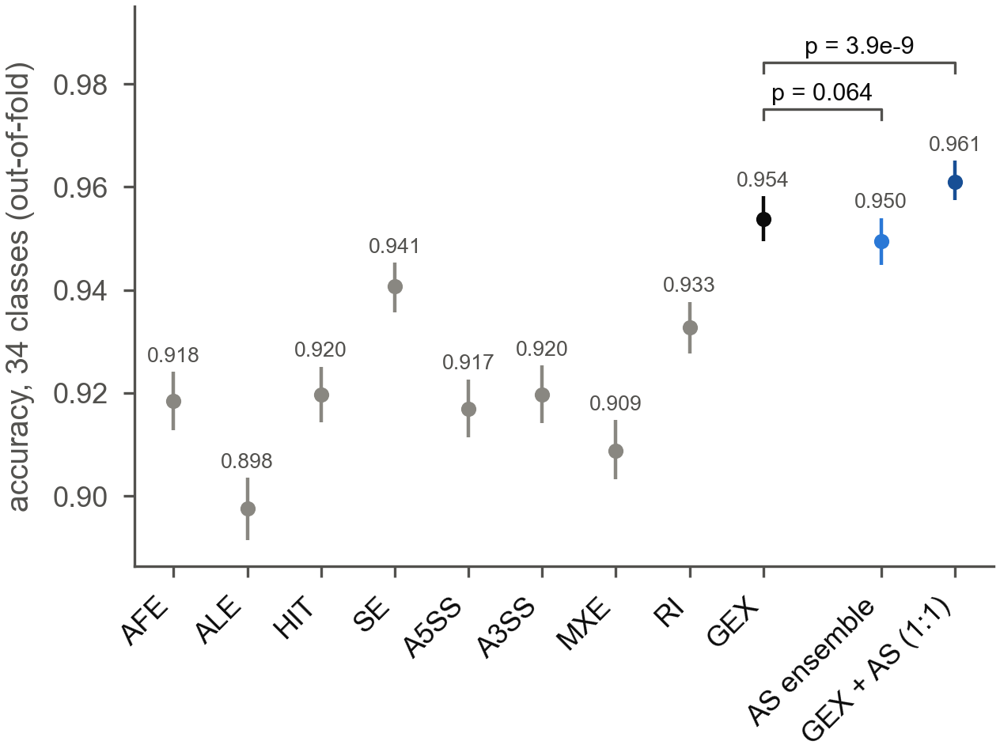

**Single views (cancer type, 34 classes).** Out-of-fold accuracy is:
- 0.898 (ALE) to 0.941 (SE) for single AS views;
- 0.954 for GEX.

**Ensemble and fusion.** The fusion weights were fixed in advance (D-14).
- The AS ensemble (mean of the 8 AS views) reaches 0.950, with a higher balanced accuracy than
  GEX (0.940 vs 0.936).
- GEX and the AS ensemble at 1:1 reach 0.961 (95% CI 0.958–0.965) and a balanced accuracy of
  0.948.

**The errors differ.**
- The AS views' misclassified sets overlap each other more (Jaccard 0.31–0.40) than they
  overlap GEX's (0.22–0.38).
- The AS ensemble gets 213 of GEX's 450 errors right.
- For tumour vs normal, summed over 15 cancers, the errors are 99 for GEX, 91 for the AS ensemble
  and 77 fused.

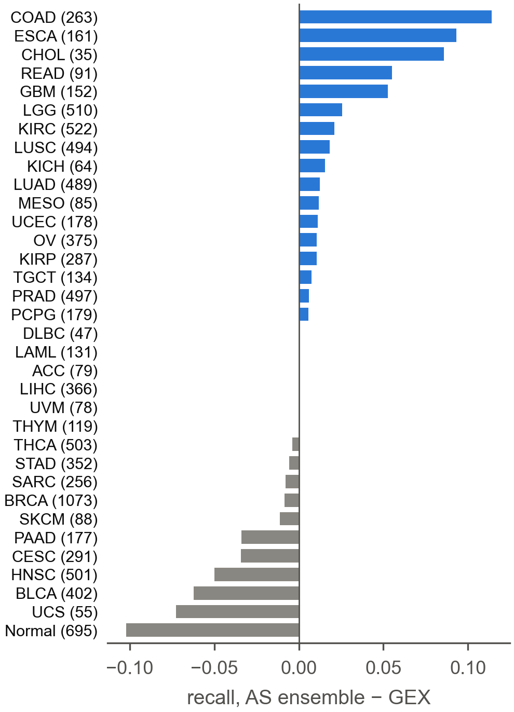

**Where splicing gains.**
- It gains for classes that expression confuses with an anatomical neighbour (COAD/READ,
  ESCA/STAD, GBM/LGG) and for CHOL.
- Section 7 shows that only some of these gains survive held-out sites.

**Where expression is better.** For pooled normal tissue (recall 0.96 vs 0.85) and for squamous
and urothelial tumours (BLCA, HNSC, CESC).

## 2. Tumours retain more intronic sequence and choose upstream last exons

**Approach.** This analysis uses every measured event, not the models' selections. So it asks a
question the models cannot have biased: in matched tumour–normal pairs, does RNA processing move
in a common direction?

**Retained introns.**
- 7 cancers retain more (BLCA, COAD, KICH, KIRC, KIRP, LUSC, PRAD); BRCA retains less.
- At the event level, retained introns that gain ≥ 5 PSI points in tumours outnumber those that
  lose them about 3:1 (median 15% vs 4.5% of events), in 13 of 15 cancers.

**Alternative splice sites.**
- A5SS long forms rise in 10 cancers and fall in none.
- A3SS long forms rise in 5.

**Last exons.**
- They move upstream in 7 cancers (BLCA, BRCA, COAD, KICH, KIRP, LUAD, LUSC) and downstream in
  none.
- This is the same direction as the proximal polyadenylation widely reported in tumours.

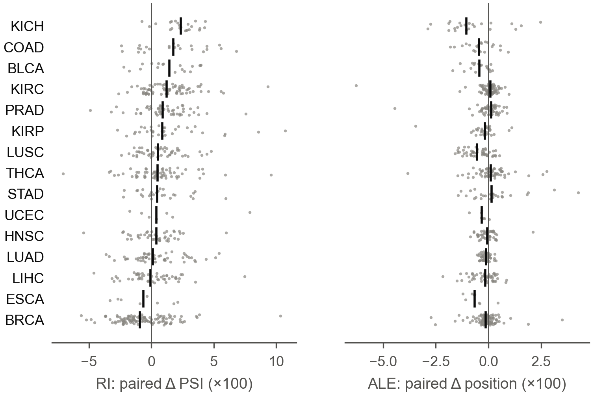

**Patient level.** The retention shift is carried by most patients. In KICH, BLCA, PRAD and
KIRC, 70–91% of patients retain more in the tumour than in their own normal tissue.

**Alternative explanations.**
- **Proliferation.** Within tumours, per-sample retention does not track a 10-gene proliferation
  score: Spearman −0.25 to 0.19, no consistent sign
  (`02_global_shifts/intron_retention_vs_proliferation.csv`).
- **3′-end factors.** Which cancers shift most is not explained by how much the cleavage and
  polyadenylation factors rise (|ρ| ≤ 0.39 across 15 cancers).
- **RNA quality.** RNA integrity and nuclear-RNA content also raise intronic reads. TCGA has no RIN
  for these samples, so a technical part cannot be excluded.

## 3. Pathways: expression reads the microenvironment; splicing rarely forms pathways

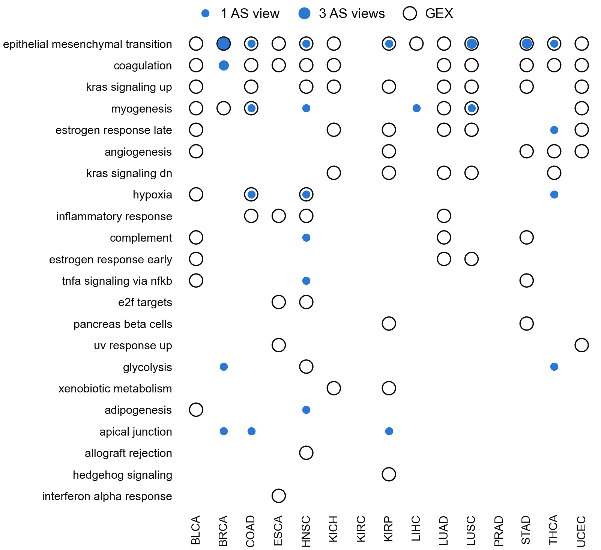

**Method.** For each model, the 200 genes with the largest SHAP importance were tested against
Hallmark, Reactome and GO-BP. The test (GOseq) corrects for how many events a gene has
(D-16).

**GEX.** The tumour-vs-normal models draw on stromal and microenvironment programmes:
- EMT in 13 of 15 cancers;
- coagulation in 10;
- KRAS signalling in 9.

**AS views.** They reach the same programmes less often: EMT in 7 cancers, myogenesis in 4.

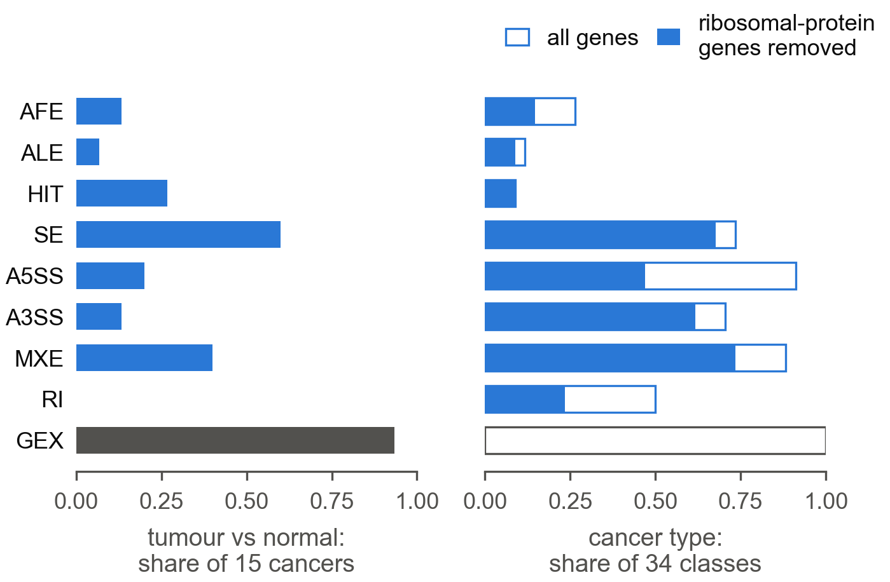

**Tumour status.** GEX's top genes form a pathway in 14 of 15 cancers. The AS views' do so in at
most 9 (SE), and RI's in none. Splicing's tumour signal is spread over genes that do not share a
programme.

**Cancer type and ribosomal proteins.** The per-class AS explanations looked pathway-rich at
first:
- 2,390 significant terms, a third of them translation-related.
- That came largely from alternative 5′/3′ splice sites in cytosolic ribosomal-protein genes,
  such as RPS24, RPL13A and RPL3. These genes are deeply covered and so measured precisely in
  every tissue.
- With RPL*/RPS* removed, 950 terms remain.

**What remains is two kinds of biology.**
- Lineage biology:
  - synapse and cell-projection genes in PCPG (SE);
  - smooth-muscle contraction in PRAD;
  - the RHO GTPase cycle in DLBC;
  - extracellular matrix in THCA;
  - adhesion and calcium transport in LGG (MXE).
- The splicing machinery's own transcripts: RNA-splicing terms from A3SS in ACC, KICH, LUAD and
  UVM.

Top terms per class are in `03_pathways/cancer_type_top_terms_by_class.csv`.

## 4. Shared events and what they do to the protein

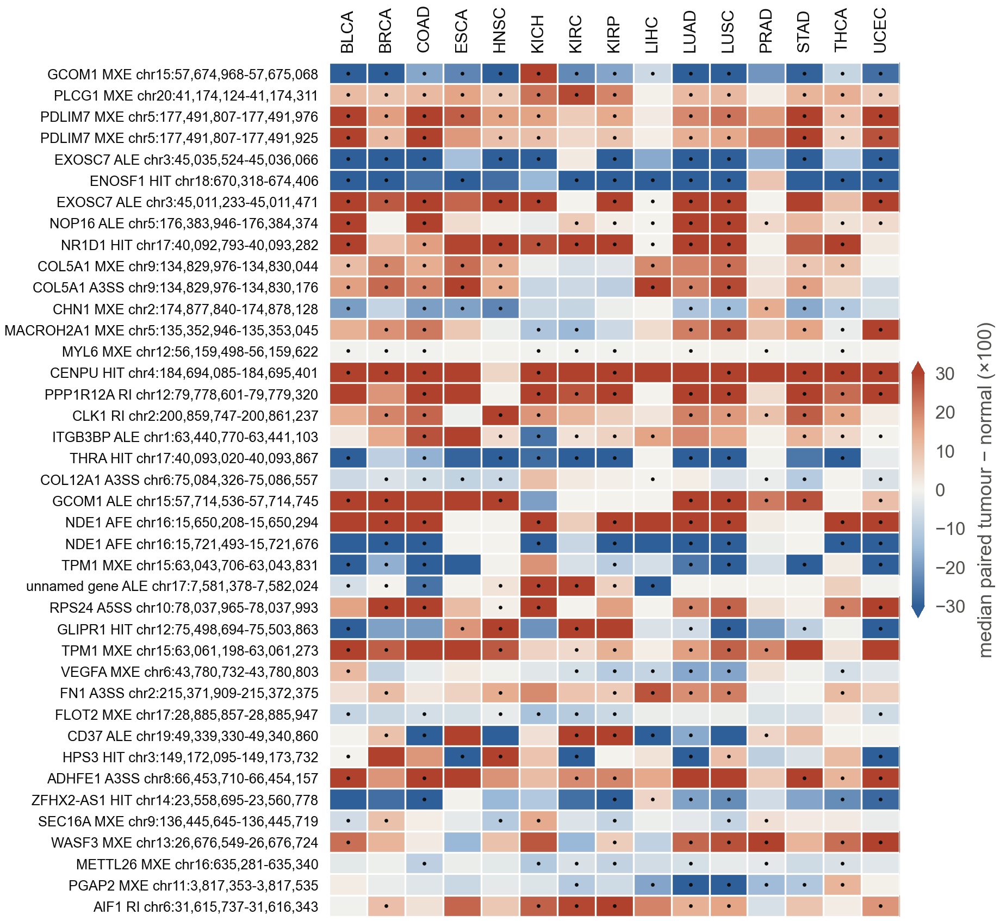

**Recurrence.** Across the 8 AS views, 404 events rank in the top 100 (mean |SHAP|) of at least 4
of the 15 tumour-vs-normal models. About 3 would be expected if the rankings were independent.
- By view: ALE 74, MXE 73, HIT 62, A3SS 51, RI 51, A5SS 47, AFE 39 and SE 7.
- Measured in every cancer, not only where they ranked, recurrent events share their majority
  direction in a median 73% of cancers.
- Recurrent RI and A5SS events mostly rise in tumours (73% and 77%), in line with the global
  shift of section 2.

**Examples.**
- A CENPU HIT event rises in all 15 cancers.
- An ENOSF1 HIT event and a GCOM1 MXE event fall in 14.
- PDLIM7 and PLCG1 mutually exclusive exon events rise in all 15.
- Several genes contribute pairs of events that move in opposite directions: two EXOSC7 last
  exons, two NDE1 first exons, and two TPM1 mutually exclusive exon events.

**Protein consequences.** The top cassette exons of the tumour-vs-normal models (n = 1,281) and
of the cancer-type classes (n = 1,914) were compared with 6,000 random measured exons:
- They are more often of a length divisible by 3: 51% and 54%, against 41% (p = 1.3e-10 and
  3.1e-24).
- Among fully coding exons (n = 628 and 1,041, against 3,050), they less often overlap a
  Pfam/CDD domain: 37% and 35%, against 51%.
- Among the same exons, they more often overlap a disordered region: 21% and 20%, against 14%.
- They less often overlap a transmembrane helix: 3.7% and 4.6%, against 6.7%.

The tumour signal therefore sits in exons that change protein segments in frame, mostly in
disordered, interaction-prone regions. These are the exons tissues use to tune protein
interactions; they mostly do not break folded domains or create frameshifts.

**Direction.** The two directions differ in emphasis (`04_events/cassette_exon_protein_features.csv`):
- Exons skipped more in tumours are the most frame-preserving (55% divisible by 3) and the most
  depleted of domains (30%; OR 0.42).
- Exons included more in tumours are the most enriched for disorder (24%; OR 1.98).

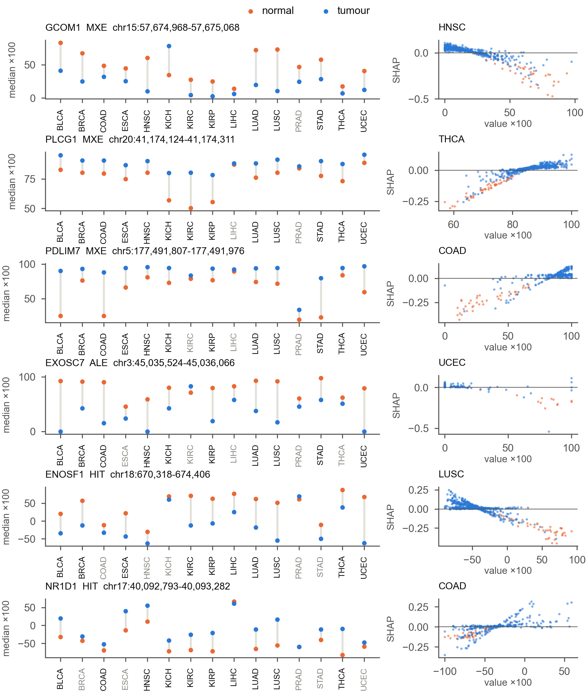

**Portraits.** Six events are shown: the most recurrent events, one per gene, whose paired change
has the same sign in at least 80% of cancers.
- Left panels: each cancer's matched normal and tumour medians, side by side.
- Right panels: the SHAP dependence. The model reads all six events monotonically; the further a
  sample's value lies in the tumour direction, the more it is pushed towards "tumour".

**Caution on NR1D1 and THRA.** The NR1D1 and THRA HIT events overlap at chr17:40.09 Mb, where the
two genes overlap on opposite strands. They move in opposite directions in 14 of 15 cancers. Most
TCGA RNA-seq is unstranded, so the two may be one change counted twice; they are better read as
a single finding.

## 5. Splicing regulators

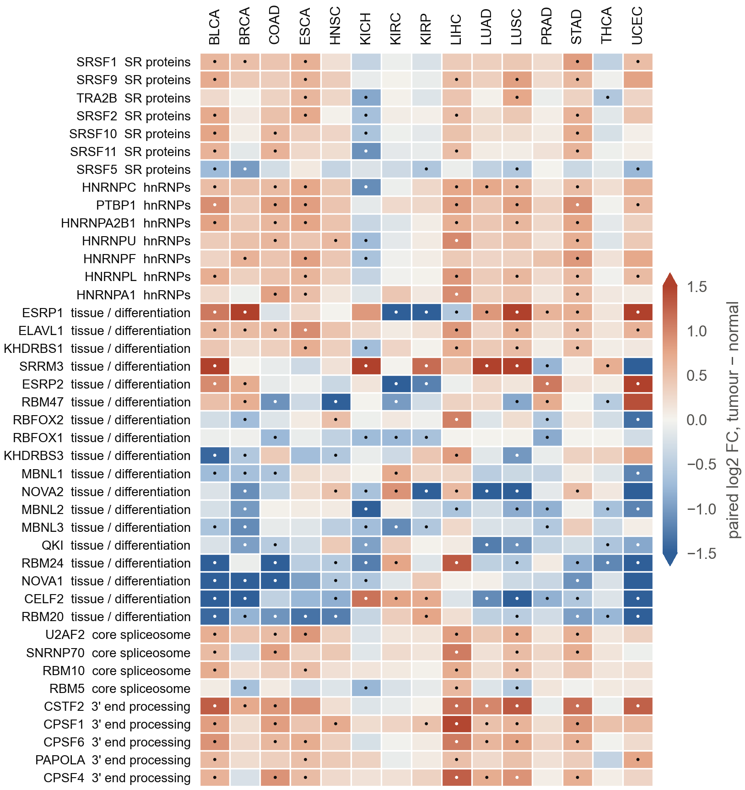

Of about 70 pre-specified RNA-binding proteins, two programmes move between tumour and matched
normal tissue.

**Rising in tumours:**
- SR proteins and hnRNPs;
- PTBP1 (up in 7 cancers);
- the epithelial regulator ESRP1 (up in 10);
- the cleavage and polyadenylation factors, such as CSTF2 (up in 8; median +1.2 log2).

**Falling:**
- CELF2 (11 cancers);
- RBM20 and RBM24 (10 each);
- NOVA2 (9);
- QKI and RBM47 (7 each);
- MBNL.

These muscle, neural and mesenchymal regulators fall partly because normal tissue contains more
stroma and smooth muscle.

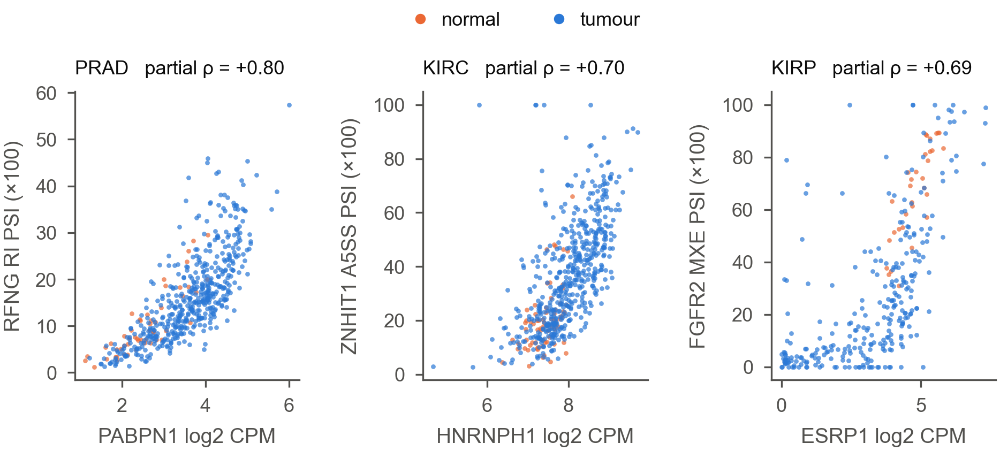

**Unsupervised links.** Within tumours, and adjusting for stromal and immune content, the
strongest regulator–event links include:
- **ESRP1 with the FGFR2 mutually exclusive exons** (KIRP, partial ρ = 0.69). This is the
  textbook epithelial splicing switch, recovered without supervision.
- **PABPN1 with retained introns** in PRAD, THCA, KIRC and LUSC (ρ up to 0.80). PABPN1 is a
  nuclear poly(A)-binding protein involved in nuclear RNA surveillance. The link fits a
  sample-level retention axis, but these are correlations and do not show which way any effect
  runs.

**Breadth.** No single factor tracks more than a small excess of the top events over background
(`05_regulators/regulator_event_association.csv`). The tumour programme is not the output of one
regulator.

## 6. Lineage: what splicing sees that expression does not

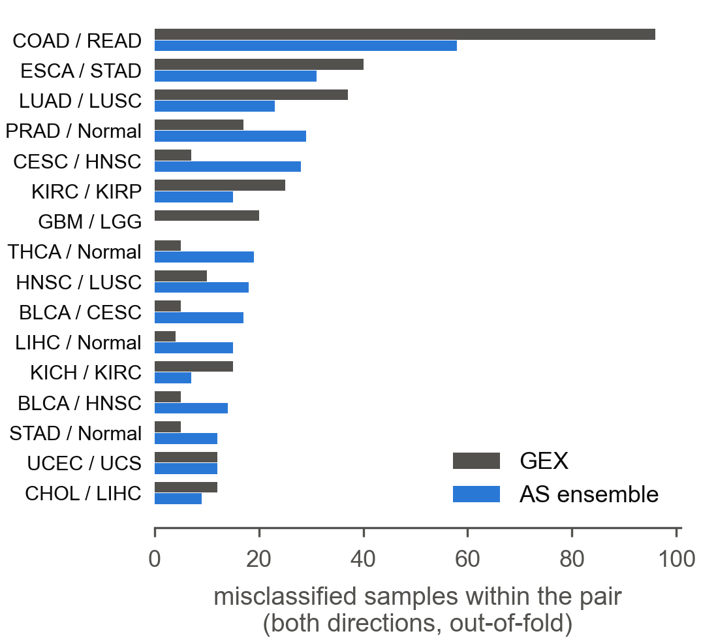

**Where GEX errs.** Expression confuses anatomical neighbours:
- colon and rectum (96 errors);
- oesophagus and stomach (40);
- lung adenocarcinoma and squamous carcinoma (37);
- kidney subtypes;
- GBM and LGG (20).

**Where splicing errs.** Splicing makes fewer of those errors (GBM/LGG: 0). It instead confuses:
- squamous and urothelial carcinomas across organs: CESC/HNSC (28 vs 7 for GEX), HNSC/LUSC,
  BLCA/CESC, BLCA/HNSC;
- several tumours with the normal tissue they arose in: PRAD, THCA, LIHC, STAD.

Splicing follows the cell type more than the organ or the tumour state.

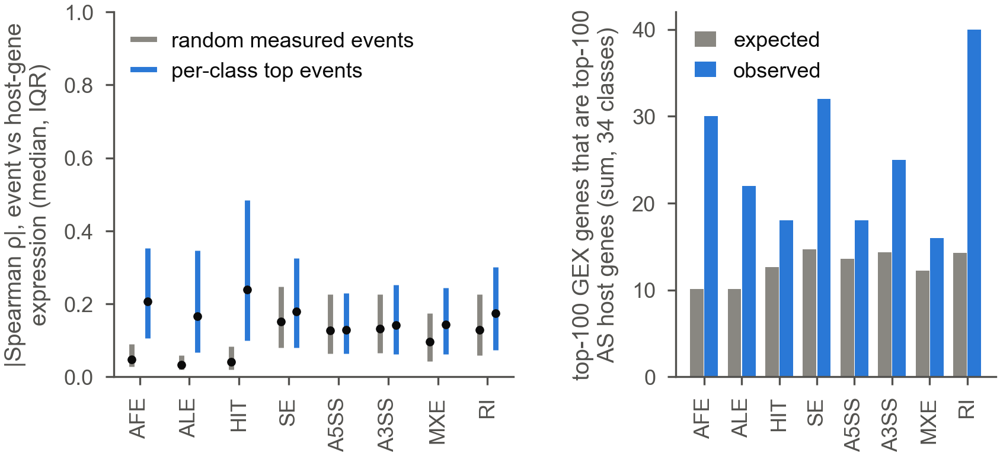

**Not an expression proxy.**
- For the splice-site views, top events correlate with their host gene's expression no more
  than random events do: median |ρ| 0.13–0.18 vs 0.10–0.15.
- Terminal-exon views track expression more. An alternative promoter or poly(A) site also
  changes how much of a gene is made.
- Each class's top-100 GEX genes share about one gene with each AS view's top-100 host genes.
  Those shared genes are lineage markers that are both expressed and spliced
  lineage-specifically: GFAP, MBP, DUOXA2, MYH11, LGALS4 and FXYD2.

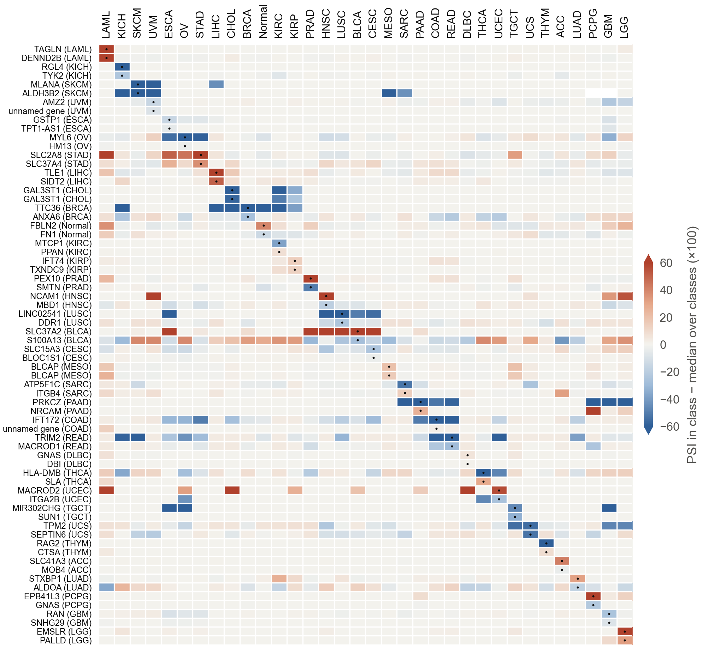

**Single exons mark single lineages.** Across the 34 classes, each class's top cassette exons are
switched specifically in that class:
- MLANA is skipped in the melanocytic tumours (SKCM and UVM);
- RAG2 is skipped in thymoma;
- SLC37A2 is included in the squamous carcinomas (HNSC, LUSC, BLCA, CESC);
- TAGLN and DENND2B are included in LAML;
- PEX10 is included in PRAD.

Exons shared by related classes form off-diagonal blocks.

## 7. Is any of this a tissue-source-site effect?

**The confound.** In TCGA every tissue-source site contributes to exactly one project, so
separating neighbouring projects can exploit site handling. Splicing readouts such as intron
retention are plausibly more sensitive to handling than gene expression.

**The test.** A fixed, untuned probe was cross-validated by patient and by site (D-20).
- **Holds:** glioma grade, kidney subtype and lung histology. Separation survives unseen sites
  in every view (drop ≤ 0.015). The near-perfect splicing separation of GBM from LGG is robust.
- **Fails:** colon vs rectum. No AS view separates the two at unseen sites (0.48–0.57); GEX keeps
  0.66.
- **Partly site-specific:** oesophagus vs stomach. AS views lose 0.08–0.14 at unseen sites, GEX
  0.06.

**Unaffected.** Tumour vs normal compares samples of the same patient and site, so sections 2
and 4 are not exposed to this confound.

## Limitations

- **What SHAP explains.** SHAP explains the models, not causation. A feature can rank highly
  because it is a precise, deeply covered proxy, as the ribosomal-protein splice sites show.
- **RNA quality.** Intronic and A5SS/A3SS long-form signals overlap with RNA quality and
  nuclear-RNA content. TCGA lacks RIN for these samples.
- **Composition.** Tumour vs normal is confounded with composition (stroma, immune and muscle
  content). The regulator analysis adjusts for marker scores, but deconvolution was not done.
- **Fusion.** Fused accuracies are honest for fixed weights. They are not a nested estimate of a
  fusion method.
- **Site probe.** It is a linear probe with fixed settings. It bounds, but does not measure, how
  site-dependent the MLPs are.
- **Reference data.** Protein annotation uses GENCODE v45 and InterPro features of one transcript
  per exon (MANE > canonical). Pathway sets are MSigDB 2026.1.
