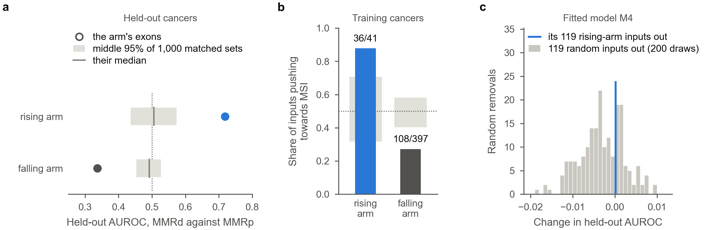
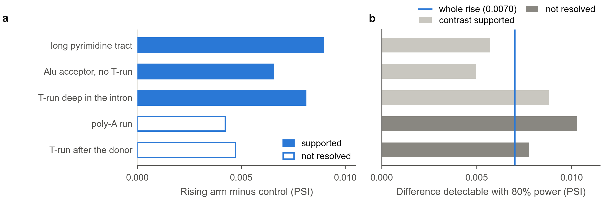
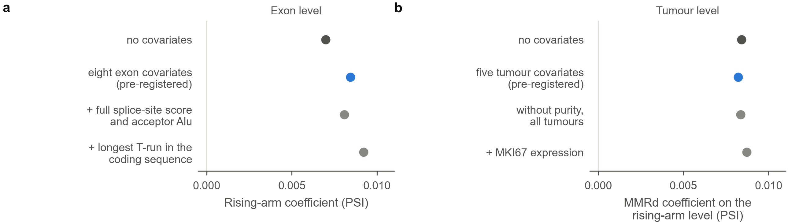
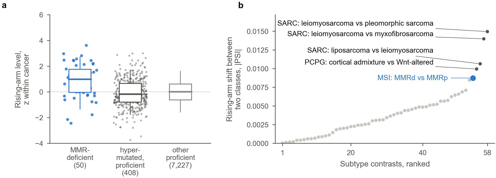
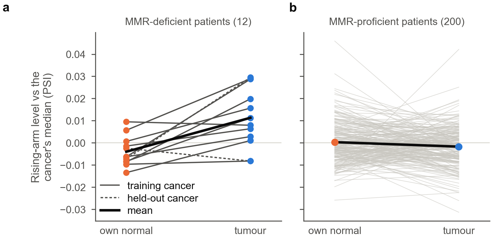
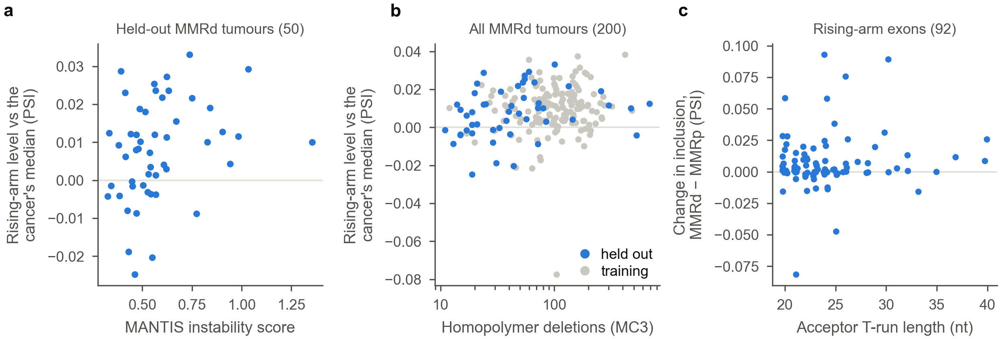
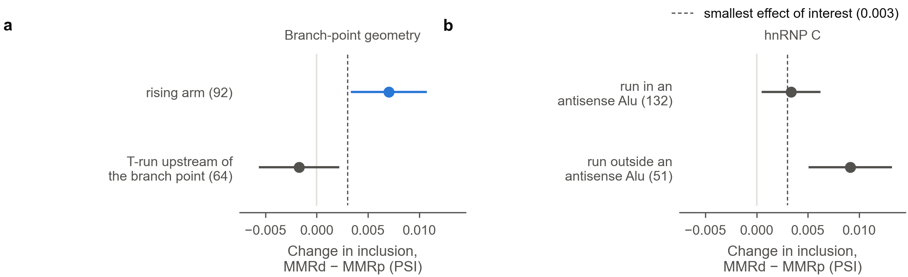

# The MSI rising arm, tested step by step (D-77)

Pre-registered as D-77 in `config/followup.yaml: msi_rising_proof` (commit 5471b27). Implemented and
dry-run on shuffled labels in `scripts/62` (commit 4b34f60), then run once with the real labels
(results committed as computed in 41b0214). Figures are drawn by `scripts/63_rising_proof_figures.py`.
Methods and amendments are in [docs/SUBTYPE_METHODS.md](../docs/SUBTYPE_METHODS.md) (D-77, A-22–A-25).

## 1. The claim, and the answer

**The claim.** In mismatch-repair-deficient (MMRd) tumours, some exons are *more* included than in
proficient (MMRp) tumours of the same cancer. These exons have a long T-run (≥ 20 nt) at the acceptor,
with the branch point at least 36 nt from the AG. This group is called the rising arm (R_up). The claim
is that the rise is real and needs both features.

**The answer: partial** (the pre-registered verdict). Nine of the twelve required tests are supported.
- **What holds.** In junction reads from the held-out cancers (50 MMRd tumours in 16 of the 30, none
  used to define the arm), R_up exons rise in MMRd tumours by +0.0070 PSI (95% interval 0.0033 to
  0.0107). The whole interval lies above the smallest effect of interest (0.003).
  - The rise needs the T-run: background exons whose predicted branch point is also ≥ 36 nt but
    which have no T-run do not move (−0.0001, 95% −0.0009 to +0.0006; RP3a +0.0074).
  - At fixed run length and offset, it is rank-associated with the gap between the run and an
    experimentally mapped branch point (partial Spearman 0.44). This rests on the held-out cancers
    alone: it does not replicate in the training cancers.
  - It exceeds long pyrimidine tracts, deep-intron T-runs and Alu acceptors without a run.
  - It survives exon and tumour covariates.
  - It separates MMRd tumours from hypermutated proficient ones, and it appears with an independent
    MSI caller.
  - It is also seen within patients, though mostly in training cancers.
- **What the data do not show.**
  - That the rise beats poly-A and donor-side T-run controls. Both tests are not resolved and are
    underpowered.
  - That the rise is unique to MSI: four of 57 other subtype contrasts move the arm more than MSI
    does, three of them involving leiomyosarcoma.
  - A dose relation.
  - A mechanism.
  - The 36-nt cut on distance: it is not supported.
  - That the rise is broad: it is carried by a minority of exons. The class mean is +0.0070, but the
    median exon moves by only +0.0019.
- **What cannot be shown with these data.** That the T-run at a given locus is shortened in the
  tumour and that this shortening causes the rise. That needs the tumour's DNA at each tract (the
  D-56 exome-slice pilot). Everything here is an association.

## 2. How the test was built

The claim had three known weaknesses:
- **The read-out.** It was first seen in percentiles of JCEC PSI (D-70), which counts exon-body reads
  as inclusion.
- **The branch point.** It came from a crude sequence heuristic.
- **The cuts.** The 20-nt and 36-nt cuts were set on the three training cancers (COAD, STAD, UCEC)
  after the reversal was seen.

D-77 answers these in eight steps, each able to fail, all written down before any junction-read
value was compared by MMR status.
- **The read-out.** Confirmatory tests use the 30 held-out cancers: 7,685 tumours, of which 50 are
  MMRd, in 16 cancers. They use junction reads only (rMATS JC), in PSI units.
- **Per exon.** delta is the mean adjusted PSI of the MMRd tumours minus the MMRp mean of the same
  cancer. A tumour's adjusted PSI is its deviation from the cancer's median, minus its own mean
  deviation over background exons of the same baseline band.
- **Positive control.** The falling arm (T-runs of 10–19 nt, R_down) is tested alongside in every
  design.
- **Process.**
  - A reviewer checked the pre-specification (Gate 1) and the implementation (Gate 2).
  - The whole pipeline was first run on shuffled labels. Four amendments were made after that dry
    run and before any real-label run (A-22 to A-25).
  - The real-label run was then made once, and the reviewer recomputed its key tests from the raw
    arrays (Gate 3).
- **Not new tumours.** These held-out tumours are not new: D-70 read them in JCEC percentiles. This is
  a stricter re-test of the same tumours with a new read-out and new controls.

**How to read Figure RP0.**
- **Boxes.** The eight steps, read left to right and top to bottom. Each box holds the step's
  question and a one-line answer.
- **Markers.** Filled: every test of the step is supported. Half: some are. Hollow: none is
  resolved.
- **The dashed box.** The mechanism tests, which sit outside the verdict.
- **The verdict box.** The claim's verdict by the pre-registered rule, and what it does not show.
- **Where the numbers are.** The overview carries no p values or test ids. Each step's figure follows
  in section 3, and every test is in the table in section 5.

<!-- legend RP0: copied from figures/rising_proof/RP0_overview.caption.md by the figure script's 'legends' step -->
> **Figure RP0. In junction reads the rising arm rises in held-out cancers, but the claim is only partly
> supported.** Pre-registered as D-77 (config/followup.yaml: msi_rising_proof; commit 5471b27) before any
> junction-read value was compared by MMR status. The claim: in MMR-deficient tumours, exons after an acceptor T-run
> of ≥ 20 nt with the sequence-predicted branch point ≥ 36 nt from the AG (the rising arm) are more included than in
> MMR-proficient tumours of the same cancer, and the rise needs both features. Confirmatory tests use the 30
> held-out cancers (50 MMR-deficient tumours in 16 of them) and junction reads only (rMATS JC), in PSI units. The
> eight steps are read in order; each box gives the step's question, a plain answer and a marker: filled = every
> test of the step supported (predicted sign and Benjamini–Hochberg q < 0.05 within its family), half = some
> supported, hollow = none resolved. The mechanism box (dashed) is outside the claim's verdict. The verdict box
> gives the claim's verdict by the pre-registered rule, under which "established" needs all 12 tests of family RP.
> Every test, with its effect, p and q, is in section 5 of results/MSI_RISING_ARM_PROOF.md and in tests.csv.
<!-- /legend -->

## 3. Step by step

### Step 1. Do models use the rising arm? (Figure RP1)

**How to read Figure RP1.**
- **Panel (a).** Places each arm's held-out AUROC (dot) beside the middle 95% of 1,000 sets of
  matched background exons (grey bar). Such sets carry any tumour-wide shift too. A dot outside the
  bar beats the matched sets.
- **Panel (b).** Shows whether the training cancers' subtype networks push towards MSI when R_up exons
  are more included. A bar above the grey band means more inputs push that way than chance allows.
- **Panel (c).** Asks whether step 54's fitted logistic regression (M4) loses accuracy without its
  R_up inputs (blue line), compared with removing as many inputs at random (grey).

<!-- legend RP1: copied from figures/rising_proof/RP1_models.caption.md by the figure script's 'legends' step -->
> **Figure RP1. Held out, the rising arm separates MMR-deficient tumours better than matched exon sets, but removing
> it from the fitted model costs no detectable accuracy.** Rising arm = acceptor T-run ≥ 20 nt with the
> sequence-predicted branch point ≥ 36 nt from the AG; falling arm = acceptor T-run of 10–19 nt. MMRd =
> MMR-deficient (≥ 10 MC3 homopolymer deletions); MMRp = MMR-proficient. (a) Held-out cancers (7,685 tumours, 50
> MMRd): AUROC for MMRd against MMRp tumours of each arm's level (a tumour's mean PSI deviation from its cancer's
> median over the arm's exons, as a percentile within the cancer); dot = the arm; grey bar = middle 95% of 1,000
> sets of background exons matched to the arm on baseline band and coverage tertile within each cancer, which carry
> any tumour-wide shift as well; tick = their median; dotted line = 0.5. The falling arm is predicted below 0.5. (b)
> Training cancers (COAD, STAD, UCEC): the subtype networks (SE view, D-38) explained with SHAP. For each rising- or
> falling-arm input and cohort, the direction is the Spearman correlation of the input's value with its SHAP over a
> fold's MSI test tumours, averaged over the folds; bar = share of input × cohort units whose higher inclusion
> pushes towards MSI; grey band behind each bar = the range expected by chance, the middle 95% (2.5th–97.5th
> percentiles) of that share over 1,000 permutations of the inputs' rows among each fold's MSI test tumours (A-22);
> dotted line = 0.5. (c) M4, step 54's logistic regression on all repeat exons (fitted in the training cancers;
> held-out AUROC 0.900), refitted at the same C without its 119 rising-arm inputs (line) and without 119 inputs
> drawn at random from its other repeat inputs, 200 times (grey; exploratory, A-25).
<!-- /legend -->

- **The arm separates MMR status held out, better than matched sets** (RP1 supported). Held-out
  AUROC is 0.719, against a matched-set median of 0.506. The falling arm goes the other way (0.337
  against 0.492).
- **The subtype networks lean on it in the predicted direction** (RPD1a supported, training).
  Higher inclusion of an R_up input pushes towards MSI for 36 of 41 input × cohort units. For R_down
  inputs it does so for 108 of 397.
- **No loss was detected when the fitted model dropped it.** Removing M4's 119 R_up inputs changes its
  held-out AUROC by +0.0001 (paired bootstrap −0.0145 to +0.0146; 68.5th percentile of 200 random
  removals). These results do not show that M4 uses it.

### Step 2. Does it rise in junction reads? (Figure RP2)

**How to read Figure RP2.**
- **Panel (a).** Class means with 95% intervals. The dashed line is the smallest effect of interest
  (0.003).
- **Panel (b).** Ranks the 92 R_up exons by their own rise. Dark blue marks the ten largest. The grey
  line shows background exons at the same quantiles, so the gap between bars and line is the rise
  above what any exon shows.

<!-- legend RP2: copied from figures/rising_proof/RP2_junction_reads.caption.md by the figure script's 'legends' step -->
> **Figure RP2. The rising arm rises in held-out junction reads, and a few of its exons carry most of the rise.**
> Held-out cancers. MMRd = MMR-deficient (≥ 10 MC3 homopolymer deletions); MMRp = MMR-proficient; change in
> inclusion = an exon's mean adjusted PSI in the MMRd tumours minus the MMRp mean of the same cancer, from junction
> reads only (rMATS JC); a tumour's adjusted PSI is its deviation from the cancer's median minus its mean deviation
> over background exons of the same baseline band. Exons need ≥ 5 MMRd tumours measured. (a) Mean change of each
> class with its 95% interval (studentized SE over MMR labels permuted within cancer, Welch–Satterthwaite df; the
> rising- and falling-arm intervals are those of the tests, the background's is descriptive). Rising arm = acceptor
> T-run ≥ 20 nt with the sequence-predicted branch point ≥ 36 nt from the AG; falling arm = acceptor T-run of 10–19
> nt; background = exons without an acceptor T-run longer than 5 nt (the B sample). (b) The 92 rising-arm exons
> ranked by their change; dark = the 10 largest, which hold 81% of the summed change; line = background exons'
> changes at the same quantiles (rank k of 92 against the background's (1 − (k − 0.5) / 92) quantile; 4,756 exons);
> the three largest labelled with their gene.
<!-- /legend -->

- **The rising arm rises** (RP2a, primary test, supported): +0.0070 PSI (0.0033 to 0.0107), p =
  0.001. The falling arm falls (RPC2a −0.0030, −0.0047 to −0.0013).
- **The rule picks exons that rise** (RP2c supported). The share of R_up exons whose studentized delta
  exceeds c = 3.02, the 97.5th percentile of background exons' studentized deltas under permuted
  labels, is 7.6 points higher than in matched background exons.
- **Per tumour** (RP2b supported): +0.0084.
- **But the mean is carried by a minority of exons.**
  - The median R_up exon moves by +0.0019 (p = 0.0005 for the median), and 62% of R_up exons move
    up.
  - The ten largest hold 81% of the summed delta. Without them the mean of the other 82 is +0.0015,
    below the SESOI.
  - The statement "RP2a's interval lies above the SESOI" describes the class mean, not the typical
    exon.
  - The largest-mover list repeats overlapping events (LINC00963 three times, MTO1 twice). Averaging
    within gene first gives +0.0068 (0.0032 to 0.0105).

**Sensitivity analyses** (no q; p from label permutation unless noted)

| Variant | RP2a (R_up mean delta) | RP3a (R_up minus distant branch point, no run) |
|---|---|---|
| Primary: JC reads, ≥ 10 reads, universe 50%, ≥ 20 MMRd | +0.0070 (p 0.001) | +0.0074 (p 0.0005) |
| JCEC counts (exon-body reads too) | +0.0077 (p 0.002), 110 exons | +0.0086 (p 0.0005) |
| JC reads ≥ 30 per cell | +0.0064 (p 0.0005), 57 exons | +0.0064 (p 0.001) |
| Universe at 80% of tumours | +0.0070 (p 0.0005), 72 exons | +0.0070 (p 0.0005) |
| Eligibility at ≥ 10 / ≥ 30 MMRd tumours | +0.0086 / +0.0090 | +0.0086 / +0.0097 |
| Exons with baseline ≥ 0.90 left out | +0.0081 (0.0039 to 0.0122), 77 exons | +0.0084 (p 0.0005) |
| Gene level (delta averaged within gene) | +0.0068 (0.0032 to 0.0105) | – |
| Not poison exons (D-76) | +0.0074 (0.0025 to 0.0123), 57 exons | – |
| Without BRCA / without CESC | +0.0073 (0.0034 to 0.0111) / +0.0065 (0.0022 to 0.0108) | – |
| Median instead of mean | +0.0019 (p 0.0005) | – |
| D-66 percentile units on JC | +0.030 (0.014 to 0.046) | – |
| Count model (quasi-binomial, logit) | +0.161 (p 0.005; floor 1/201) | +0.110 (p 0.010) |

In the count model, 78 of 3,035 fits were separated and dropped (A-23).

### Step 3. Does it need both features? (Figure RP3)

**How to read Figure RP3.**
- **Panel (a).** Does the rise need the T-run? R_up against background exons whose predicted branch
  point is also ≥ 36 nt from the AG, without a T-run.
- **Panel (b).** Is there a step at 36 nt? Long-run exons grouped by the predicted branch point's
  distance from the AG, with the rule's cut marked. A step would show as a jump in the bin means
  across the dashed line. Descriptive.
- **Panel (c).** Does a larger gap between the run and an experimentally mapped branch point go with
  a larger rise, at fixed run length and position? Held-out cancers on the left, training cancers on
  the right. Descriptive; the tests are RP3e and RPD3b.

<!-- legend RP3: copied from figures/rising_proof/RP3_branch_point.caption.md by the figure script's 'legends' step -->
> **Figure RP3. The rise needs the T-run, a step at 36 nt is not supported, and the link to the branch-point gap is
> seen in held-out cancers only.** MMRd = MMR-deficient (≥ 10 MC3 homopolymer deletions); MMRp = MMR-proficient;
> change in inclusion = an exon's mean adjusted PSI in the MMRd tumours minus the MMRp mean of the same cancer, from
> junction reads only (rMATS JC); a tumour's adjusted PSI is its deviation from the cancer's median minus its mean
> deviation over background exons of the same baseline band. (a) Held-out cancers: mean change with its 95% interval
> for the rising arm (rising arm = acceptor T-run ≥ 20 nt with the sequence-predicted branch point ≥ 36 nt from the
> AG) and for background exons whose predicted branch point is also ≥ 36 nt from the AG, without a T-run; dashed =
> the smallest effect of interest. (b) Held-out cancers, exons with an acceptor T-run ≥ 20 nt and a predicted branch
> point (rising arm right of the dashed line, the rule's 36-nt cut; long runs with a nearer branch point left of
> it): change by the predicted branch point's distance from the AG, in D-70's exploratory bins (A-16); dots = exons,
> bars = bin means (≥ 5 exons). Descriptive. (c) Exons with an acceptor T-run ≥ 20 nt and an experimentally mapped
> branch point upstream of the run (BPHunter, lifted to GRCh38), in the held-out cancers (left; 52 exons, 31 of them
> in the rising arm) and in the training cancers (right): rank of the change against rank of the gap from the run to
> the mapped branch point, each with run length and offset (ranks) regressed out; line = least squares. For these
> exons the branch point's distance from the AG is the offset of the run plus its length plus the gap, minus 1, so a
> cut on that distance mixes run length and position with the gap. The scatter is descriptive; the tests are listed
> below.
<!-- /legend -->

- **It needs the T-run** (RP3a supported). R_up exons rise more than background exons whose predicted
  branch point is also ≥ 36 nt from the AG, without a T-run: +0.0074, p = 0.0005.
- **In the held-out cancers it is rank-associated with the gap to the mapped branch point** (RP3e,
  the verdict's branch-point test, supported).
  - At fixed run length and offset, the partial Spearman of delta with the gap is +0.44, p = 0.004,
    over 52 exons. Leaving out one exon at a time gives 0.40 to 0.47.
  - With the heuristic branch point it is +0.33 (RP3c supported).
  - By gap bin (descriptive; the bins were chosen after the results were seen), the rise sits at gaps
    above 5 nt, is highest at 6–10 nt, and is not monotone: 1–5 nt mean +0.0031 (median −0.0001,
    22 exons); 6–10 nt mean +0.0182 (median +0.0164, 17 exons); ≥ 11 nt mean +0.0081 (median
    +0.0043, 13 exons).
- **It does not replicate in the training cancers.** The same test there gives RPD3b +0.07, p = 0.61
  (62 exons, 150 MMRd tumours, not resolved). The gap association rests on the held-out set alone.
- **The 36-nt cut on distance is not supported.**
  - Figure RP3b shows no step at 36 nt. Long runs with the predicted branch point 30–35 nt from the
    AG rise about as much as those at 36–49 nt (bin means +0.0063 and +0.0050). Only the nearest bin,
    18–29 nt, lies below 0 (−0.0047, 18 exons). Descriptive; values in `RP3_branch_point.csv`.
  - Neither cut at 36 nt is resolved: RP3b, against long runs with a near heuristic branch point
    (+0.0052, p = 0.16), and RP3d, mapped branch point ≥ 36 against < 36 nt (+0.0012, p = 0.85).
  - The pre-specified sensitivity cuts for R_up (no q): ≥ 50 nt +0.0068, p = 0.091; > 60 nt
    +0.0077, p = 0.026.
  - For these exons the branch point's distance from the AG is exactly the run's offset plus its
    length plus the gap, minus 1. A cut on the distance therefore mixes run length and position with
    the gap.
  - Two of the six largest rises among the rising-arm exons (three of the six largest among all 52
    exons) have a mapped branch point under 36 nt.

### Step 4. Is it the microsatellite? (Figure RP4)

**How to read Figure RP4.**
- **Panel (a).** The pre-registered contrast: R_up minus each control, within matched strata. Each
  control has no acceptor T-run but shares one other feature with R_up. Filled bars are supported,
  hollow bars not resolved.
- **Panel (b).** The difference each contrast could have detected with 80% power, against the whole
  rise of R_up (blue line). A bar past the line means the contrast could not reliably see a
  difference as large as the rise itself.

<!-- legend RP4: copied from figures/rising_proof/RP4_controls.caption.md by the figure script's 'legends' step -->
> **Figure RP4. The rise exceeds that of three other long tracts; the poly-A and donor-side contrasts were
> underpowered.** Held-out cancers, junction reads. Rising arm = acceptor T-run ≥ 20 nt with the sequence-predicted
> branch point ≥ 36 nt from the AG. Each control has no acceptor T-run longer than 7 nt and shares one other feature
> with the rising arm: a long pyrimidine tract that is not a microsatellite (with a distant branch point), an
> acceptor inside an Alu, a poly-A run (≥ 15 nt) at the acceptor, a T-run of ≥ 20 nt deep in the intron, or one
> after the donor. (a) The pre-registered contrast: the rising arm's change minus the control's, within strata of
> baseline band × coverage tertile, coarsened until each rising-arm stratum holds ≥ 3 controls; filled = supported,
> hollow = not resolved. (b) The difference each contrast could detect with 80% power at two-sided 0.05 (2.80 SD of
> its exon-permutation null, rebuilt with step 62's code and seed; normal approximation; descriptive), against the
> whole rise of the rising arm (blue line). Light grey bars = the three contrasts that were supported, dark grey =
> the two that were not resolved (poly-A and donor-side runs); the shade marks the verdict, not the bar's length.
<!-- /legend -->

- **Supported.** The rise is larger than in:
  - long pyrimidine tracts that are not microsatellites (RP4b, +0.0089);
  - T-runs deep in the intron (RP4c, +0.0081);
  - Alu acceptors without a run (RP4e, +0.0066; also within the antisense-Alu subset, +0.0070).
- **Not resolved: poly-A runs (RP4a) and donor-side T-runs (RP4d).** These are underpowered, which is
  not the same as the controls rising too.
  - Their label-permutation p is small (0.005 and 0.010), but their exon-permutation p is not (0.25
    and 0.088).
  - The poly-A contrast has 61 controls, 27 of them effective after matching.
  - The difference detectable with 80% power is about 0.010 for poly-A and 0.008 for donor-side runs,
    larger than RP2a itself. Even if the controls did not move at all, the power would be about 0.48
    and 0.72.
  - The controls' own means are small: poly-A +0.0016 (p = 0.10), donor-side +0.0019 (p = 0.15).
  - Specificity against a homopolymer of another base, or a T-run after the donor, remains open.
- **Less certain outside Alu.** 61 of the 92 R_up acceptors lie in an Alu. For the other 31, R_up
  minus distant branch point is +0.0057 (p = 0.068). The rise is not Alu origin as such (RP4e), but
  the evidence outside Alu is weaker.

### Step 5. Does it survive confounders? (Figure RP5)

**How to read Figure RP5.**
- **Rows.** Each row is the same effect estimated with a different set of covariates: per exon in
  panel (a), per tumour in panel (b).
- **What to look for.** If a covariate explained the rise, the blue dot would move towards 0.

<!-- legend RP5: copied from figures/rising_proof/RP5_confounders.caption.md by the figure script's 'legends' step -->
> **Figure RP5. The rise remains after exon and tumour covariates.** Held-out cancers, junction reads. MMRd =
> MMR-deficient (≥ 10 MC3 homopolymer deletions); MMRp = MMR-proficient. (a) OLS of each exon's change in inclusion
> on a rising-arm indicator against the B sample of background exons (92 rising-arm + 4,756 exons). The
> pre-registered model adds eight exon covariates: baseline, length, coverage, host-gene change, poison status, the
> core splice-site score (−3..+3, blind to the tract), GC and Alu exon. The full −20..+3 score and the acceptor-Alu
> flag measure the tract itself and enter only a sensitivity model. (b) OLS of each held-out tumour's rising-arm
> level on MMR status with cancer indicators. The pre-registered model adds the tumour's global inclusion axis,
> stroma, immune infiltrate, retained-intron level and purity. Blue = the pre-registered models; dark grey = no
> covariates; light grey = sensitivity models. No intervals were computed for these coefficients; their p values are
> below.
<!-- /legend -->

- **Exon level** (RP5a supported): the R_up coefficient is +0.0084 (p = 0.004). The covariates are
  baseline, length, coverage, host-gene change, poison status, core splice-site score, GC and Alu
  exons. Without covariates it is +0.0070. The full splice-site score and acceptor-Alu flag (+0.0081)
  and the longest coding T-run (+0.0092) do not remove it.
- **Tumour level** (RP5b supported): the MMRd coefficient is +0.0082 (p = 0.0001). The covariates
  are the tumour's global inclusion axis, stroma, immune infiltrate, retained introns and purity. It
  is +0.0084 without purity and +0.0087 with MKI67 expression added.

### Step 6. Is it mismatch repair? (Figure RP6)

**How to read Figure RP6.**
- **Panel (a).** Compares MMRd tumours with tumours that are hypermutated without MMR deficiency,
  each scored within its own cancer.
- **Panel (b).** Ranks the MSI shift (blue) among the same shift for 57 other subtype contrasts.
  The contrasts at or above MSI are named.

<!-- legend RP6: copied from figures/rising_proof/RP6_specificity.caption.md by the figure script's 'legends' step -->
> **Figure RP6. The rise marks mismatch repair rather than mutation load, but four other subtype contrasts (three in
> sarcoma) move it more than MSI.** Held-out cancers, junction reads. MMRd = MMR-deficient (≥ 10 MC3 homopolymer
> deletions); MMRp = MMR-proficient; hypermutated MMRp = ≥ 500 single-nucleotide variants without MMR deficiency.
> (a) Each tumour's rising-arm level (mean adjusted PSI over its rising-arm exons; rising arm = acceptor T-run ≥ 20
> nt with the sequence-predicted branch point ≥ 36 nt from the AG) as a z within its cancer against the cancer's
> non-hypermutated MMRp tumours; boxes = quartiles, line = median, whiskers = 5th–95th percentiles, dots = tumours
> (not drawn for the other MMRp tumours). (b) The shift of the rising-arm exons between two classes (D-70's RV1 in
> junction reads: 20 tumours drawn from each class, mean over rising-arm exons of the difference in mean adjusted
> PSI, mean over 50 draws), for MSI (20 held-out MMRd tumours, each with a random MMRp tumour of its cancer) and for
> each of the 57 non-MSI subtype contrasts of the subtype task (two classes of one cohort with ≥ 20 tumours each,
> MSI, POLE and MMRd tumours removed), ranked; blue = MSI, grey = the 57 other contrasts, dark grey and labelled =
> those above MSI. The null contrasts are not matched by cancer, while the MSI draws pair tumours within cancer.
<!-- /legend -->

- **Mismatch repair, not mutation load** (RP6a supported).
  - The arm separates MMRd from hypermutated MMRp tumours: AUROC 0.72, p = 3 × 10⁻⁷. Within the
    cancers that have both, it is 0.74.
  - With MANTIS MSI-H as the label the arm still rises (RP6b +0.015, p = 0.003); with MSIsensor,
    +0.013.
- **Not unique to MSI** (RP6c not resolved, p = 0.086). Four of the 57 non-MSI contrasts move the
  arm more than MSI does (s = 0.0087):
  - SARC leiomyosarcoma against undifferentiated pleomorphic sarcoma (0.0149);
  - SARC leiomyosarcoma against myxofibrosarcoma (0.0140);
  - SARC dedifferentiated liposarcoma against leiomyosarcoma (−0.0106);
  - PCPG cortical admixture against Wnt-altered (−0.0099).

  The first three all involve leiomyosarcoma (smooth muscle), which D-70's RV1 had flagged. The fourth is an
  admixture class. The null contrasts are not matched by cancer, while the MSI draws pair tumours
  within cancer. So the arm moves with smooth-muscle lineage or composition at least as much as with
  MMR deficiency. Its link to mismatch repair rests on RP6a, not on uniqueness.

### Step 7. Within the same patient? (Figure RP7)

**How to read Figure RP7.**
- **Lines.** Each line joins a patient's own normal tissue (orange) to the tumour (blue). Panel (a)
  holds the 12 MMRd patients, dashed where the cancer is held out; panel (b) the 200 MMRp patients of
  the same cancers.
- **Black line.** The mean of the panel. A rise from normal to tumour in (a) but not in (b) is the
  within-patient rise.

<!-- legend RP7: copied from figures/rising_proof/RP7_within_patient.caption.md by the figure script's 'legends' step -->
> **Figure RP7. MMR-deficient tumours rise above their own normal tissue, mostly in training cancers.**
> Tumour–normal pairs (the tumour and a Solid Tissue Normal file of the same patient) of the cancers with at least
> one MMR-deficient pair: BRCA, COAD, PRAD, STAD, UCEC. MMRd = MMR-deficient (≥ 10 MC3 homopolymer deletions); MMRp
> = MMR-proficient. Each line joins a patient's own normal tissue to the tumour: the rising-arm level (rising arm =
> acceptor T-run ≥ 20 nt with the sequence-predicted branch point ≥ 36 nt from the AG) of each sample, its mean PSI
> deviation from the cancer's median over the rising-arm exons measured in both samples, minus its mean deviation
> over background exons of the same baseline band. The tumour minus the normal is the pair arm that the test uses.
> (a) The 12 MMR-deficient patients; 10 are in training cancers (COAD 6, STAD 3, UCEC 1), so the test is not held
> out (family RPP). (b) The 200 MMR-proficient patients of the same cancers. Orange = own normal tissue, blue =
> tumour; black line = mean.
<!-- /legend -->

- **MMRd tumours rise above their own normal tissue more than MMRp tumours do** (RP7 supported):
  +0.019, p = 0.0001. The falling arm goes the other way (RPC7 −0.0045).
- **Mostly a training-cancer result.** 10 of the 12 MMRd pairs are in training cancers (COAD 6, STAD
  3, UCEC 1), so RP7 is supporting evidence, not a held-out test (family RPP).
- **The held-out pairs split.** In BRCA the single MMRd pair lies above the cancer's proficient pairs;
  in PRAD it lies slightly below them.

### Step 8. Does it follow dose? (Figure RP8)

**How to read Figure RP8.**
- **Panel (a).** Would show a slope if tumours with a higher instability score had more rise.
- **Panel (b).** Would show one if tumours with more homopolymer deletions had more rise.
- **Panel (c).** Would show one if longer runs rose more.

<!-- legend RP8: copied from figures/rising_proof/RP8_dose.caption.md by the figure script's 'legends' step -->
> **Figure RP8. A dose relation is not shown.** MMRd = MMR-deficient (≥ 10 MC3 homopolymer deletions); MMRp =
> MMR-proficient; rising arm = acceptor T-run ≥ 20 nt with the sequence-predicted branch point ≥ 36 nt from the AG.
> A tumour's rising-arm level = its mean adjusted PSI deviation from its cancer's median over the rising-arm exons.
> (a) The 50 held-out MMRd tumours: rising-arm level against the MANTIS score, the exome instability score. (b) All
> 200 MMRd tumours, training cancers included: rising-arm level against the number of MC3 homopolymer deletions (log
> scale). (c) The rising-arm exons: change in inclusion against acceptor T-run length (20–40 nt; jittered). The
> tests ask for a graded relation, which D-70's percentile read-out had not found (RV6); the first two are partial
> Spearman correlations given cancer.
<!-- /legend -->

- **A dose relation is not shown.** None of the three dose tests is resolved:
  - MANTIS score among held-out MMRd tumours (RP8a, +0.23, p = 0.22);
  - deletion count among all 200 MMRd tumours (RP8b, +0.11, p = 0.13);
  - run length across R_up exons (RP8c, +0.05, p = 0.68).
- **Nor is one shown for the falling arm** (RPC8, −0.30, p = 0.060).

### Mechanism (Figure RPM, outside the verdict)

**How to read Figure RPM.** The two readings make different predictions:
- **Branch-point geometry** (panel a) predicts no rise for a T-run upstream of the branch point
  (shield exons), and a larger rise in R_up.
- **hnRNP C competition** predicts a rise for shield exons too, and more in runs inside an antisense
  Alu (panel b).

<!-- legend RPM: copied from figures/rising_proof/RPM_mechanism.caption.md by the figure script's 'legends' step -->
> **Figure RPM. The data do not separate branch-point geometry from hnRNP C.** Held-out cancers, junction reads;
> outside the claim's verdict (family RPM). Change in inclusion = an exon's mean adjusted PSI in the MMRd tumours
> minus the MMRp mean of the same cancer, from junction reads only (rMATS JC); a tumour's adjusted PSI is its
> deviation from the cancer's median minus its mean deviation over background exons of the same baseline band. Mean
> change with a descriptive 95% interval; dashed = the smallest effect of interest. (a) Rising arm = acceptor T-run
> ≥ 20 nt with the sequence-predicted branch point ≥ 36 nt from the AG; T-run upstream of the branch point = exons
> without an acceptor T-run of ≥ 10 nt whose intron holds a T-run of ≥ 20 nt upstream of the branch point (shield
> exons). Shortening that run cannot bring the branch point closer to the AG, so the geometry reading predicts no
> rise there and a larger rise in the rising arm. (b) Eligible runs of ≥ 20 nt (rising arm, or with a near or no
> branch point) inside an antisense Alu and outside one. hnRNP C binds long U-runs and represses Alu-derived exons,
> so the hnRNP C reading predicts that shield exons rise too and that runs inside an antisense Alu rise more.
> Numbers = exons measured. The tests compare classes within strata of baseline band × coverage tertile (and
> run-length bins for (b)), keeping the exons that have a partner there (92 against 64 exons, 45 effective controls
> for (a); 131 against 42 exons, 19 effective controls for (b)), so they differ from the raw difference of the dots.
<!-- /legend -->

- **Not resolved.** None of the three tests is resolved: R_up minus shield (RPM1, +0.0073, p = 0.11),
  shield exons against 0 (RPM2, −0.0017), and antisense-Alu runs minus other long runs (RPM3,
  −0.0030).
- **The mechanism remains open.** Geometry had predicted RPM1 supported. The gap association
  (step 3) leans towards geometry, but it rests on the held-out cancers alone (it does not replicate
  in the training cancers), and the data do not separate the two readings formally.

## 4. What this proves and what it does not

**Shown** (an association, held out, in junction reads):
- **A held-out rise in exons with a long acceptor T-run.** In MMRd tumours, these exons are more
  included than in proficient tumours of the same cancer, in held-out cancers (50 MMRd tumours in 16
  of the 30) not used to define the rule.
- **It needs the T-run.** Background exons whose predicted branch point is also ≥ 36 nt but which
  have no T-run do not move (−0.0001, 95% −0.0009 to +0.0006; RP3a +0.0074).
- **A rank association with the gap** between the run and an experimentally mapped branch point, at
  fixed run length and offset (partial Spearman 0.44). It does not replicate in the training cancers
  (RPD3b +0.07, p = 0.61) and rests on the held-out set alone.
- **It is not explained by** long pyrimidine tracts, deep-intron T-runs, Alu origin, exon or tumour
  covariates, or hypermutation.
- **It is present within patients**, mostly in training cancers.

**Not shown:**
- **Uniqueness to MSI.** Four of 57 subtype contrasts, three of them in leiomyosarcoma, move the arm
  more than MSI does.
- **Beating poly-A and donor-side runs.** These are not resolved and underpowered; the question is
  open.
- **A dose relation.**
- **The mechanism.** Open; the held-out gap association fits geometry but did not replicate in
  training.
- **The 36-nt cut on distance.** It is not supported (RP3b, RP3d not resolved).
- **Locus-level causation.** No tract is observed shortening in the tumour's DNA. That needs the D-56
  exome-slice pilot.

**Qualifiers that travel with every use of this result:**
- **The rise is uneven.** The class mean (+0.0070) is carried by a minority of exons: the median exon
  moves by +0.0019, and without the ten largest the mean is +0.0015. RP2a's interval clearing the
  SESOI describes the mean. RP2c (a 7.6-point excess of rising exons over matched ones) and the
  median should be quoted beside it.
- **No loss was detected when the fitted model dropped it.** Removing M4's 119 R_up inputs changes its
  held-out AUROC by +0.0001 (paired bootstrap −0.0145 to +0.0146; 68.5th percentile of 200 random
  removals). These results do not show that M4 uses it. The arm carries information on its own
  (RP1).
- **The instrument check failed, narrowly.**
  - It draws 92 falling-arm exons at a time to the rising arm's coverage and mirrored baseline. Its
    median statistic was −1.92 against a critical value of −2.00, with 47.6% of draws below
    (80% needed).
  - It gates only the "refuted" clause, so the verdict is unaffected: the rise was detected.
  - It does mean that a 92-exon set near PSI 0 or 1 sees a known fall only about half the time.
    Non-resolution of contrasts of that size (RP4a, RP4d, RP3b, RP3d) is weak evidence of absence.
- **These are not new tumours.** D-70 read them in JCEC percentiles. This is a stricter re-test with a
  new read-out and new controls.

## 5. Methods, data and all tests

**Methods** (full specification in D-77 and `config/followup.yaml: msi_rising_proof`):
- **PSI and inclusion.** rMATS JC PSI = IJC / (IJC + ratio × SJC), counted where a tumour has ≥ 10
  junction reads. An exon enters a cancer's universe when it is measured in ≥ 50% of its tumours. The
  baseline is the cancer's median over all tumours, in 13 bands.
- **Adjustment.** Each tumour's deviation from the baseline is adjusted by its mean deviation over
  background exons of the same band.
- **Exon delta.** The MMRd mean minus the MMRp mean of the same cancer, over exons with ≥ 5 MMRd
  tumours measured. An exon is eligible held out when ≥ 20 held-out MMRd tumours sit in cancers where
  it is in the universe.
- **Class means.** These use a studentized statistic under MMR labels permuted within cancer
  (2,000; Chung and Romano 2013), with a Welch–Satterthwaite interval.
- **Class contrasts.** They permute exon labels within strata of baseline band × coverage tertile,
  coarsened until each R_up stratum holds ≥ 3 controls (10,000), and also MMR labels. p is the larger
  of the two (an intersection–union test).
- **Regressions.** Freedman–Lane residual permutation on the HC3 t (Freedman and Lane 1983).
- **Correlations.** Partial Spearman, with permutation within cells.
- **Verdicts.**
  - A test is supported when its sign is the predicted one and q < 0.05 within its family
    (Benjamini–Hochberg). The families are RP (12 tests), RPS (9), RPP (2), RPC (8), RPD (6) and
    RPM (3).
  - The claim's verdict follows the pre-registered rule, in order: uninterpretable, refuted,
    established, partial.
- **Amendments.** Four amendments were made after the shuffled-label dry run, before any real-label
  run:
  - A-22: a permutation null for RPD1;
  - A-23: separated count-model fits dropped;
  - A-24: blanking of committed cells over fewer than 5 MMRd tumours;
  - A-25: the M4 random-removal reference.
- **After the real-label run.** Only the wording of verdict.json's unmet conditions changed, from
  "RP4a supported (not resolved)" to "RP4a not resolved (needed: supported)". This came from the
  Gate 3 review and was regenerated from the report stage, with no recomputation.

**Data.**
- **Junction and exon-body counts.** rMATS SE counts of the 2026-10-14 count store (TCGA, GDC).
- **MMR status and calls.** MC3 homopolymer-deletion MMR status and hypermutation (D-71's tumours).
  MANTIS and MSIsensor calls (Bonneville et al. 2017; Niu et al. 2014).
- **Branch points.** Experimentally mapped branch points from BPHunter Dataset S1 (Zhang et al.
  2022; hg19), lifted to GRCh38 with the UCSC hg19-to-hg38 chain.
- **Repeats.** Alu annotation from the UCSC hg38 RepeatMasker table.
- **Pinning.** All external files are pinned by size and MD5 in `scripts/62` and by SHA-256 in
  `config/sources.yaml`.
- **Where values live.** Per-sample values stay in the git-ignored data directory. The committed
  tables (`results/subtype/msi_cis/code/proof/`) hold aggregates.

**Reproduction.**
- `python scripts/62_msi_rising_proof.py --only compute --labels real --real-labels-approved`
  (681 s of compute), then `--only report` with the same flags.
- `python scripts/63_rising_proof_figures.py`. It redraws the figures from the committed tables and
  local caches, and stops unless every redrawn statistic equals the committed one.

**All 40 tests** (`tests.csv`), by step. p is the raw p (the larger of the exon and the label
permutation p where both exist). q is Benjamini–Hochberg within the family, named in brackets after
the test id. Effects are in PSI except for correlations (RP3c, RP3e, RPD3b, RP8a–c, RPC8), AUROC or
share differences (RP1, RPC1, RPD1a, RPD1b, RP2c, RP6a, RPC6), and the four class means, which carry
their 95% interval. The table is written from `tests.csv` by `scripts/63`'s `legends` step.

<!-- tests-table: written by scripts/63's 'legends' step from tests.csv -->
| Step | Test | In plain words | Effect | p | q | Verdict |
|---|---|---|---|---|---|---|
| 1 | RP1 (RPS) | Held out, the rising arm separates MMRd tumours better than matched exon sets (AUROC minus their median) | +0.213 | 1.0e-3 | 0.002 | supported |
| 1 | RPC1 (RPC) | The same for the falling arm (predicted below) | −0.155 | 1.0e-3 | 0.003 | supported |
| 1 | RPD1a (RPD) | Training: the subtype networks push towards MSI when rising-arm inputs rise (share minus 0.5) | +0.378 | 1.0e-3 | 0.001 | supported |
| 1 | RPD1b (RPD) | The same for falling-arm inputs (predicted below) | −0.228 | 1.0e-3 | 0.001 | supported |
| 2 | RP2a (RP) | Mean change of the rising-arm exons (primary test) | +0.0070 (0.0033 to 0.0107) | 1.0e-3 | 0.002 | supported |
| 2 | RPC2a (RPC) | Mean change of the falling-arm exons | −0.0030 (−0.0047 to −0.0013) | 0.002 | 0.004 | supported |
| 2 | RP2b (RPS) | Per tumour: rising-arm level, MMRd minus MMRp | +0.0084 | 5.0e-4 | 0.002 | supported |
| 2 | RPC2b (RPC) | Per tumour: falling-arm level, MMRd minus MMRp | −0.0030 | 0.001 | 0.003 | supported |
| 2 | RP2c (RPS) | Share of rising-arm exons that rise, minus that of matched background exons | +0.076 | 7.0e-4 | 0.002 | supported |
| 2 | RPD2a (RPD) | Training: mean change of the rising-arm exons | +0.0111 (0.0088 to 0.0134) | 5.0e-4 | 1.0e-3 | supported |
| 2 | RPD2b (RPD) | Training: mean change of the falling-arm exons | −0.0091 (−0.0104 to −0.0077) | 5.0e-4 | 1.0e-3 | supported |
| 3 | RP3a (RP) | Rising arm minus exons with a distant branch point and no T-run | +0.0074 | 5.0e-4 | 0.001 | supported |
| 3 | RPD3a (RPD) | Training: the same | +0.0108 | 5.0e-4 | 1.0e-3 | supported |
| 3 | RP3b (RPS) | Rising arm minus long runs with a near predicted branch point (the 36-nt cut) | +0.0052 | 0.16 | 0.24 | not resolved |
| 3 | RP3d (RPS) | Mapped branch point ≥ 36 nt minus < 36 nt | +0.0012 | 0.85 | 0.85 | not resolved |
| 3 | RP3c (RPS) | Change against the gap to the predicted branch point, at fixed run length and offset (ranks) | +0.333 | 5.0e-4 | 0.002 | supported |
| 3 | RP3e (RP) | Change against the gap to the mapped branch point, at fixed run length and offset (ranks) | +0.438 | 0.004 | 0.006 | supported |
| 3 | RPD3b (RPD) | Training: the same as RP3e | +0.070 | 0.61 | 0.61 | not resolved |
| 4 | RP4b (RP) | Rising arm minus long pyrimidine tracts | +0.0089 | 5.0e-4 | 0.001 | supported |
| 4 | RP4e (RP) | Rising arm minus Alu acceptors without a T-run | +0.0066 | 5.0e-4 | 0.001 | supported |
| 4 | RP4c (RP) | Rising arm minus T-runs deep in the intron | +0.0081 | 0.008 | 0.010 | supported |
| 4 | RP4a (RP) | Rising arm minus poly-A runs at the acceptor | +0.0042 | 0.25 | 0.25 | not resolved |
| 4 | RP4d (RP) | Rising arm minus T-runs after the donor | +0.0047 | 0.088 | 0.096 | not resolved |
| 5 | RP5a (RP) | Rising-arm coefficient with eight exon covariates | +0.0084 | 0.004 | 0.006 | supported |
| 5 | RPC5a (RPC) | Falling-arm coefficient, the same model | −0.0022 | 0.034 | 0.039 | supported |
| 5 | RP5b (RP) | MMRd coefficient on the rising-arm level, five tumour covariates | +0.0082 | 1.0e-4 | 6.0e-4 | supported |
| 5 | RPC5b (RPC) | The same on the falling-arm level | −0.0033 | 2.0e-4 | 8.0e-4 | supported |
| 6 | RP6a (RP) | Rising-arm level, MMRd against hypermutated MMRp (AUROC minus 0.5) | +0.221 | 3.2e-7 | 3.8e-6 | supported |
| 6 | RPC6 (RPC) | The same for the falling arm | −0.183 | 2.3e-5 | 1.8e-4 | supported |
| 6 | RP6b (RPS) | Rising-arm level, MANTIS MSI-high against stable | +0.0151 | 0.003 | 0.006 | supported |
| 6 | RP6c (RP) | MSI shift ranked against 57 other subtype contrasts | +0.0087 | 0.086 | 0.096 | not resolved |
| 7 | RP7 (RPP) | Tumour minus own normal tissue, MMRd minus MMRp pairs (rising arm; not held out) | +0.0194 | 1.0e-4 | 2.0e-4 | supported |
| 7 | RPC7 (RPC) | The same for the falling arm | −0.0045 | 0.007 | 0.010 | supported |
| 8 | RP8a (RPS) | Rising-arm level against MANTIS score, held-out MMRd (partial ρ) | +0.229 | 0.22 | 0.28 | not resolved |
| 8 | RPC8 (RPC) | Falling-arm level against MANTIS score | −0.303 | 0.060 | 0.060 | not resolved |
| 8 | RP8b (RPP) | Rising-arm level against deletion count, all MMRd (partial ρ) | +0.114 | 0.13 | 0.13 | not resolved |
| 8 | RP8c (RPS) | Change against run length over the rising arm (ρ) | +0.048 | 0.68 | 0.76 | not resolved |
| M | RPM1 (RPM) | Rising arm minus T-runs upstream of the branch point | +0.0073 | 0.11 | 0.33 | not resolved |
| M | RPM2 (RPM) | T-runs upstream of the branch point, against 0 | −0.0017 | 0.31 | 0.41 | not resolved |
| M | RPM3 (RPM) | Runs in an antisense Alu minus other long runs | −0.0030 | 0.41 | 0.41 | not resolved |
<!-- /tests-table -->

## 6. References

- Bonneville R et al. (2017) Landscape of microsatellite instability across 39 cancer types. *JCO
  Precis Oncol* 2017:PO.17.00073. PMID 29850653.
- Chua K, Reed R (2001) An upstream AG determines whether a downstream AG is selected during
  catalytic step II of splicing. *Mol Cell Biol* 21:1509. PMID 11238888.
- Chung E, Romano JP (2013) Exact and asymptotically robust permutation tests. *Ann Stat* 41:484–507.
  doi:10.1214/13-AOS1090.
- Corvelo A, Hallegger M, Smith CWJ, Eyras E (2010) Genome-wide association between branch point
  properties and alternative splicing. *PLoS Comput Biol* 6:e1001016. PMID 21124863.
- DeBoever C et al. (2015) Transcriptome sequencing reveals potential mechanism of cryptic 3′ splice
  site selection in SF3B1-mutated cancers. *PLoS Comput Biol* 11:e1004105. PMID 25768983.
- Freedman D, Lane D (1983) A nonstochastic interpretation of reported significance levels. *J Bus
  Econ Stat* 1:292–298. doi:10.1080/07350015.1983.10509354.
- Jonchère V et al. (2024) Microsatellite instability at U2AF-binding polypyrimidic tract sites
  perturbs alternative splicing during colorectal cancer initiation. *Genome Biol* 25:210. PMID
  39107855.
- Niu B et al. (2014) MSIsensor: microsatellite instability detection using paired tumor-normal
  sequence data. *Bioinformatics* 30:1015. PMID 24371154.
- Zarnack K et al. (2013) Direct competition between hnRNP C and U2AF65 protects the transcriptome
  from the exonization of Alu elements. *Cell* 152:453. PMID 23374342.
- Zhang P et al. (2022) Genome-wide detection of human variants that disrupt intronic branchpoints.
  *Proc Natl Acad Sci USA* 119:e2211194119 (BPHunter; Dataset S1). PMID 36306325.

PMIDs as verified for D-77's research notes (2026-10-23) and for results/SUBTYPE.md (2026-10-12 and
2026-10-13). Chung and Romano 2013 and Freedman and Lane 1983 are cited by DOI.
