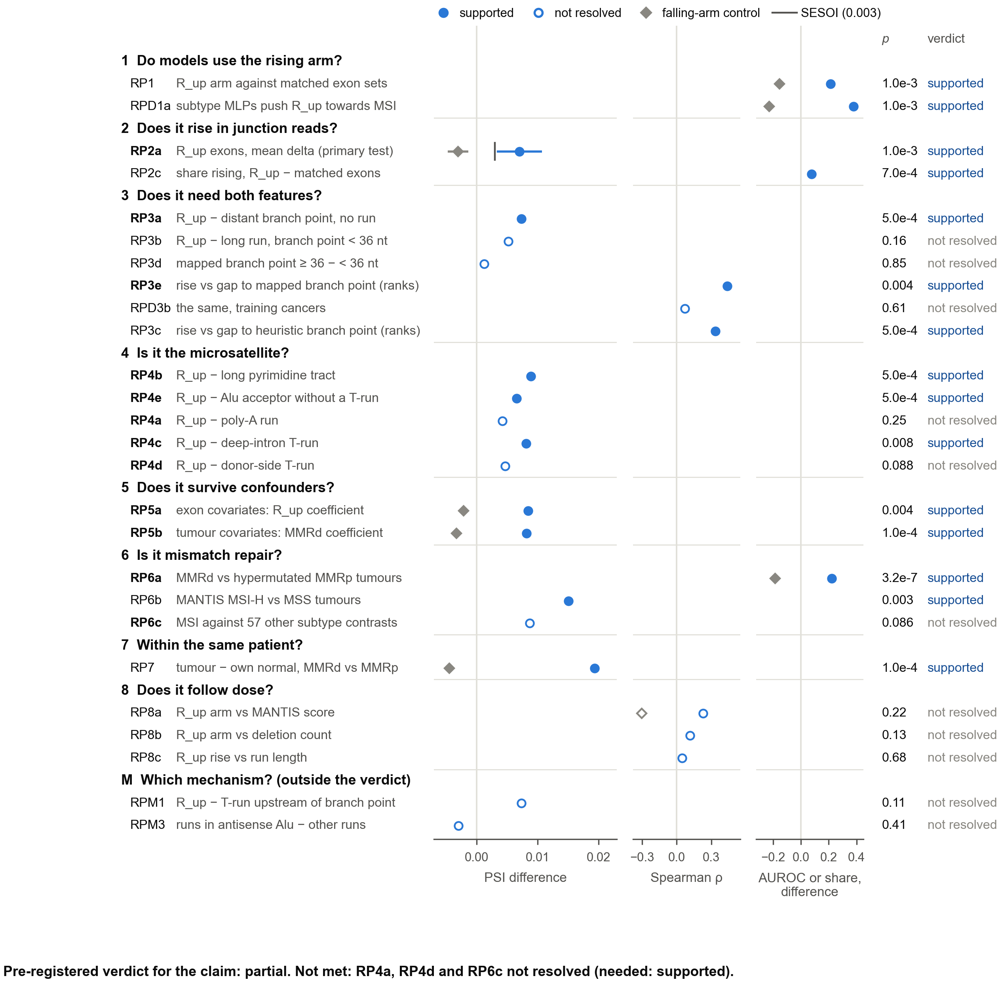

# The MSI rising arm, tested step by step (D-77)

Pre-registered as D-77 in `config/followup.yaml: msi_rising_proof` (commit 5471b27). Implemented and
dry-run on shuffled labels in `scripts/62` (commit 4b34f60), then run once with the real labels
(results committed as computed in 41b0214). Figures are drawn by `scripts/63_rising_proof_figures.py`.
Methods and amendments are in [docs/SUBTYPE_METHODS.md](../docs/SUBTYPE_METHODS.md) (D-77, A-22–A-25).

## 1. The claim, and the answer

**The claim.** In mismatch-repair-deficient (MMRd) tumours, some exons are *more* included than in
proficient (MMRp) tumours of the same cancer. These exons have a long T-run (≥ 20 nt) at the acceptor,
with the branch point at least 36 nt from the AG. This group is called the rising arm (R_up). The claim
is that the rise is real and needs both features.

**The answer: partial** (the pre-registered verdict). Nine of the twelve required tests are supported.
- **What holds.** In junction reads from the held-out cancers (50 MMRd tumours in 16 of the 30, none
  used to define the arm), R_up exons rise in MMRd tumours by +0.0070 PSI (95% interval 0.0033 to
  0.0107). The whole interval lies above the smallest effect of interest (0.003).
  - The rise needs the T-run: exons with the same distant branch point but no run do not rise.
  - At fixed run length and offset, it is rank-associated with the gap between the run and an
    experimentally mapped branch point (partial Spearman 0.44). This rests on the held-out cancers
    alone: it does not replicate in the training cancers.
  - It exceeds long pyrimidine tracts, deep-intron T-runs and Alu acceptors without a run.
  - It survives exon and tumour covariates.
  - It separates MMRd tumours from hypermutated proficient ones, and it appears with an independent
    MSI caller.
  - It is also seen within patients, though mostly in training cancers.
- **What the data do not show.**
  - That the rise beats poly-A and donor-side T-run controls. Both tests are not resolved and are
    underpowered.
  - That the rise is unique to MSI: four of 57 other subtype contrasts move the arm as much, three of
    them involving leiomyosarcoma.
  - A dose relation.
  - A mechanism.
  - The 36-nt cut on distance: it is not supported.
  - The rise is carried by a minority of exons. The class mean is +0.0070, but the median exon moves
    by only +0.0019.
- **What cannot be shown with these data.** That the T-run at a given locus is shortened in the
  tumour and that this shortening causes the rise. That needs the tumour's DNA at each tract (the
  D-56 exome-slice pilot). Everything here is an association.

## 2. How the test was built

The claim had three known weaknesses:
- **The read-out.** It was first seen in percentiles of JCEC PSI (D-70), which counts exon-body reads
  as inclusion.
- **The branch point.** It came from a crude sequence heuristic.
- **The cuts.** The 20-nt and 36-nt cuts were set on the three training cancers (COAD, STAD, UCEC)
  after the reversal was seen.

D-77 answers these in eight steps, each able to fail, all written down before any junction-read
value was compared by MMR status.
- **The read-out.** Confirmatory tests use the 30 held-out cancers: 7,685 tumours, of which 50 are
  MMRd, in 16 cancers. They use junction reads only (rMATS JC), in PSI units.
- **Per exon.** delta is the mean adjusted PSI of the MMRd tumours minus the MMRp mean of the same
  cancer. A tumour's adjusted PSI is its deviation from the cancer's median, minus its own mean
  deviation over background exons of the same baseline band.
- **Positive control.** The falling arm (T-runs of 10–19 nt, R_down) is tested alongside in every
  design.
- **Process.**
  - A reviewer checked the pre-specification (Gate 1) and the implementation (Gate 2).
  - The whole pipeline was first run on shuffled labels. Four amendments were made after that dry
    run and before any real-label run (A-22 to A-25).
  - The real-label run was then made once, and the reviewer recomputed its key tests from the raw
    arrays (Gate 3).
- **Not new tumours.** These held-out tumours are not new: D-70 read them in JCEC percentiles. This is
  a stricter re-test of the same tumours with a new read-out and new controls.

**How to read Figure RP0.**
- **Rows.** One row per test shown, top to bottom in the order of the argument; step headings in
  bold. The 12 tests the verdict needs have bold ids. Six tests are left out of the figure; the legend
  names them, and all 40 are in `tests.csv` and in section 5.
- **Columns.** The effect sits in the column of its unit: a PSI difference, a Spearman correlation,
  or an AUROC or share difference.
- **Markers.** Filled dots are supported, hollow dots not resolved. Grey diamonds are the same test on
  the falling arm, which should go the other way.
- **Right-hand columns.** The raw p and the verdict. The line under the figure gives the claim's
  verdict.

<!-- legend RP0: copied from figures/rising_proof/RP0_ladder.caption.md by the figure script's 'legends' step -->
> **Figure RP0. The rising arm passes 9 of the 12 pre-registered tests; the claim is partial.** Pre-registered as
> D-77 (config/followup.yaml: msi_rising_proof; commit 5471b27) before any junction-read value was compared by MMR
> status. Confirmatory tests use the 30 held-out cancers (50 MMR-deficient tumours in 16 of them) and junction reads
> only (rMATS JC), in PSI units. delta = an exon's mean adjusted PSI in MMR-deficient (MMRd) tumours minus the
> proficient (MMRp) mean of the same cancer. One row per test shown, in the order of the argument; the id is bold
> for the 12 tests the verdict needs (family RP). RPD3b is the gap test of RP3e repeated in the training cancers.
> Not shown: RP2b, RPC2b, RPD2a, RPD2b, RPD3a, RPM2 (all in tests.csv). Effects in different units sit in different
> columns: PSI differences (class contrasts, regression coefficients, arm contrasts), Spearman ρ (rank associations
> and dose), and AUROC or share differences (RP1: AUROC minus the median of matched exon sets; RPD1a: share of
> positive SHAP directions minus 0.5; RP2c: share of R_up exons rising minus that of matched exons; RP6a: AUROC
> minus 0.5). Filled = supported (predicted sign and q < 0.05 within the family), hollow = not resolved; bars = 95%
> intervals where the test has one (RP2a and RPC2a: studentized, Welch–Satterthwaite). Grey diamonds = the same test
> on the falling arm (runs of 10–19 nt), predicted below 0. p = raw p of the test (the larger of the exon and the
> label permutation p where both exist); q and families in RP0_ladder.csv. The line under the panel gives the
> claim's verdict by the pre-registered rule.
<!-- /legend -->

## 3. Step by step

### Step 1. Do models use the rising arm? (Figure RP1)

**How to read Figure RP1.**
- **Panel (a).** Shows whether the training cancers' subtype networks push towards MSI when R_up exons
  are more included. A bar above the grey band means more inputs push that way than chance allows.
- **Panels (b) and (c).** Place the arm's held-out AUROC (line) among 1,000 sets of matched
  background exons (grey). Such sets carry any tumour-wide shift too.
- **Panel (d).** Asks whether step 54's fitted logistic regression (M4) loses accuracy without its
  R_up inputs, compared with removing as many inputs at random.

<!-- legend RP1: copied from figures/rising_proof/RP1_models.caption.md by the figure script's 'legends' step -->
> **Figure RP1. The rising arm separates MMR-deficient tumours better than matched exon sets, but the fitted model
> does not need it.** (a) Training cancers (COAD, STAD, UCEC): the subtype MLPs (SE view, D-38) explain each
> tumour's own class, so the MSI class's SHAP exists for the MSI test tumours. For each R_up or R_down input and
> cohort, the direction is the Spearman correlation of the input's value with its SHAP over a fold's MSI test
> tumours, averaged over the folds; bars = share of input × cohort units with a positive direction (higher inclusion
> pushes towards MSI); grey band = 2.5th–97.5th percentiles of 1,000 permutations of the inputs' rows among each
> fold's MSI test tumours (A-22); dashed line = 0.5. (b, c) Held-out cancers (7,685 tumours, 50 MMRd): AUROC for
> MMRd against MMRp of the R_up (b) and R_down (c) arm (the tumour's mean PSI deviation from its cancer's median
> over the class's exons, as a percentile within the cancer); line = the class; grey = 1,000 sets of background
> exons matched to the class on baseline band and coverage tertile within each cancer, which carry any tumour-wide
> shift as well; dotted line = AUROC 0.5. (d) M4, step 54's logistic regression on all repeat exons (fitted in the
> training cancers; held-out AUROC 0.900), refitted at the same C without its 119 R_up inputs (line) and without 119
> inputs drawn at random from its other repeat inputs, 200 times (grey; exploratory, A-25).
<!-- /legend -->

- **The arm separates MMR status held out, better than matched sets** (RP1 supported). Held-out
  AUROC is 0.719, against a matched-set median of 0.506. The falling arm goes the other way (0.337
  against 0.492).
- **The subtype networks lean on it in the predicted direction** (RPD1a supported, training).
  Higher inclusion of an R_up input pushes towards MSI for 36 of 41 input × cohort units. For R_down
  inputs it does so for 108 of 397.
- **The fitted logistic model does not need it.** Removing M4's 119 R_up inputs changes its held-out
  AUROC by +0.0001. That lies at the 68.5th percentile of 200 random removals (median −0.0031). M4
  is equally accurate without the rising arm, so these results do not say that M4 uses it.

### Step 2. Does it rise in junction reads? (Figure RP2)

**How to read Figure RP2.**
- **Panel (a).** Class means with 95% intervals; the hollow dot is the R_up median.
- **Panel (b).** Ranks the 92 R_up exons by their own rise. Dark blue marks the ten largest. The grey
  line shows background exons at the same quantiles, so the gap between bars and line is the rise
  above what any exon shows.

<!-- legend RP2: copied from figures/rising_proof/RP2_junction_reads.caption.md by the figure script's 'legends' step -->
> **Figure RP2. Junction reads confirm the rise in held-out cancers, carried by a minority of the exons.** Held-out
> cancers, junction reads only (rMATS JC). Per exon, delta = the mean adjusted PSI of the MMRd tumours minus the
> MMRp mean of the same cancer (≥ 5 MMRd tumours measured); a tumour's adjusted PSI is its deviation from the
> cancer's median, minus its mean deviation over background exons of the same baseline band. (a) Mean delta of each
> class with its 95% interval (studentized SE over MMR labels permuted within cancer, Welch–Satterthwaite df; the
> intervals of R_up and R_down are those of RP2a and RPC2a, the background's is descriptive); hollow = R_up median;
> dashed = the smallest effect of interest (SESOI, 0.003). Background = the B sample of exons without an acceptor
> T-run longer than 5 nt (4,756). (b) The 92 R_up exons ranked by delta; dark blue = the 10 largest; grey line = the
> background exons' deltas at the same quantiles (rank k of 92 against the background's (1 − (k − 0.5) / 92)
> quantile; 4,756 exons; middle 95% −0.0313 to 0.0302); lines = R_up mean, median and the SESOI; the three largest
> labelled.
<!-- /legend -->

- **The rising arm rises** (RP2a, primary test, supported): +0.0070 PSI (0.0033 to 0.0107), p =
  0.001. The falling arm falls (RPC2a −0.0030, −0.0047 to −0.0013).
- **The rule picks exons that rise** (RP2c supported). The share of R_up exons whose studentized delta
  exceeds c = 3.02, the 97.5th percentile of background exons' studentized deltas under permuted
  labels, is 7.6 points higher than in matched background exons.
- **Per tumour** (RP2b supported): +0.0084.
- **But the mean is carried by a minority of exons.**
  - The median R_up exon moves by +0.0019 (p = 0.0005 for the median), and 62% of R_up exons move
    up.
  - The ten largest hold 81% of the summed delta. Without them the mean of the other 82 is +0.0015,
    below the SESOI.
  - The statement "RP2a's interval lies above the SESOI" describes the class mean, not the typical
    exon.
  - The largest-mover list repeats overlapping events (LINC00963 three times, MTO1 twice). Averaging
    within gene first gives +0.0068 (0.0032 to 0.0105).

**Sensitivity analyses** (no q; p from label permutation unless noted)

| Variant | RP2a (R_up mean delta) | RP3a (R_up minus distant branch point, no run) |
|---|---|---|
| Primary: JC reads, ≥ 10 reads, universe 50%, ≥ 20 MMRd | +0.0070 (p 0.001) | +0.0074 (p 0.0005) |
| JCEC counts (exon-body reads too) | +0.0077 (p 0.002), 110 exons | +0.0086 (p 0.0005) |
| JC reads ≥ 30 per cell | +0.0064 (p 0.0005), 57 exons | +0.0064 (p 0.001) |
| Universe at 80% of tumours | +0.0070 (p 0.0005), 72 exons | +0.0070 (p 0.0005) |
| Eligibility at ≥ 10 / ≥ 30 MMRd tumours | +0.0086 / +0.0090 | +0.0086 / +0.0097 |
| Exons with baseline ≥ 0.90 left out | +0.0081 (0.0039 to 0.0122), 77 exons | +0.0084 (p 0.0005) |
| Gene level (delta averaged within gene) | +0.0068 (0.0032 to 0.0105) | – |
| Not poison exons (D-76) | +0.0074 (0.0025 to 0.0123), 57 exons | – |
| Without BRCA / without CESC | +0.0073 (0.0034 to 0.0111) / +0.0065 (0.0022 to 0.0108) | – |
| Median instead of mean | +0.0019 (p 0.0005) | – |
| D-66 percentile units on JC | +0.030 (0.014 to 0.046) | – |
| Count model (quasi-binomial, logit) | +0.161 (p 0.005; floor 1/201) | +0.110 (p 0.010) |

In the count model, 78 of 3,035 fits were separated and dropped (A-23).

### Step 3. Does it need both features? (Figure RP3)

**How to read Figure RP3.**
- **Panel (a).** Groups the exons with a long run and an experimentally mapped branch point by the gap
  between the run and that branch point.
- **Panel (b).** Removes run length and position, then asks whether a larger gap still means a larger
  rise.

<!-- legend RP3: copied from figures/rising_proof/RP3_branch_point.caption.md by the figure script's 'legends' step -->
> **Figure RP3. The rise needs the T-run and, in held-out cancers, is rank-associated with the gap to the mapped
> branch point; the 36-nt cut is not supported.** Held-out cancers, junction reads. The 52 eligible exons with an
> acceptor T-run of ≥ 20 nt and an experimentally mapped branch point upstream of the run (BPHunter, lifted to
> GRCh38; 31 of them in the rising arm). For these exons the branch point's distance from the AG is exactly the
> offset of the run plus its length plus the gap, minus 1, so a cut on that distance mixes run length and position
> with the gap; the test therefore asks whether delta is rank-associated with the gap at fixed run length and
> offset. (a) Delta by gap bin (descriptive, the bins chosen after the results): dots = exons, solid line = mean,
> dotted = median. (b) The same exons: rank of delta against rank of the gap, each with run length and offset
> (ranks) regressed out; line = least squares.
<!-- /legend -->

- **It needs the T-run** (RP3a supported). R_up exons rise more than exons with the same distant
  branch point and no run: +0.0074, p = 0.0005.
- **In the held-out cancers it is rank-associated with the gap to the mapped branch point** (RP3e,
  the verdict's branch-point test, supported).
  - At fixed run length and offset, the partial Spearman of delta with the gap is +0.44, p = 0.004,
    over 52 exons. Leaving out one exon at a time gives 0.40 to 0.47.
  - With the heuristic branch point it is +0.33 (RP3c supported).
  - By gap bin (descriptive; the bins were chosen after the results were seen), the rise sits at gaps
    above 5 nt, is highest at 6–10 nt, and is not monotone: 1–5 nt mean +0.0031 (median −0.0001,
    22 exons); 6–10 nt mean +0.0182 (median +0.0164, 17 exons); ≥ 11 nt mean +0.0081 (median
    +0.0043, 13 exons).
- **It does not replicate in the training cancers.** The same test there gives RPD3b +0.07, p = 0.61
  (62 exons, 150 MMRd tumours, not resolved). The gap association rests on the held-out set alone.
- **The 36-nt cut on distance is not supported.**
  - Neither cut at 36 nt is resolved: RP3b, against long runs with a near heuristic branch point
    (+0.0052, p = 0.16), and RP3d, mapped branch point ≥ 36 against < 36 nt (+0.0012, p = 0.85).
  - The pre-specified sensitivity cuts for R_up (no q): ≥ 50 nt +0.0068, p = 0.091; > 60 nt
    +0.0077, p = 0.026.
  - For these exons the branch point's distance from the AG is exactly the run's offset plus its
    length plus the gap, minus 1. A cut on the distance therefore mixes run length and position with
    the gap.
  - Two of the six largest rises among the rising-arm exons (three of the six largest among all 52
    exons) have a mapped branch point under 36 nt.

### Step 4. Is it the microsatellite? (Figure RP4)

**How to read Figure RP4.**
- **Dots.** The mean rise of each control class, which has no acceptor T-run but shares one other
  feature with R_up.
- **Right-hand columns.** The pre-registered contrast: R_up minus the control, within matched strata.

<!-- legend RP4: copied from figures/rising_proof/RP4_controls.caption.md by the figure script's 'legends' step -->
> **Figure RP4. The rise exceeds long pyrimidine tracts, deep T-runs and Alu acceptors; poly-A and donor-side runs
> are not resolved.** Held-out cancers, junction reads. Mean delta (dot) of the rising arm and of each control
> class, with a descriptive 95% interval (RP2a's construction); dashed = SESOI. Controls have no acceptor T-run
> longer than 7 nt and differ from R_up in one feature: a distant branch point and no run (B sample), a long
> pyrimidine tract that is not a microsatellite with a distant branch point, an acceptor inside an Alu, a poly-A run
> (≥ 15 nt) at the acceptor, a T-run of ≥ 20 nt deep in the intron, or after the donor. The tests compare R_up with
> each control within strata of baseline band × coverage tertile, coarsened until each R_up stratum holds ≥ 3
> controls (stratum-weighted difference of mean delta; right-hand columns), so they differ from the raw difference
> of the dots. p = the larger of the exon-label (class) permutation p and the MMR-label permutation p.
<!-- /legend -->

- **Supported.** The rise is larger than in:
  - long pyrimidine tracts that are not microsatellites (RP4b, +0.0089);
  - T-runs deep in the intron (RP4c, +0.0081);
  - Alu acceptors without a run (RP4e, +0.0066; also within the antisense-Alu subset, +0.0070).
- **Not resolved: poly-A runs (RP4a) and donor-side T-runs (RP4d).** These are underpowered, which is
  not the same as the controls rising too.
  - Their label-permutation p is small (0.005 and 0.010), but their exon-permutation p is not (0.25
    and 0.088).
  - The poly-A contrast has 61 controls, 27 of them effective after matching.
  - The difference detectable with 80% power is about 0.010 for poly-A and 0.008 for donor-side runs,
    larger than RP2a itself. Even if the controls did not move at all, the power would be about 0.48
    and 0.72.
  - The controls' own means are small: poly-A +0.0016 (p = 0.10), donor-side +0.0019 (p = 0.15).
  - Specificity against a homopolymer of another base, or a T-run after the donor, remains open.
- **Less certain outside Alu.** 61 of the 92 R_up acceptors lie in an Alu. For the other 31, R_up
  minus distant branch point is +0.0057 (p = 0.068). The rise is not Alu origin as such (RP4e), but
  the evidence outside Alu is weaker.

### Step 5. Does it survive confounders? (Figure RP5)

**How to read Figure RP5.**
- **Rows.** Each row is the same effect estimated with a different set of covariates.
- **What to look for.** If a covariate explained the rise, the blue dot would move towards 0.

<!-- legend RP5: copied from figures/rising_proof/RP5_confounders.caption.md by the figure script's 'legends' step -->
> **Figure RP5. Exon and tumour covariates leave the rise unchanged.** Held-out cancers, junction reads. Exon level:
> OLS of delta on an R_up indicator against the B sample of background exons (92 R_up + 4,756 exons), with exon
> covariates; the core splice-site score (−3..+3) is blind to the tract, while the full −20..+3 score and the
> acceptor-Alu flag measure the tract itself and enter only a sensitivity model. Tumour level: OLS of each held-out
> tumour's R_up arm on MMR status with cancer indicators and the tumour's global inclusion axis, stroma, immune
> infiltrate, retained-intron level and purity. Blue = the pre-registered models; dark grey = no covariates (the
> difference of the two class means at exon level; RP2b at tumour level); light grey = sensitivity models. No
> intervals were computed for these coefficients; p is shown instead.
<!-- /legend -->

- **Exon level** (RP5a supported): the R_up coefficient is +0.0084 (p = 0.004). The covariates are
  baseline, length, coverage, host-gene change, poison status, core splice-site score, GC and Alu
  exons. Without covariates it is +0.0070. The full splice-site score and acceptor-Alu flag (+0.0081)
  and the longest coding T-run (+0.0092) do not remove it.
- **Tumour level** (RP5b supported): the MMRd coefficient is +0.0082 (p = 0.0001). The covariates
  are the tumour's global inclusion axis, stroma, immune infiltrate, retained introns and purity. It
  is +0.0084 without purity and +0.0087 with MKI67 expression added.

### Step 6. Is it mismatch repair? (Figure RP6)

**How to read Figure RP6.**
- **Panel (a).** Compares MMRd tumours with tumours that are hypermutated without MMR deficiency,
  each scored within its own cancer.
- **Panel (b).** Ranks the MSI effect among the same effect for 57 other subtype contrasts.

<!-- legend RP6: copied from figures/rising_proof/RP6_specificity.caption.md by the figure script's 'legends' step -->
> **Figure RP6. The arm separates mismatch repair from mutation load, but leiomyosarcoma contrasts move it as
> much.** Held-out cancers, junction reads. (a) Each tumour's R_up arm (mean adjusted PSI over its R_up exons) as a
> z within its cancer against the cancer's non-hypermutated MMRp tumours: MMRd (50), hypermutated MMRp (408;
> hypermutated without MMR deficiency) and the other MMRp tumours (7,227); boxes = quartiles, whiskers = 5th–95th
> percentiles, dots = tumours (other MMRp not drawn). (b) The MSI statistic s (D-70's RV1 in junction reads: 20
> held-out MMRd tumours, each with a random MMRp tumour of its cancer; mean over R_up exons of the difference in
> mean adjusted PSI; mean over 50 draws) against the same statistic for each of the 57 non-MSI subtype contrasts of
> the subtype task (two classes of one cohort with ≥ 20 tumours each, MSI, POLE and MMRd tumours removed; 20 tumours
> drawn from each class, 50 draws); contrasts at or above MSI's |s| are labelled. The null contrasts are not matched
> by cancer, while the MSI draws pair tumours within cancer.
<!-- /legend -->

- **Mismatch repair, not mutation load** (RP6a supported).
  - The arm separates MMRd from hypermutated MMRp tumours: AUROC 0.72, p = 3 × 10⁻⁷. Within the
    cancers that have both, it is 0.74.
  - With MANTIS MSI-H as the label the arm still rises (RP6b +0.015, p = 0.003); with MSIsensor,
    +0.013.
- **Not unique to MSI** (RP6c not resolved, p = 0.086). Four of the 57 non-MSI contrasts move the
  arm at least as much as MSI does (s = 0.0087):
  - SARC leiomyosarcoma against undifferentiated pleomorphic sarcoma (0.0149);
  - SARC leiomyosarcoma against myxofibrosarcoma (0.0140);
  - SARC dedifferentiated liposarcoma against leiomyosarcoma (−0.0106);
  - PCPG cortical admixture against Wnt-altered (−0.0099).

  The first three all involve leiomyosarcoma (smooth muscle), which D-70's RV1 had flagged. The fourth is an
  admixture class. The null contrasts are not matched by cancer, while the MSI draws pair tumours
  within cancer. So the arm moves with smooth-muscle lineage or composition about as much as with
  MMR deficiency. Its link to mismatch repair rests on RP6a, not on uniqueness.

### Step 7. Within the same patient? (Figure RP7)

**How to read Figure RP7.**
- **Dots.** Each dot is one tumour minus its own normal tissue. Blue marks MMRd patients.
- **Lines.** Means where a group has at least 5 pairs.

<!-- legend RP7: copied from figures/rising_proof/RP7_within_patient.caption.md by the figure script's 'legends' step -->
> **Figure RP7. MMR-deficient tumours rise above their own normal tissue, mostly in training cancers.** The
> tumour–normal pairs of the cancers with at least one MMRd pair. Pair arm = the tumour's mean PSI deviation over
> its R_up exons minus that of its own normal tissue (the same exons, the same adjustment for each sample's
> inclusion level). Dots = pairs; lines = means where a group has ≥ 5 pairs. 12 MMRd and 200 MMRp pairs; 10 of the
> MMRd pairs are in training cancers (COAD 6, STAD 3, UCEC 1), so this test is not held out (family RPP).
<!-- /legend -->

- **MMRd tumours rise above their own normal tissue more than MMRp tumours do** (RP7 supported):
  +0.019, p = 0.0001. The falling arm goes the other way (RPC7 −0.0045).
- **Mostly a training-cancer result.** 10 of the 12 MMRd pairs are in training cancers (COAD 6, STAD
  3, UCEC 1), so RP7 is supporting evidence, not a held-out test (family RPP).
- **The held-out pairs split.** In BRCA the single MMRd pair lies above the cancer's proficient pairs;
  in PRAD it lies slightly below them.

### Step 8. Does it follow dose? (Figure RP8)

**How to read Figure RP8.**
- **Panel (a).** Would show a slope if tumours with more instability had more rise.
- **Panel (b).** Would show one if longer runs rose more.

<!-- legend RP8: copied from figures/rising_proof/RP8_dose.caption.md by the figure script's 'legends' step -->
> **Figure RP8. The rise does not follow dose.** (a) The held-out MMRd tumours (50): R_up arm against the MANTIS
> score (the exome instability score). (b) The R_up exons: delta against acceptor T-run length (20–40 nt; jittered).
> Both tests ask for a graded relation, which D-70's percentile read-out had not found (RV6).
<!-- /legend -->

- **No dose relation.** None of the three dose tests is resolved:
  - MANTIS score among held-out MMRd tumours (RP8a, +0.23, p = 0.22);
  - deletion count among all 200 MMRd tumours (RP8b, +0.11, p = 0.13);
  - run length across R_up exons (RP8c, +0.05, p = 0.68).
- **The falling arm shows no dose either** (RPC8, −0.30, p = 0.060).

### Mechanism (Figure RPM, outside the verdict)

**How to read Figure RPM.** The two readings make different predictions:
- **Branch-point geometry** predicts no rise for a T-run upstream of the branch point (shield exons).
- **hnRNP C competition** predicts a rise there too, and more in runs inside an antisense Alu.

<!-- legend RPM: copied from figures/rising_proof/RPM_mechanism.caption.md by the figure script's 'legends' step -->
> **Figure RPM. The mechanism tests are not resolved.** Held-out cancers, junction reads; outside the claim's
> verdict (family RPM). Mean delta with a descriptive 95% interval; dashed = SESOI. Shield exons have no acceptor
> T-run but a T-run of ≥ 20 nt upstream of their branch point: shortening it cannot bring the branch point closer to
> the AG, so the geometry reading predicts no rise there and a rise in R_up above it (RPM1), while the hnRNP C
> reading (hnRNP C binds long U-runs and represses Alu-derived exons) predicts that shield exons rise too (RPM2) and
> that runs inside an antisense Alu rise more (RPM3). Long runs = eligible runs of ≥ 20 nt (R_up, near or no branch
> point), compared within strata and run-length bins.
<!-- /legend -->

- **Not resolved.** None of the three tests is resolved: R_up minus shield (RPM1, +0.0073, p = 0.11),
  shield exons against 0 (RPM2, −0.0017), and antisense-Alu runs minus other long runs (RPM3,
  −0.0030).
- **The mechanism remains open.** Geometry had predicted RPM1 supported. The gap association
  (step 3) leans towards geometry, but it rests on the held-out cancers alone (it does not replicate
  in the training cancers), and the data do not separate the two readings formally.

## 4. What this proves and what it does not

**Shown** (an association, held out, in junction reads):
- **A held-out rise in exons with a long acceptor T-run.** In MMRd tumours, these exons are more
  included than in proficient tumours of the same cancer, in held-out cancers (50 MMRd tumours in 16
  of the 30) not used to define the rule.
- **It needs the T-run.** It is absent in exons with the same distant branch point and no run.
- **A rank association with the gap** between the run and an experimentally mapped branch point, at
  fixed run length and offset (partial Spearman 0.44). It does not replicate in the training cancers
  (RPD3b +0.07, p = 0.61) and rests on the held-out set alone.
- **It is not explained by** long pyrimidine tracts, deep-intron T-runs, Alu origin, exon or tumour
  covariates, or hypermutation.
- **It is present within patients**, mostly in training cancers.

**Not shown:**
- **Uniqueness to MSI.** Four of 57 subtype contrasts, three of them in leiomyosarcoma, move the arm as
  much.
- **Beating poly-A and donor-side runs.** These are not resolved and underpowered; the question is
  open.
- **A dose relation.**
- **The mechanism.** It leans towards geometry but is formally open.
- **The 36-nt cut on distance.** It is not supported (RP3b, RP3d not resolved).
- **Locus-level causation.** No tract is observed shortening in the tumour's DNA. That needs the D-56
  exome-slice pilot.

**Qualifiers that travel with every use of this result:**
- **The rise is uneven.** The class mean (+0.0070) is carried by a minority of exons: the median exon
  moves by +0.0019, and without the ten largest the mean is +0.0015. RP2a's interval clearing the
  SESOI describes the mean. RP2c (a 7.6-point excess of rising exons over matched ones) and the
  median should be quoted beside it.
- **The fitted logistic model does not need the rising arm.** Removing it leaves M4's AUROC
  unchanged. The arm carries information on its own (RP1), but M4's accuracy does not depend on it.
- **The instrument check failed, narrowly.**
  - It draws 92 falling-arm exons at a time to the rising arm's coverage and mirrored baseline. Its
    median statistic was −1.92 against a critical value of −2.00, with 47.6% of draws below
    (80% needed).
  - It gates only the "refuted" clause, so the verdict is unaffected: the rise was detected.
  - It does mean that a 92-exon set near PSI 0 or 1 sees a known fall only about half the time.
    Non-resolution of contrasts of that size (RP4a, RP4d, RP3b, RP3d) is weak evidence of absence.
- **These are not new tumours.** D-70 read them in JCEC percentiles. This is a stricter re-test with a
  new read-out and new controls.

## 5. Methods, data and all tests

**Methods** (full specification in D-77 and `config/followup.yaml: msi_rising_proof`):
- **PSI and inclusion.** rMATS JC PSI = IJC / (IJC + ratio × SJC), counted where a tumour has ≥ 10
  junction reads. An exon enters a cancer's universe when it is measured in ≥ 50% of its tumours. The
  baseline is the cancer's median over all tumours, in 13 bands.
- **Adjustment.** Each tumour's deviation from the baseline is adjusted by its mean deviation over
  background exons of the same band.
- **Exon delta.** The MMRd mean minus the MMRp mean of the same cancer, over exons with ≥ 5 MMRd
  tumours measured. An exon is eligible held out when ≥ 20 held-out MMRd tumours sit in cancers where
  it is in the universe.
- **Class means.** These use a studentized statistic under MMR labels permuted within cancer
  (2,000; Chung and Romano 2013), with a Welch–Satterthwaite interval.
- **Class contrasts.** They permute exon labels within strata of baseline band × coverage tertile,
  coarsened until each R_up stratum holds ≥ 3 controls (10,000), and also MMR labels. p is the larger
  of the two (an intersection–union test).
- **Regressions.** Freedman–Lane residual permutation on the HC3 t (Freedman and Lane 1983).
- **Correlations.** Partial Spearman, with permutation within cells.
- **Verdicts.**
  - A test is supported when its sign is the predicted one and q < 0.05 within its family
    (Benjamini–Hochberg). The families are RP (12 tests), RPS (9), RPP (2), RPC (8), RPD (6) and
    RPM (3).
  - The claim's verdict follows the pre-registered rule, in order: uninterpretable, refuted,
    established, partial.
- **Amendments.** Four amendments were made after the shuffled-label dry run, before any real-label
  run:
  - A-22: a permutation null for RPD1;
  - A-23: separated count-model fits dropped;
  - A-24: blanking of committed cells over fewer than 5 MMRd tumours;
  - A-25: the M4 random-removal reference.
- **After the real-label run.** Only the wording of verdict.json's unmet conditions changed, from
  "RP4a supported (not resolved)" to "RP4a not resolved (needed: supported)". This came from the
  Gate 3 review and was regenerated from the report stage, with no recomputation.

**Data.**
- **Junction and exon-body counts.** rMATS SE counts of the 2026-10-14 count store (TCGA, GDC).
- **MMR status and calls.** MC3 homopolymer-deletion MMR status and hypermutation (D-71's tumours).
  MANTIS and MSIsensor calls (Bonneville et al. 2017; Niu et al. 2014).
- **Branch points.** Experimentally mapped branch points from BPHunter Dataset S1 (Zhang et al.
  2022; hg19), lifted to GRCh38 with the UCSC hg19-to-hg38 chain.
- **Repeats.** Alu annotation from the UCSC hg38 RepeatMasker table.
- **Pinning.** All external files are pinned by size and MD5 in `scripts/62` and by SHA-256 in
  `config/sources.yaml`.
- **Where values live.** Per-sample values stay in the git-ignored data directory. The committed
  tables (`results/subtype/msi_cis/code/proof/`) hold aggregates.

**Reproduction.**
- `python scripts/62_msi_rising_proof.py --only compute --labels real --real-labels-approved`
  (681 s of compute), then `--only report` with the same flags.
- `python scripts/63_rising_proof_figures.py`. It redraws the figures from the committed tables and
  local caches, and stops unless every redrawn statistic equals the committed one.

**All 40 tests** (`tests.csv`). p is the raw p (the larger of the exon and the label permutation p
where both exist). q is Benjamini–Hochberg within the family. Estimates are in PSI except for
correlations (RP3c, RP3e, RP8a–c, RPC8, RPD3b), AUROC or share differences (RP1, RPC1, RP2c, RP6a,
RPC6, RPD1a, RPD1b) and the count model.

| Test | Family | Claim | Estimate | p | q | Verdict |
|---|---|---|---|---|---|---|
| RP2a | RP | mean delta over eligible R_up exons (JC, PSI) | +0.0070 | 1.0e-3 | 0.002 | supported |
| RP3a | RP | R_up minus B_far, stratum-weighted mean delta | +0.0074 | 5.0e-4 | 0.001 | supported |
| RP3e | RP | partial Spearman of delta with g_exp given L and o | +0.438 | 0.004 | 0.006 | supported |
| RP4a | RP | R_up minus polyA (≥ 15 nt) | +0.0042 | 0.25 | 0.25 | not resolved |
| RP4b | RP | R_up minus ppt_far | +0.0089 | 5.0e-4 | 0.001 | supported |
| RP4c | RP | R_up minus deep | +0.0081 | 0.008 | 0.010 | supported |
| RP4d | RP | R_up minus donor | +0.0047 | 0.088 | 0.096 | not resolved |
| RP4e | RP | R_up minus alu | +0.0066 | 5.0e-4 | 0.001 | supported |
| RP5a | RP | OLS coefficient of R_up on delta, exon covariates (vs B sample) | +0.0084 | 0.004 | 0.006 | supported |
| RP5b | RP | OLS coefficient of MMRd on the R_up arm, tumour covariates | +0.0082 | 1.0e-4 | 6.0e-4 | supported |
| RP6a | RP | AUROC of the R_up arm z, MMRd vs hypermutated MMRp, minus 0.5 | +0.221 | 3.2e-7 | 3.8e-6 | supported |
| RP6c | RP | MMRd contrast s (JC adj) against 57 subtype contrasts | +0.0087 | 0.086 | 0.096 | not resolved |
| RP1 | RPS | R_up dev-arm AUROC minus the median of 1,000 matched B sets | +0.213 | 1.0e-3 | 0.002 | supported |
| RP2b | RPS | R_up arm_contrast | +0.0084 | 5.0e-4 | 0.002 | supported |
| RP2c | RPS | share of R_up exons rising minus the share of matched B-sample exons | +0.0761 | 7.0e-4 | 0.002 | supported |
| RP3b | RPS | R_up minus near_bp | +0.0052 | 0.16 | 0.24 | not resolved |
| RP3c | RPS | partial Spearman of delta with g given L and o (heuristic branch point) | +0.333 | 5.0e-4 | 0.002 | supported |
| RP3d | RPS | experimental branch point d_exp ≥ 36 minus < 36 | +0.0012 | 0.85 | 0.85 | not resolved |
| RP6b | RPS | R_up arm_contrast, MANTIS MSI-H vs MSS | +0.0151 | 0.003 | 0.006 | supported |
| RP8a | RPS | partial Spearman of the R_up arm with MANTIS given cancer, MMRd | +0.229 | 0.22 | 0.28 | not resolved |
| RP8c | RPS | Spearman of delta with run length over R_up | +0.0477 | 0.68 | 0.76 | not resolved |
| RP7 | RPP | tumour-normal pair arm, MMRd minus MMRp pairs | +0.0194 | 1.0e-4 | 2.0e-4 | supported |
| RP8b | RPP | partial Spearman of the R_up arm with log(1 + deletions) given cancer, MMRd | +0.114 | 0.13 | 0.13 | not resolved |
| RPC1 | RPC | R_down dev-arm AUROC minus the median of 1,000 matched B sets | −0.155 | 1.0e-3 | 0.003 | supported |
| RPC2a | RPC | mean delta over eligible R_down exons | −0.0030 | 0.002 | 0.004 | supported |
| RPC2b | RPC | R_down arm_contrast | −0.0030 | 0.001 | 0.003 | supported |
| RPC5a | RPC | OLS coefficient of R_down on delta, exon covariates (vs B sample) | −0.0022 | 0.034 | 0.039 | supported |
| RPC5b | RPC | OLS coefficient of MMRd on the R_down arm, tumour covariates | −0.0033 | 2.0e-4 | 8.0e-4 | supported |
| RPC6 | RPC | AUROC of the R_down arm z, MMRd vs hypermutated MMRp, minus 0.5 | −0.183 | 2.3e-5 | 1.8e-4 | supported |
| RPC7 | RPC | tumour-normal pair arm (R_down), MMRd minus MMRp pairs | −0.0045 | 0.007 | 0.010 | supported |
| RPC8 | RPC | partial Spearman of the R_down arm with MANTIS given cancer, MMRd | −0.303 | 0.060 | 0.060 | not resolved |
| RPD1a | RPD | share of R_up SHAP directions > 0, minus 0.5 | +0.378 | 1.0e-3 | 0.001 | supported |
| RPD1b | RPD | share of R_down SHAP directions > 0, minus 0.5 | −0.228 | 1.0e-3 | 0.001 | supported |
| RPD2a | RPD | training: mean delta over R_up exons | +0.0111 | 5.0e-4 | 1.0e-3 | supported |
| RPD2b | RPD | training: mean delta over R_down exons | −0.0091 | 5.0e-4 | 1.0e-3 | supported |
| RPD3a | RPD | training: R_up minus B_far | +0.0108 | 5.0e-4 | 1.0e-3 | supported |
| RPD3b | RPD | training: partial Spearman of delta with g_exp given L and o | +0.0702 | 0.61 | 0.61 | not resolved |
| RPM1 | RPM | R_up minus shield | +0.0073 | 0.11 | 0.33 | not resolved |
| RPM2 | RPM | mean delta over shield exons | −0.0017 | 0.31 | 0.41 | not resolved |
| RPM3 | RPM | runs ≥ 20 in an antisense Alu minus not | −0.0030 | 0.41 | 0.41 | not resolved |

Names in the table: B_far, background exons with a branch point ≥ 36 nt and no acceptor T-run;
near_bp, long runs with a near heuristic branch point; ppt_far, long pyrimidine tracts that are not
microsatellites; deep and donor, T-runs deep in the intron or after the donor; alu, Alu acceptors
without a T-run; shield, a T-run upstream of the branch point; g_exp, the gap from the run to the
mapped branch point; L and o, the run's length and offset from the AG.

## 6. References

- Bonneville R et al. (2017) Landscape of microsatellite instability across 39 cancer types. *JCO
  Precis Oncol* 2017:PO.17.00073. PMID 29850653.
- Chua K, Reed R (2001) An upstream AG determines whether a downstream AG is selected during
  catalytic step II of splicing. *Mol Cell Biol* 21:1509. PMID 11238888.
- Chung E, Romano JP (2013) Exact and asymptotically robust permutation tests. *Ann Stat* 41:484–507.
  doi:10.1214/13-AOS1090.
- Corvelo A, Hallegger M, Smith CWJ, Eyras E (2010) Genome-wide association between branch point
  properties and alternative splicing. *PLoS Comput Biol* 6:e1001016. PMID 21124863.
- DeBoever C et al. (2015) Transcriptome sequencing reveals potential mechanism of cryptic 3′ splice
  site selection in SF3B1-mutated cancers. *PLoS Comput Biol* 11:e1004105. PMID 25768983.
- Freedman D, Lane D (1983) A nonstochastic interpretation of reported significance levels. *J Bus
  Econ Stat* 1:292–298. doi:10.1080/07350015.1983.10509354.
- Jonchère V et al. (2024) Microsatellite instability at U2AF-binding polypyrimidic tract sites
  perturbs alternative splicing during colorectal cancer initiation. *Genome Biol* 25:210. PMID
  39107855.
- Niu B et al. (2014) MSIsensor: microsatellite instability detection using paired tumor-normal
  sequence data. *Bioinformatics* 30:1015. PMID 24371154.
- Zarnack K et al. (2013) Direct competition between hnRNP C and U2AF65 protects the transcriptome
  from the exonization of Alu elements. *Cell* 152:453. PMID 23374342.
- Zhang P et al. (2022) Genome-wide detection of human variants that disrupt intronic branchpoints.
  *Proc Natl Acad Sci USA* 119:e2211194119 (BPHunter; Dataset S1). PMID 36306325.

PMIDs as verified for D-77's research notes (2026-10-23) and for results/SUBTYPE.md (2026-10-12 and
2026-10-13). Chung and Romano 2013 and Freedman and Lane 1983 are cited by DOI.
