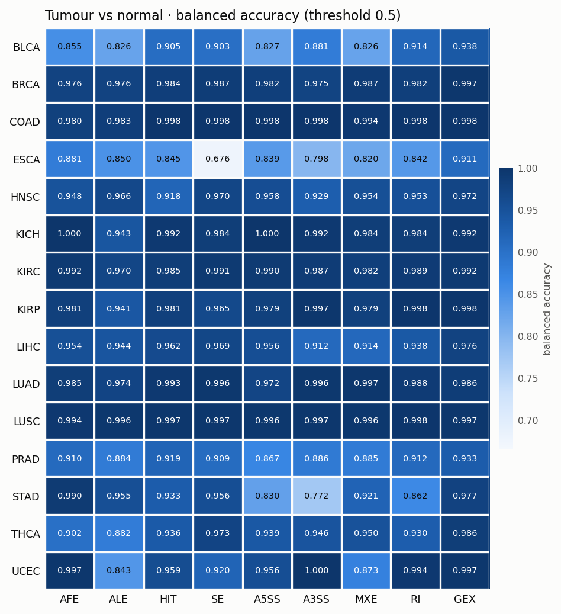

# Results

Generated by `scripts/06_summarise_results.py`. All numbers are **out-of-fold**: each sample is predicted by the outer-fold model that never saw it (or any sample of its case) during feature selection, tuning or training. Brackets: 95 % case-level bootstrap CIs on the pooled out-of-fold predictions.

## Task 1 — tumour vs normal, per cancer

### AUROC (95 % CI)

| Cancer | n (normal) | AFE | ALE | HIT | SE | A5SS | A3SS | MXE | RI | GEX |
|---|---|---|---|---|---|---|---|---|---|---|
| BLCA | 420 (18) | 0.987 (0.972–0.998) | 0.973 (0.944–0.996) | 0.912 (0.786–0.998) | 0.976 (0.939–0.997) | 0.974 (0.947–0.994) | 0.981 (0.955–0.999) | 0.982 (0.964–0.993) | 0.993 (0.982–1.000) | 0.996 (0.991–1.000) |
| BRCA | 1185 (112) | 0.997 (0.994–0.999) | 0.993 (0.986–0.998) | 0.998 (0.997–1.000) | 0.999 (0.998–1.000) | 0.997 (0.995–0.999) | 0.998 (0.996–0.999) | 0.999 (0.997–1.000) | 0.999 (0.998–1.000) | 1.000 (0.999–1.000) |
| COAD | 302 (39) | 0.999 (0.997–1.000) | 0.997 (0.992–1.000) | 1.000 (0.998–1.000) | 0.999 (0.997–1.000) | 1.000 (1.000–1.000) | 0.999 (0.995–1.000) | 0.998 (0.994–1.000) | 1.000 (0.999–1.000) | 1.000 (1.000–1.000) |
| ESCA | 172 (11) | 0.918 (0.796–0.996) | 0.894 (0.758–0.979) | 0.863 (0.712–1.000) | 0.711 (0.439–0.960) | 0.913 (0.805–0.985) | 0.907 (0.804–0.980) | 0.858 (0.711–0.991) | 0.871 (0.689–0.986) | 0.976 (0.949–0.996) |
| HNSC | 545 (44) | 0.970 (0.919–0.998) | 0.981 (0.951–0.998) | 0.966 (0.917–0.996) | 0.982 (0.950–1.000) | 0.990 (0.978–0.998) | 0.983 (0.963–0.998) | 0.993 (0.986–0.999) | 0.985 (0.962–0.999) | 0.987 (0.968–1.000) |
| KICH | 88 (24) | 1.000 (1.000–1.000) | 0.992 (0.977–1.000) | 1.000 (1.000–1.000) | 0.996 (0.987–1.000) | 1.000 (1.000–1.000) | 1.000 (1.000–1.000) | 0.999 (0.997–1.000) | 1.000 (1.000–1.000) | 1.000 (1.000–1.000) |
| KIRC | 593 (71) | 0.993 (0.975–1.000) | 0.992 (0.971–1.000) | 0.986 (0.952–1.000) | 0.989 (0.960–1.000) | 0.988 (0.957–1.000) | 0.998 (0.993–1.000) | 0.990 (0.963–1.000) | 0.986 (0.951–1.000) | 0.987 (0.953–1.000) |
| KIRP | 319 (32) | 0.999 (0.997–1.000) | 0.948 (0.874–1.000) | 0.999 (0.998–1.000) | 0.999 (0.996–1.000) | 0.999 (0.997–1.000) | 1.000 (0.999–1.000) | 0.999 (0.997–1.000) | 1.000 (1.000–1.000) | 1.000 (1.000–1.000) |
| LIHC | 416 (50) | 0.987 (0.975–0.996) | 0.979 (0.963–0.992) | 0.990 (0.974–0.999) | 0.995 (0.990–0.999) | 0.993 (0.988–0.998) | 0.986 (0.977–0.994) | 0.983 (0.971–0.993) | 0.990 (0.982–0.996) | 0.997 (0.993–1.000) |
| LUAD | 547 (58) | 0.999 (0.998–1.000) | 0.998 (0.996–1.000) | 1.000 (0.999–1.000) | 1.000 (1.000–1.000) | 0.999 (0.998–1.000) | 1.000 (0.999–1.000) | 1.000 (1.000–1.000) | 0.999 (0.997–1.000) | 1.000 (0.999–1.000) |
| LUSC | 543 (49) | 0.998 (0.994–1.000) | 0.998 (0.994–1.000) | 0.998 (0.994–1.000) | 1.000 (0.999–1.000) | 0.999 (0.998–1.000) | 0.999 (0.996–1.000) | 0.998 (0.996–1.000) | 0.999 (0.998–1.000) | 0.998 (0.994–1.000) |
| PRAD | 549 (52) | 0.967 (0.942–0.985) | 0.948 (0.915–0.975) | 0.980 (0.966–0.991) | 0.970 (0.948–0.987) | 0.944 (0.905–0.971) | 0.942 (0.897–0.975) | 0.969 (0.947–0.986) | 0.977 (0.957–0.991) | 0.957 (0.909–0.992) |
| STAD | 383 (31) | 0.994 (0.987–1.000) | 0.984 (0.956–0.998) | 0.979 (0.946–0.996) | 0.993 (0.985–0.998) | 0.957 (0.905–0.990) | 0.907 (0.840–0.963) | 0.988 (0.978–0.996) | 0.970 (0.937–0.991) | 0.996 (0.989–1.000) |
| THCA | 562 (59) | 0.964 (0.929–0.987) | 0.976 (0.962–0.988) | 0.970 (0.936–0.993) | 0.993 (0.984–0.999) | 0.980 (0.964–0.993) | 0.986 (0.972–0.997) | 0.982 (0.967–0.993) | 0.972 (0.929–0.995) | 0.988 (0.961–1.000) |
| UCEC | 191 (13) | 0.998 (0.993–1.000) | 0.940 (0.809–1.000) | 0.999 (0.996–1.000) | 0.987 (0.965–1.000) | 0.998 (0.992–1.000) | 1.000 (1.000–1.000) | 0.990 (0.977–0.999) | 0.999 (0.996–1.000) | 1.000 (1.000–1.000) |

### Balanced accuracy / specificity for normals (MCC)

| Cancer | AFE | ALE | HIT | SE | A5SS | A3SS | MXE | RI | GEX |
|---|---|---|---|---|---|---|---|---|---|
| BLCA | 0.855 / 0.72 (0.71) | 0.826 / 0.67 (0.65) | 0.905 / 0.83 (0.71) | 0.903 / 0.83 (0.68) | 0.827 / 0.67 (0.67) | 0.881 / 0.78 (0.73) | 0.826 / 0.67 (0.65) | 0.914 / 0.83 (0.85) | 0.938 / 0.89 (0.81) |
| BRCA | 0.976 / 0.96 (0.92) | 0.976 / 0.98 (0.86) | 0.984 / 0.97 (0.96) | 0.987 / 0.98 (0.95) | 0.982 / 0.97 (0.94) | 0.975 / 0.96 (0.91) | 0.987 / 0.98 (0.95) | 0.982 / 0.97 (0.94) | 0.997 / 1.00 (0.97) |
| COAD | 0.980 / 0.97 (0.93) | 0.983 / 0.97 (0.96) | 0.998 / 1.00 (0.99) | 0.998 / 1.00 (0.99) | 0.998 / 1.00 (0.99) | 0.998 / 1.00 (0.99) | 0.994 / 1.00 (0.96) | 0.998 / 1.00 (0.99) | 0.998 / 1.00 (0.99) |
| ESCA | 0.881 / 0.82 (0.61) | 0.850 / 0.82 (0.46) | 0.845 / 0.73 (0.62) | 0.676 / 0.36 (0.47) | 0.839 / 0.73 (0.57) | 0.798 / 0.73 (0.39) | 0.820 / 0.73 (0.47) | 0.842 / 0.73 (0.59) | 0.911 / 0.91 (0.58) |
| HNSC | 0.948 / 0.93 (0.79) | 0.966 / 0.95 (0.86) | 0.918 / 0.86 (0.77) | 0.970 / 0.95 (0.90) | 0.958 / 0.93 (0.87) | 0.929 / 0.86 (0.89) | 0.954 / 0.93 (0.83) | 0.953 / 0.91 (0.92) | 0.972 / 0.95 (0.92) |
| KICH | 1.000 / 1.00 (1.00) | 0.943 / 0.92 (0.89) | 0.992 / 1.00 (0.97) | 0.984 / 1.00 (0.95) | 1.000 / 1.00 (1.00) | 0.992 / 1.00 (0.97) | 0.984 / 1.00 (0.95) | 0.984 / 1.00 (0.95) | 0.992 / 1.00 (0.97) |
| KIRC | 0.992 / 0.99 (0.98) | 0.970 / 0.96 (0.91) | 0.985 / 0.97 (0.98) | 0.991 / 0.99 (0.98) | 0.990 / 0.99 (0.97) | 0.987 / 0.99 (0.95) | 0.982 / 0.97 (0.95) | 0.989 / 0.99 (0.96) | 0.992 / 0.99 (0.98) |
| KIRP | 0.981 / 0.97 (0.95) | 0.941 / 0.91 (0.84) | 0.981 / 0.97 (0.95) | 0.965 / 0.94 (0.93) | 0.979 / 0.97 (0.93) | 0.997 / 1.00 (0.97) | 0.979 / 0.97 (0.93) | 0.998 / 1.00 (0.98) | 0.998 / 1.00 (0.98) |
| LIHC | 0.954 / 0.94 (0.85) | 0.944 / 0.94 (0.79) | 0.962 / 0.96 (0.85) | 0.969 / 0.96 (0.89) | 0.956 / 0.94 (0.86) | 0.912 / 0.86 (0.79) | 0.914 / 0.86 (0.79) | 0.938 / 0.90 (0.85) | 0.976 / 0.98 (0.89) |
| LUAD | 0.985 / 0.98 (0.94) | 0.974 / 0.97 (0.90) | 0.993 / 1.00 (0.94) | 0.996 / 1.00 (0.96) | 0.972 / 0.95 (0.95) | 0.996 / 1.00 (0.96) | 0.997 / 1.00 (0.97) | 0.988 / 0.98 (0.96) | 0.986 / 0.98 (0.94) |
| LUSC | 0.994 / 1.00 (0.94) | 0.996 / 1.00 (0.96) | 0.997 / 1.00 (0.97) | 0.997 / 1.00 (0.97) | 0.996 / 1.00 (0.96) | 0.997 / 1.00 (0.97) | 0.996 / 1.00 (0.96) | 0.998 / 1.00 (0.98) | 0.997 / 1.00 (0.97) |
| PRAD | 0.910 / 0.88 (0.69) | 0.884 / 0.83 (0.67) | 0.919 / 0.88 (0.74) | 0.909 / 0.87 (0.72) | 0.867 / 0.79 (0.65) | 0.886 / 0.83 (0.68) | 0.885 / 0.81 (0.72) | 0.912 / 0.87 (0.74) | 0.933 / 0.90 (0.78) |
| STAD | 0.990 / 1.00 (0.89) | 0.955 / 0.94 (0.83) | 0.933 / 0.90 (0.76) | 0.956 / 0.94 (0.84) | 0.830 / 0.68 (0.70) | 0.772 / 0.58 (0.54) | 0.921 / 0.87 (0.78) | 0.862 / 0.74 (0.75) | 0.977 / 0.97 (0.90) |
| THCA | 0.902 / 0.85 (0.74) | 0.882 / 0.80 (0.74) | 0.936 / 0.92 (0.78) | 0.973 / 0.97 (0.90) | 0.939 / 0.92 (0.80) | 0.946 / 0.93 (0.80) | 0.950 / 0.93 (0.83) | 0.930 / 0.88 (0.84) | 0.986 / 0.98 (0.94) |
| UCEC | 0.997 / 1.00 (0.96) | 0.843 / 0.69 (0.78) | 0.959 / 0.92 (0.92) | 0.920 / 0.85 (0.87) | 0.956 / 0.92 (0.88) | 1.000 / 1.00 (1.00) | 0.873 / 0.77 (0.72) | 0.994 / 1.00 (0.93) | 0.997 / 1.00 (0.96) |

Mean over cancers:

| Metric | AFE | ALE | HIT | SE | A5SS | A3SS | MXE | RI | GEX |
|---|---|---|---|---|---|---|---|---|---|
| auroc | 0.985 | 0.973 | 0.976 | 0.973 | 0.982 | 0.979 | 0.982 | 0.983 | 0.992 |
| balanced_accuracy | 0.956 | 0.929 | 0.954 | 0.946 | 0.939 | 0.938 | 0.938 | 0.952 | 0.977 |
| auprc_normal | 0.925 | 0.892 | 0.931 | 0.916 | 0.904 | 0.912 | 0.910 | 0.928 | 0.952 |
| mcc | 0.859 | 0.806 | 0.860 | 0.866 | 0.850 | 0.835 | 0.831 | 0.882 | 0.906 |

## Task 2 — cancer type (33 TCGA projects + pooled Normal), pan-cancer

| View | Accuracy | Balanced accuracy | Macro F1 | Macro AUROC (OvR) | Top-3 accuracy | Log loss |
|---|---|---|---|---|---|---|
| AFE | 0.918 (0.913–0.924) | 0.914 (0.905–0.921) | 0.904 (0.897–0.912) | 0.997 | 0.985 | 0.280 |
| ALE | 0.898 (0.891–0.903) | 0.890 (0.881–0.899) | 0.882 (0.872–0.889) | 0.996 | 0.981 | 0.335 |
| HIT | 0.920 (0.914–0.925) | 0.920 (0.912–0.926) | 0.909 (0.901–0.915) | 0.997 | 0.989 | 0.266 |
| SE | 0.941 (0.936–0.946) | 0.923 (0.916–0.931) | 0.918 (0.910–0.927) | 0.998 | 0.992 | 0.202 |
| A5SS | 0.917 (0.912–0.923) | 0.907 (0.899–0.916) | 0.901 (0.892–0.909) | 0.997 | 0.987 | 0.267 |
| A3SS | 0.920 (0.914–0.925) | 0.912 (0.904–0.919) | 0.905 (0.897–0.913) | 0.997 | 0.987 | 0.272 |
| MXE | 0.909 (0.904–0.914) | 0.903 (0.895–0.911) | 0.893 (0.884–0.900) | 0.997 | 0.984 | 0.293 |
| RI | 0.933 (0.927–0.937) | 0.921 (0.914–0.929) | 0.918 (0.911–0.924) | 0.998 | 0.990 | 0.219 |
| GEX | 0.954 (0.949–0.958) | 0.936 (0.928–0.943) | 0.930 (0.924–0.937) | 0.998 | 0.994 | 0.165 |

## Interpretability (SHAP)

Every outer-fold model is explained with `shap.DeepExplainer` on **all** of its held-out samples. Per job folder (`results/<task>/<view>/<cohort>/`):

- `shap_top_features.csv`: top 200 features by mean |SHAP| pooled over folds (a feature a fold did not select contributes 0 for that fold), with `n_folds_selected` and `direction_spearman` (Spearman of feature value vs SHAP: > 0 means higher PSI / usage / expression pushes towards tumour);
- `shap_top_genes.csv`: the same importances summed per host gene;
- `shap_top_features_by_class.csv` (cancer type): top 30 features per class, explaining each sample's own centred class logit, with a per-class direction;
- figures: `shap_beeswarm.png` (tumour status), `shap_class_heatmap.png` and `confusion_matrix.png` (cancer type).

### Top 5 SHAP genes · tumor_status

| Cohort | AFE | ALE | HIT | SE | A5SS | A3SS | MXE | RI | GEX |
|---|---|---|---|---|---|---|---|---|---|
| BLCA | SEPTIN9, CAPG, THOC3, GSN, PSMD4 | EXOSC7, SNHG14, MORC3, COX6C, ATRN | FMNL3, COL4A5, ENSG00000289755, KRT8, PGM3 | MUC20-OT1, PCBP1-AS1, ZNG1E, LCA5L, MAPK10 | HNRNPA1, GBF1, PCBP1-AS1, EIF3I, HGS | LAS1L, LINC00665, GBF1, TMEM91, PLAGL1 | PCBP1-AS1, JPX, ANXA2, PVT1, MIR4435-2HG | PFDN5, CDK5RAP3, GAS5, SNHG29, GALT | COMP, FNDC1, INHBA, MFAP5, CHRDL2 |
| BRCA | TANK, LSP1, NDE1, HNRNPL, CDKN2C | CXCL12, CD37, DST, SLC44A1, RNASEK-C17orf49 | C17orf58, RNASEK-C17orf49, FBLN2, NDE1, CXCL12 | ABI3BP, COL6A3, ZBED3-AS1, SNHG29, ACTN1 | SNHG5, PCBP1-AS1, HNRNPA1, PACRGL, CYREN | GPX4, SNHG29, FN1, TAF1D, HNRNPC | ANXA2, SS18, SLMAP, MTHFSD, LETMD1 | GBF1, AP1G2, SNHG29, GAS5, GALT | COL10A1, HBB, CES1, COMP, BGN |
| COAD | TTLL12, AP3S2, HNF4A, SRI, UGP2 | EXOSC7, SLC39A14, KIF16B, SLC22A18AS, MARVELD3 | LGALS9B, VPS9D1-AS1, NVL, TSPAN8, SLC22A18AS | RPS24, PDLIM7, SNHG29, ADAM15, METTL26 | IL32, INTS11, SNRNP70, PARD3, TPM1 | LAS1L, ZDHHC16, FAM3D, MORF4L2, CCDC24 | PCBP1-AS1, ANXA2, PVT1, DLG1, PDLIM7 | SNHG29, PLCD4, CLK4, ACO2, CTNNB1 | CLDN1, KRT80, GRIN2D, BEST4, CEMIP |
| ESCA | PRKAG2, BAIAP2L2, FARP1, EIF5A, PTPN6 | SULT1A4, STPG1, RNF149, NOP58, MIR205HG | NBPF14, NBPF9, PWP2, ANKRD36B, ENSG00000238035 | MIR4435-2HG, PVT1, GGA1, JPX, TNC | PACRGL, FIGNL1, PCBP1-AS1, MUC20-OT1, SPG7 | SNHG29, TPT1-AS1, SPIN3, PLAGL1, HGS | PCBP1-AS1, JPX, PVT1, ANXA2, GBF1 | GAS5, SPG7, CTSA, CIT, ACADVL | ISG15, PLEKHG2, MROH2A, ULBP2, AKIP1 |
| HNSC | CCND3, MGAT1, FXYD3, KEAP1, SDCCAG8 | TGFB1, LAMP2, EXOSC7, TPM1, WLS | KRT9, DTX2P1-UPK3BP1-PMS2P11, SCYL3, UQCC2, AKR1B15 | HM13, MFF, RPS24, FN1, DMKN | ANXA2, GBF1, SNHG11, BUD23, THUMPD3-AS1 | SNHG29, TMEM91, DDX5, FN1, MMP11 | PVT1, JPX, DMKN, PCBP1-AS1, ANXA2 | GAS5, SNHG29, THOC6, CTNNB1, ATXN2L | CHST2, CA9, PTHLH, ADAM12, ISG15 |
| KICH | GMDS, GNAI1, ST6GAL1, NEDD4L, VEPH1 | ING5, RPP30, SLC25A35, DMGDH, EPB41L5 | AKR1C2, CLCNKA, CHKB-CPT1B, TRRAP, SMIM5 | LINC02532, NDRG4, ST6GAL1, TEX41, PCBP1-AS1 | CTSH, PCBP1-AS1, MUC20-OT1, OCIAD1, INTS11 | PLAGL1, RDH5, LCN12, NDUFS2, DDX5 | JPX, ANXA2, PCBP1-AS1, TEX41, MARK3 | SLC5A9, SNHG28, NAGS, CTSH, CCDC78 | UGT3A1, IRX2, TSPAN8, UGT2A3, AQP2 |
| KIRC | ST6GAL1, WNK1, MTURN, AP1M2, TMEM116 | RPS3, COX19, GTF2IRD2B, FAM177A1, NDEL1 | SLC9A3, SLC9A3-AS1, MFSD4A, TYMSOS, HERC2 | PVT1, GAL3ST1, RPS24, ZSCAN31, ADGRG1 | MUC20-OT1, CYREN, HDLBP, NPEPPS, BDNF-AS | ACSL6, PLAGL1, CCDC24, TMEM91, PCBP1-AS1 | PCBP1-AS1, TEX41, PVT1, JPX, ANXA2 | NR1I3, SNHG28, HNRNPH1, GDPD2, RHOT2 | AVPR2, AQP3, RAB42, CA8, STC1 |
| KIRP | NDE1, PIGQ, CALD1, APOC1, DDC | FAM228B, CD37, EXOSC7, ANKRD42, MUC20-OT1 | SLC9A3, SLC9A3-AS1, SLC39A4, MYH11, ENOSF1 | KHK, BIN1, ABHD11, DNASE1, MFF | MUC20-OT1, SNHG5, CYREN, PCBP1-AS1, FIGNL1 | NR1I3, TMEM91, IL17RE, ACSL6, FAM111A | PCBP1-AS1, ANXA2, JPX, PVT1, ZBED3-AS1 | NHERF4, NR1I3, DCXR, DNASE1, F12 | SLC9A3, CLCNKA, SORCS2, SCNN1B, CLDN16 |
| LIHC | THAP4, COMT, SLCO2B1, APOC1, RNF4 | MASP1, OPN3, LRRFIP1, BAAT, LEPR | UGT2B11, DHODH, DHRS4L2, CSAD, ENSG00000273154 | FN1, DGUOK, WARS1, METTL26, VEGFA | HNRNPA1, N4BP2L2, SNHG5, PCBP1-AS1, HGS | FN1, TMEM91, WDR45, APTX, DDX5 | PCBP1-AS1, PVT1, PURPL, ANXA2, JPX | AP1G2, SNHG1, ZGPAT, LINC01093, CDK5RAP3 | FABP4, COL15A1, SLCO4C1, PLCH2, FGGY |
| LUAD | PRMT1, SPTBN1, CAPG, PTPA, SMCO4 | MACF1, TUSC2, EXOSC7, MUC1, FAM228B | HPS3, SMARCB1, ADGRD1-AS1, AMY2B, MDM2 | VEGFA, GPS1, CTNND1, CMC2, ADAM15 | CYREN, VEGFA, SNHG5, PCBP1-AS1, EIF3I | FN1, NDRG4, RAB34, QKI, STXBP2 | PVT1, ANXA2, JPX, PCBP1-AS1, DMKN | GALT, TPM1, GAS5, U2AF1L4, DCXR | AFAP1-AS1, HS6ST2, ENSG00000227066, CYP24A1, COL17A1 |
| LUSC | SPTBN1, TSPAN31, NDE1, LDB1, ISLR | SLC44A1, EXOSC7, SNHG14, DST, PPP2R5C | ZNG1F, DHRS4L2, TUBB6, AFG3L2, DMKN | PVT1, CD44, VEGFA, ADGRG1, CMC2 | CYREN, SNHG5, PARD3, TPM1, VEGFA | LAS1L, BSDC1, FN1, PKMYT1, SNHG29 | TEX41, PCBP1-AS1, PVT1, ANXA2, JPX | DNMT1, GAS5, TPM1, RPL10A, SNHG29 | HP, GALNT14, MMP12, LGI3, B4GALNT4 |
| PRAD | SINHCAF, RPL7L1, BAG6, SPON2, SPOCK1 | PCA3, UNK, OBSL1, CD37, PKD1 | EIF4B, TRPM4, NOMO2, PDLIM5, EWSR1 | PPP3CB-AS1, RPS24, LINC00963, PGAP2, SORBS2 | HNRNPA1, PCBP1-AS1, HGS, GAS5, PIGT | SNHG29, DDX5, TMEM91, TAF1D, LAS1L | JPX, PCBP1-AS1, PVT1, ANXA2, MARK3 | IMPDH2, SNHG29, SNHG1, AP1G2, SNHG17 | TDRD1, APOE, APOC1, DLX1, SNAPC1 |
| STAD | LTBP1, TSPAN31, SYNPO2, QPRT, BRD9 | SYNPO2, CXCL12, GANC, FCGR3B, WDR20 | NBPF26, NBPF9, RTEL1-TNFRSF6B, DTX2P1-UPK3BP1-PMS2P11, ANAPC1P2 | PCBP1-AS1, FOXRED1, PDLIM7, PVT1, MUC20-OT1 | PCBP1-AS1, PACRGL, SNHG5, GBF1, HNRNPA1 | SNHG29, CCL4L2, ATG16L2, PRR13, HGS | PCBP1-AS1, PVT1, JPX, CYRIB, GBF1 | RHOT2, AMT, SNHG29, ANO7, SNHG1 | CFD, INHBA, MYOC, LYVE1, SCARA5 |
| THCA | KIAA1217, MDK, MAD2L2, SERPINA1, ZNF638 | MIR100HG, RPS3, N4BP2L2, PPP1R12A, PARD6G | TYMS, COL8A1, BMP8A, MAD2L2, SLC26A4-AS1 | FN1, SNHG29, CAMLG, GPX8, ANXA2 | HNRNPA1, GBF1, LINC00667, SPG7, MUC20-OT1 | SNHG29, OCEL1, PLEKHA6, SNHG1, FN1 | PCBP1-AS1, JPX, PVT1, DMKN, ANXA2 | SNHG29, SNHG1, CCDC78, CTSH, INTS11 | PTCHD4, LYVE1, GDF15, SLC5A5, GABRB2 |
| UCEC | NDE1, PPP1R16A, RAB34, WTAP, PHYHD1 | EXOSC7, PPP2R5C, FBXO16, LRRFIP1, AP1S2 | TUBB6, TAF10, AFG3L2, CENPU, HPS3 | RPS24, PBRM1, SORBS2, SNHG5, MARK3 | PACRGL, SNHG5, PCBP1-AS1, FIGNL1, TPM1 | SNHG29, HGS, CCL4L2, EEF1D, GALT | PVT1, PCBP1-AS1, JPX, ANXA2, SGCE | GBF1, SNHG5, PFDN5, SNHG14, SPG7 | PRAME, CDKN2A, ZCCHC12, SFN, TBX18 |

### Top 5 SHAP genes · cancer_type

| Cohort | AFE | ALE | HIT | SE | A5SS | A3SS | MXE | RI | GEX |
|---|---|---|---|---|---|---|---|---|---|
| PANCAN | SEPTIN9, EVL, NDE1, CREB3L4, PTPA | DST, EXOSC7, SNHG14, COX19, PPP2R5C | HOPX, HPS3, PREPL, SLC3A1, C12orf43 | EEF1D, CD44, DDR1, PLD3, HNRNPA1 | HNRNPA1, SNHG5, TPM1, CYREN, PARD3 | SNHG29, HNRNPA1, ASAH1, HNRNPA2B1, TAF1D | JPX, ADAM15, ANXA2, RPAIN, PFDN5 | SNHG29, GAS5, AP1G2, DCXR, HNRNPA2B1 | SFTPB, SFTPA1, SFTPA2, HOXA9, CASC9 |

## Per-job folders

| Task | View | Cohort | Folder |
|---|---|---|---|
| cancer_type | A3SS | PANCAN | [cancer_type/a3ss/PANCAN](cancer_type/a3ss/PANCAN/) |
| cancer_type | A5SS | PANCAN | [cancer_type/a5ss/PANCAN](cancer_type/a5ss/PANCAN/) |
| cancer_type | AFE | PANCAN | [cancer_type/afe/PANCAN](cancer_type/afe/PANCAN/) |
| cancer_type | ALE | PANCAN | [cancer_type/ale/PANCAN](cancer_type/ale/PANCAN/) |
| cancer_type | GEX | PANCAN | [cancer_type/gex/PANCAN](cancer_type/gex/PANCAN/) |
| cancer_type | HIT | PANCAN | [cancer_type/hit/PANCAN](cancer_type/hit/PANCAN/) |
| cancer_type | MXE | PANCAN | [cancer_type/mxe/PANCAN](cancer_type/mxe/PANCAN/) |
| cancer_type | RI | PANCAN | [cancer_type/ri/PANCAN](cancer_type/ri/PANCAN/) |
| cancer_type | SE | PANCAN | [cancer_type/se/PANCAN](cancer_type/se/PANCAN/) |
| tumor_status | A3SS | BLCA | [tumor_status/a3ss/BLCA](tumor_status/a3ss/BLCA/) |
| tumor_status | A3SS | BRCA | [tumor_status/a3ss/BRCA](tumor_status/a3ss/BRCA/) |
| tumor_status | A3SS | COAD | [tumor_status/a3ss/COAD](tumor_status/a3ss/COAD/) |
| tumor_status | A3SS | ESCA | [tumor_status/a3ss/ESCA](tumor_status/a3ss/ESCA/) |
| tumor_status | A3SS | HNSC | [tumor_status/a3ss/HNSC](tumor_status/a3ss/HNSC/) |
| tumor_status | A3SS | KICH | [tumor_status/a3ss/KICH](tumor_status/a3ss/KICH/) |
| tumor_status | A3SS | KIRC | [tumor_status/a3ss/KIRC](tumor_status/a3ss/KIRC/) |
| tumor_status | A3SS | KIRP | [tumor_status/a3ss/KIRP](tumor_status/a3ss/KIRP/) |
| tumor_status | A3SS | LIHC | [tumor_status/a3ss/LIHC](tumor_status/a3ss/LIHC/) |
| tumor_status | A3SS | LUAD | [tumor_status/a3ss/LUAD](tumor_status/a3ss/LUAD/) |
| tumor_status | A3SS | LUSC | [tumor_status/a3ss/LUSC](tumor_status/a3ss/LUSC/) |
| tumor_status | A3SS | PRAD | [tumor_status/a3ss/PRAD](tumor_status/a3ss/PRAD/) |
| tumor_status | A3SS | STAD | [tumor_status/a3ss/STAD](tumor_status/a3ss/STAD/) |
| tumor_status | A3SS | THCA | [tumor_status/a3ss/THCA](tumor_status/a3ss/THCA/) |
| tumor_status | A3SS | UCEC | [tumor_status/a3ss/UCEC](tumor_status/a3ss/UCEC/) |
| tumor_status | A5SS | BLCA | [tumor_status/a5ss/BLCA](tumor_status/a5ss/BLCA/) |
| tumor_status | A5SS | BRCA | [tumor_status/a5ss/BRCA](tumor_status/a5ss/BRCA/) |
| tumor_status | A5SS | COAD | [tumor_status/a5ss/COAD](tumor_status/a5ss/COAD/) |
| tumor_status | A5SS | ESCA | [tumor_status/a5ss/ESCA](tumor_status/a5ss/ESCA/) |
| tumor_status | A5SS | HNSC | [tumor_status/a5ss/HNSC](tumor_status/a5ss/HNSC/) |
| tumor_status | A5SS | KICH | [tumor_status/a5ss/KICH](tumor_status/a5ss/KICH/) |
| tumor_status | A5SS | KIRC | [tumor_status/a5ss/KIRC](tumor_status/a5ss/KIRC/) |
| tumor_status | A5SS | KIRP | [tumor_status/a5ss/KIRP](tumor_status/a5ss/KIRP/) |
| tumor_status | A5SS | LIHC | [tumor_status/a5ss/LIHC](tumor_status/a5ss/LIHC/) |
| tumor_status | A5SS | LUAD | [tumor_status/a5ss/LUAD](tumor_status/a5ss/LUAD/) |
| tumor_status | A5SS | LUSC | [tumor_status/a5ss/LUSC](tumor_status/a5ss/LUSC/) |
| tumor_status | A5SS | PRAD | [tumor_status/a5ss/PRAD](tumor_status/a5ss/PRAD/) |
| tumor_status | A5SS | STAD | [tumor_status/a5ss/STAD](tumor_status/a5ss/STAD/) |
| tumor_status | A5SS | THCA | [tumor_status/a5ss/THCA](tumor_status/a5ss/THCA/) |
| tumor_status | A5SS | UCEC | [tumor_status/a5ss/UCEC](tumor_status/a5ss/UCEC/) |
| tumor_status | AFE | BLCA | [tumor_status/afe/BLCA](tumor_status/afe/BLCA/) |
| tumor_status | AFE | BRCA | [tumor_status/afe/BRCA](tumor_status/afe/BRCA/) |
| tumor_status | AFE | COAD | [tumor_status/afe/COAD](tumor_status/afe/COAD/) |
| tumor_status | AFE | ESCA | [tumor_status/afe/ESCA](tumor_status/afe/ESCA/) |
| tumor_status | AFE | HNSC | [tumor_status/afe/HNSC](tumor_status/afe/HNSC/) |
| tumor_status | AFE | KICH | [tumor_status/afe/KICH](tumor_status/afe/KICH/) |
| tumor_status | AFE | KIRC | [tumor_status/afe/KIRC](tumor_status/afe/KIRC/) |
| tumor_status | AFE | KIRP | [tumor_status/afe/KIRP](tumor_status/afe/KIRP/) |
| tumor_status | AFE | LIHC | [tumor_status/afe/LIHC](tumor_status/afe/LIHC/) |
| tumor_status | AFE | LUAD | [tumor_status/afe/LUAD](tumor_status/afe/LUAD/) |
| tumor_status | AFE | LUSC | [tumor_status/afe/LUSC](tumor_status/afe/LUSC/) |
| tumor_status | AFE | PRAD | [tumor_status/afe/PRAD](tumor_status/afe/PRAD/) |
| tumor_status | AFE | STAD | [tumor_status/afe/STAD](tumor_status/afe/STAD/) |
| tumor_status | AFE | THCA | [tumor_status/afe/THCA](tumor_status/afe/THCA/) |
| tumor_status | AFE | UCEC | [tumor_status/afe/UCEC](tumor_status/afe/UCEC/) |
| tumor_status | ALE | BLCA | [tumor_status/ale/BLCA](tumor_status/ale/BLCA/) |
| tumor_status | ALE | BRCA | [tumor_status/ale/BRCA](tumor_status/ale/BRCA/) |
| tumor_status | ALE | COAD | [tumor_status/ale/COAD](tumor_status/ale/COAD/) |
| tumor_status | ALE | ESCA | [tumor_status/ale/ESCA](tumor_status/ale/ESCA/) |
| tumor_status | ALE | HNSC | [tumor_status/ale/HNSC](tumor_status/ale/HNSC/) |
| tumor_status | ALE | KICH | [tumor_status/ale/KICH](tumor_status/ale/KICH/) |
| tumor_status | ALE | KIRC | [tumor_status/ale/KIRC](tumor_status/ale/KIRC/) |
| tumor_status | ALE | KIRP | [tumor_status/ale/KIRP](tumor_status/ale/KIRP/) |
| tumor_status | ALE | LIHC | [tumor_status/ale/LIHC](tumor_status/ale/LIHC/) |
| tumor_status | ALE | LUAD | [tumor_status/ale/LUAD](tumor_status/ale/LUAD/) |
| tumor_status | ALE | LUSC | [tumor_status/ale/LUSC](tumor_status/ale/LUSC/) |
| tumor_status | ALE | PRAD | [tumor_status/ale/PRAD](tumor_status/ale/PRAD/) |
| tumor_status | ALE | STAD | [tumor_status/ale/STAD](tumor_status/ale/STAD/) |
| tumor_status | ALE | THCA | [tumor_status/ale/THCA](tumor_status/ale/THCA/) |
| tumor_status | ALE | UCEC | [tumor_status/ale/UCEC](tumor_status/ale/UCEC/) |
| tumor_status | GEX | BLCA | [tumor_status/gex/BLCA](tumor_status/gex/BLCA/) |
| tumor_status | GEX | BRCA | [tumor_status/gex/BRCA](tumor_status/gex/BRCA/) |
| tumor_status | GEX | COAD | [tumor_status/gex/COAD](tumor_status/gex/COAD/) |
| tumor_status | GEX | ESCA | [tumor_status/gex/ESCA](tumor_status/gex/ESCA/) |
| tumor_status | GEX | HNSC | [tumor_status/gex/HNSC](tumor_status/gex/HNSC/) |
| tumor_status | GEX | KICH | [tumor_status/gex/KICH](tumor_status/gex/KICH/) |
| tumor_status | GEX | KIRC | [tumor_status/gex/KIRC](tumor_status/gex/KIRC/) |
| tumor_status | GEX | KIRP | [tumor_status/gex/KIRP](tumor_status/gex/KIRP/) |
| tumor_status | GEX | LIHC | [tumor_status/gex/LIHC](tumor_status/gex/LIHC/) |
| tumor_status | GEX | LUAD | [tumor_status/gex/LUAD](tumor_status/gex/LUAD/) |
| tumor_status | GEX | LUSC | [tumor_status/gex/LUSC](tumor_status/gex/LUSC/) |
| tumor_status | GEX | PRAD | [tumor_status/gex/PRAD](tumor_status/gex/PRAD/) |
| tumor_status | GEX | STAD | [tumor_status/gex/STAD](tumor_status/gex/STAD/) |
| tumor_status | GEX | THCA | [tumor_status/gex/THCA](tumor_status/gex/THCA/) |
| tumor_status | GEX | UCEC | [tumor_status/gex/UCEC](tumor_status/gex/UCEC/) |
| tumor_status | HIT | BLCA | [tumor_status/hit/BLCA](tumor_status/hit/BLCA/) |
| tumor_status | HIT | BRCA | [tumor_status/hit/BRCA](tumor_status/hit/BRCA/) |
| tumor_status | HIT | COAD | [tumor_status/hit/COAD](tumor_status/hit/COAD/) |
| tumor_status | HIT | ESCA | [tumor_status/hit/ESCA](tumor_status/hit/ESCA/) |
| tumor_status | HIT | HNSC | [tumor_status/hit/HNSC](tumor_status/hit/HNSC/) |
| tumor_status | HIT | KICH | [tumor_status/hit/KICH](tumor_status/hit/KICH/) |
| tumor_status | HIT | KIRC | [tumor_status/hit/KIRC](tumor_status/hit/KIRC/) |
| tumor_status | HIT | KIRP | [tumor_status/hit/KIRP](tumor_status/hit/KIRP/) |
| tumor_status | HIT | LIHC | [tumor_status/hit/LIHC](tumor_status/hit/LIHC/) |
| tumor_status | HIT | LUAD | [tumor_status/hit/LUAD](tumor_status/hit/LUAD/) |
| tumor_status | HIT | LUSC | [tumor_status/hit/LUSC](tumor_status/hit/LUSC/) |
| tumor_status | HIT | PRAD | [tumor_status/hit/PRAD](tumor_status/hit/PRAD/) |
| tumor_status | HIT | STAD | [tumor_status/hit/STAD](tumor_status/hit/STAD/) |
| tumor_status | HIT | THCA | [tumor_status/hit/THCA](tumor_status/hit/THCA/) |
| tumor_status | HIT | UCEC | [tumor_status/hit/UCEC](tumor_status/hit/UCEC/) |
| tumor_status | MXE | BLCA | [tumor_status/mxe/BLCA](tumor_status/mxe/BLCA/) |
| tumor_status | MXE | BRCA | [tumor_status/mxe/BRCA](tumor_status/mxe/BRCA/) |
| tumor_status | MXE | COAD | [tumor_status/mxe/COAD](tumor_status/mxe/COAD/) |
| tumor_status | MXE | ESCA | [tumor_status/mxe/ESCA](tumor_status/mxe/ESCA/) |
| tumor_status | MXE | HNSC | [tumor_status/mxe/HNSC](tumor_status/mxe/HNSC/) |
| tumor_status | MXE | KICH | [tumor_status/mxe/KICH](tumor_status/mxe/KICH/) |
| tumor_status | MXE | KIRC | [tumor_status/mxe/KIRC](tumor_status/mxe/KIRC/) |
| tumor_status | MXE | KIRP | [tumor_status/mxe/KIRP](tumor_status/mxe/KIRP/) |
| tumor_status | MXE | LIHC | [tumor_status/mxe/LIHC](tumor_status/mxe/LIHC/) |
| tumor_status | MXE | LUAD | [tumor_status/mxe/LUAD](tumor_status/mxe/LUAD/) |
| tumor_status | MXE | LUSC | [tumor_status/mxe/LUSC](tumor_status/mxe/LUSC/) |
| tumor_status | MXE | PRAD | [tumor_status/mxe/PRAD](tumor_status/mxe/PRAD/) |
| tumor_status | MXE | STAD | [tumor_status/mxe/STAD](tumor_status/mxe/STAD/) |
| tumor_status | MXE | THCA | [tumor_status/mxe/THCA](tumor_status/mxe/THCA/) |
| tumor_status | MXE | UCEC | [tumor_status/mxe/UCEC](tumor_status/mxe/UCEC/) |
| tumor_status | RI | BLCA | [tumor_status/ri/BLCA](tumor_status/ri/BLCA/) |
| tumor_status | RI | BRCA | [tumor_status/ri/BRCA](tumor_status/ri/BRCA/) |
| tumor_status | RI | COAD | [tumor_status/ri/COAD](tumor_status/ri/COAD/) |
| tumor_status | RI | ESCA | [tumor_status/ri/ESCA](tumor_status/ri/ESCA/) |
| tumor_status | RI | HNSC | [tumor_status/ri/HNSC](tumor_status/ri/HNSC/) |
| tumor_status | RI | KICH | [tumor_status/ri/KICH](tumor_status/ri/KICH/) |
| tumor_status | RI | KIRC | [tumor_status/ri/KIRC](tumor_status/ri/KIRC/) |
| tumor_status | RI | KIRP | [tumor_status/ri/KIRP](tumor_status/ri/KIRP/) |
| tumor_status | RI | LIHC | [tumor_status/ri/LIHC](tumor_status/ri/LIHC/) |
| tumor_status | RI | LUAD | [tumor_status/ri/LUAD](tumor_status/ri/LUAD/) |
| tumor_status | RI | LUSC | [tumor_status/ri/LUSC](tumor_status/ri/LUSC/) |
| tumor_status | RI | PRAD | [tumor_status/ri/PRAD](tumor_status/ri/PRAD/) |
| tumor_status | RI | STAD | [tumor_status/ri/STAD](tumor_status/ri/STAD/) |
| tumor_status | RI | THCA | [tumor_status/ri/THCA](tumor_status/ri/THCA/) |
| tumor_status | RI | UCEC | [tumor_status/ri/UCEC](tumor_status/ri/UCEC/) |
| tumor_status | SE | BLCA | [tumor_status/se/BLCA](tumor_status/se/BLCA/) |
| tumor_status | SE | BRCA | [tumor_status/se/BRCA](tumor_status/se/BRCA/) |
| tumor_status | SE | COAD | [tumor_status/se/COAD](tumor_status/se/COAD/) |
| tumor_status | SE | ESCA | [tumor_status/se/ESCA](tumor_status/se/ESCA/) |
| tumor_status | SE | HNSC | [tumor_status/se/HNSC](tumor_status/se/HNSC/) |
| tumor_status | SE | KICH | [tumor_status/se/KICH](tumor_status/se/KICH/) |
| tumor_status | SE | KIRC | [tumor_status/se/KIRC](tumor_status/se/KIRC/) |
| tumor_status | SE | KIRP | [tumor_status/se/KIRP](tumor_status/se/KIRP/) |
| tumor_status | SE | LIHC | [tumor_status/se/LIHC](tumor_status/se/LIHC/) |
| tumor_status | SE | LUAD | [tumor_status/se/LUAD](tumor_status/se/LUAD/) |
| tumor_status | SE | LUSC | [tumor_status/se/LUSC](tumor_status/se/LUSC/) |
| tumor_status | SE | PRAD | [tumor_status/se/PRAD](tumor_status/se/PRAD/) |
| tumor_status | SE | STAD | [tumor_status/se/STAD](tumor_status/se/STAD/) |
| tumor_status | SE | THCA | [tumor_status/se/THCA](tumor_status/se/THCA/) |
| tumor_status | SE | UCEC | [tumor_status/se/UCEC](tumor_status/se/UCEC/) |
